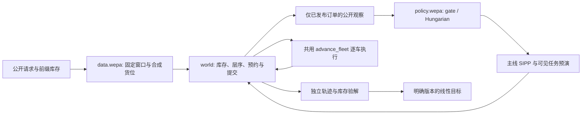

# Warehouse AGV Scheduling

当前主线是 **WEPA真实请求回放＋联合GA派单＋SIPP路径规划（gate）**。它以公开到达记录驱动合成仓库的入库、出库、库存和层序约束；不是原厂数字孪生，也没有动态六车全局最优证明。运行核心只用Python标准库，支持Python3.10+。

```bash
python -m pip install -e .
agv run --profile wepa --case wepa-day45-bin4335 --algorithm gate --output runs/demo.json
```

源码直接位于 [`src/agv/`](src/agv/)，无需解压研究包。结果含完整轨迹、独立验解、T/R/D/P90、空驶、真实CPU计时，以及明确的`objective_id`。默认拒绝覆盖已有结果。

当前线性目标为 `F=0.5*T/900+0.3*R/900+0.2*D/5400`（6车、1格/秒）。历史profile的相对F使用同场景参照分母，与这个目标不能混比。`gate_anchor`、`gate_anchor_tail`、`gate_tail`、`gate_trigger`是独立实验选项，不替换默认gate。



## 复现历史实验

已发布实验绑定 **`ccff577`**，精确源码保护会拒绝用最新源码运行旧协议。独立工作树可保留当前项目环境，并复现旧结果；新实验应另行冻结协议。

```bash
git worktree add --detach ../agv-wepa-repro ccff577
cd ../agv-wepa-repro
python3 -m venv .venv
source .venv/bin/activate  # Windows: .venv\Scripts\activate
python -m pip install -e .
agv experiment run --protocol protocols/wepa-20261029-frozen.json \
  --split development --output runs/repro/development --workers 1
```

后续选型与验证命令见[实验报告](docs/experiments/wepa-integration-20261029.md#复现与尚未实施部分)。完整历史提交保留在 Git 中，不能用当前指纹重签旧报告。

## 模型、运行与结果

- [WEPA模型与数据边界](docs/model/wepa.md)
- [集成、优化与验证报告](docs/experiments/wepa-integration-20261029.md)
- [第二轮审核、跨日期验证和性能分析](docs/experiments/review2-20261029.md)
- [架构与未合并的业务边界](docs/architecture.md)
- [日期隔离的冻结协议](protocols/wepa-20261029-frozen.json)：8个开发窗口、16个验证窗口、8个封存窗口；封存集不开放给日常实验。该测量协议绑定`ccff577`源码快照，复现需检出该提交；当前代码的新实验应另行冻结协议。
- [原始数据许可与字节哈希](research/recommended-20261024/data/README.md)
- [原研究归档与来源身份](archive/INDEX.md)

可选决策延迟在提交前重新规划并检查预约，默认关闭以保持金标准：

```bash
agv run --profile wepa --case wepa-day45-bin4335 --algorithm hungarian \
  --latency fixed --latency-scale 2 --output runs/delayed.json
```

`measured`模式把本机决策CPU秒乘以`--latency-scale`换成仿真步数；它依赖机器，不能作为确定性轨迹金标准。

## 实验与开发

```bash
python -m pip install -e '.[dev]'
python -m unittest discover -s tests -t .
python scripts/check_architecture.py
ruff check src tests scripts
ruff format --check src tests scripts
# 微型CP-SAT证书是可选依赖，六车算法不需要它
python -m pip install -e '.[exact]'
python -m unittest tests.exact.test_optimality tests.exact.test_coupled
```

正式实验使用`agv experiment run/select/analyze`，协议绑定源码、模型、目标、窗口和种子。结果缓存需显式启用`--cache-dir`；命中仍独立验解，保留原测量CPU，不冒充新计时。全轨迹存入忽略的`runs/`，Git只保存紧凑统计和回归指纹。

历史legacy/V4/V9/V9.1模型、23个历史算法名、旧场景输入和CLI仍保留。显式历史算法或`--input`继续走其原模型：

```bash
agv run --input examples/scenarios/dynamic_medium_burst.json \
  --algorithm sipp_budget --output runs/historical-demo.json
agv serve
```

网页目前仍用于历史profile回放，WEPA使用上述已安装CLI；尚未把不同库存模型强行接到旧网页。历史算法、报告和训练排序器说明见[旧版总览](docs/history/README-before-wepa-20261029.md)。
