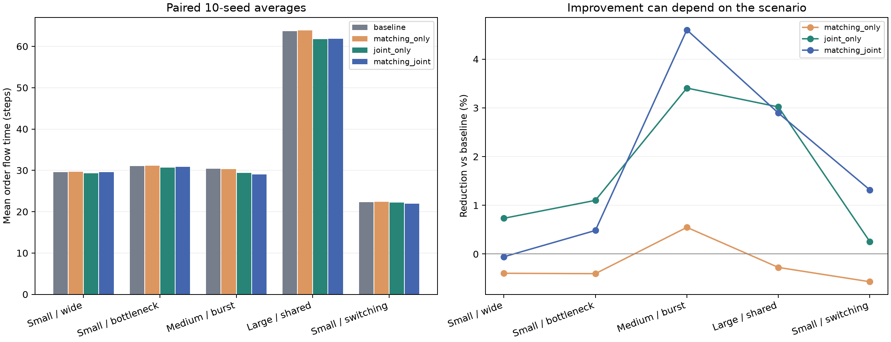

# 算法实现与实验报告

日期：2026-10-14。选题：任务 1——仓库穿梭无人车智能调度。

本次完成原版运行观察、论文调研、途中联合重规划实现、可选匹配实现、240 次配对与消融实验、轨迹解释和运行说明。主要推荐 **原贪心分配 + RHCR/MAPF-LNS 思想启发的联合后缀重规划**。匹配融合在动态突发场景效果更好，在部分静态场景略有退步，所以保留为可选方案。

## 1. 原版本实测与问题定位

先完整复制队友文件夹，再运行原代码；原始 Desktop 文件夹未改动。原版 55 项 unittest 全部通过，4 组固定样例和 16 种动态组合均已实际运行，原独立验证器检查通过。记录在 `../artifacts/baseline_tests.txt`、`baseline_run.txt`、`baseline_dynamic_run.txt` 和 `baseline_audit.txt`。本机 HTTP 测试需要 `NO_PROXY=127.0.0.1,localhost`，首次未绕过系统代理时出现 404，设置本机请求直连后通过；此为测试环境问题，没有为此修改物理模型。

浏览器已现场打开原页面，逐步查看从停车位出发、前往取货和任务完成统计。固定种子0、4车12单成绩如下：

| 原版场景 | 完成单数 | 最后一单完成 | 全车返回 | 平均订单耗时 | 总移动 | 行驶阶段停留 |
|---|---:|---:|---:|---:|---:|---:|
| 静态宽通道 | 12/12 | 51 | 62 | 26.750 | 202 | 1 |
| 静态窄通道 | 12/12 | 52 | 67 | 27.333 | 212 | 5 |
| 动态宽通道 | 12/12 | 67 | 85 | 14.667 | 228 | 3 |
| 动态窄通道 | 12/12 | 71 | 89 | 14.667 | 232 | 3 |

静态与动态的平均耗时不同还来自任务释放时间，不能直接据此声称动态调度更优。`makespan` 指最后一单卸货结束，`time` 成功时还包含全部回家，不可混用。

根因在 `Environment.assign()`：先分配的车辆预订完整取货→交付→返程路线，后车只能绕开它；`advance()` 只能按原预约执行。改变订单匹配可能改善接单选择，却没有解除忙车路线不可修改的限制。该限制需要执行环境与规划器一起改变。

## 2. 论文选择与本项目改造

调研 6 篇原始论文，完整标题、作者、年份和原文链接见 [论文调研与算法选择](论文调研与算法选择.md)。最终保留现有时空 A*，融合两项思想：

1. [RHCR，AAAI 2021](https://ojs.aaai.org/index.php/AAAI/article/view/17344)：执行与重新协调持续交替，接入途中重规划。
2. [MAPF-LNS，IJCAI 2021](https://www.ijcai.org/proceedings/2021/568)：从当前可行解出发，联合修复车辆子集，只接受改善。

现有时空 A* 与 [Silver 的 Cooperative Pathfinding，2005](https://ojs.aaai.org/index.php/AIIDE/article/view/18726) 属于同类预约式协作搜索。没有直接复制论文代码仓库。

本实现检查直到回家的完整剩余路线，没有实现 RHCR 原论文的有限碰撞窗口，也未实现 MAPF-LNS 的全部自适应邻域。准确称为思想启发的融合适配，不能写成原论文完整复现。

## 3. 已实现机制

### 3.1 忙车与返程车联合改路

`JointPlanner.propose(observation)` 只读取可见观测。观测新增 `active_task` 和 `route_record`，只暴露已接任务、已知服务记录，不提供未来订单或总订单数。

默认在成功接新订单后，或时刻能被5整除时触发。候选采用全车队路线后缀邻域，按轮转、反序及必要的固定种子打乱尝试最多8个顺序；再尝试按车辆列表相邻的若干车辆对。这些车辆对不意味着空间上最邻近。未选车辆保持原路线。

低层按不同优先级逐车用时空 A* 修复；多车未来路线统一作为一个候选提交。“联合”是多车路线同时改变和统一提交，低层并非在全部车辆位置的笛卡尔积上做联合 A*。

### 3.2 各执行阶段保留真实状态

| 阶段 | 固定事实 | 可修改部分 |
|---|---|---|
| 去取货 | 任务所有权、指派时刻、当前车位 | 停靠侧及剩余取送返回 |
| 装货中 | 装货开始/结束时刻、已服务量和停靠格 | 连续完成剩余装货之后的路线 |
| 载货行驶 | 已完成取货及服务记录 | 剩余交付与返回 |
| 卸货中 | 原卸货开始/结束时刻与位置 | 完成当前卸货之后的回程 |
| 返回中 | 已卸货完成记录 | 剩余返程 |

已执行的 `paths` 前缀从不改写。服务中不能移动或提前结束，也不能取消已有订单、重新分给别的车。

### 3.3 可解释目标与接受规则

在同一时刻 t 比较固定的已接任务，用字典序最小化：

```text
(sum(max(0, delivery_end - t)), max(t + suffix_length - 1), remaining_moves)
```

依次是：当前任务的剩余送达耗时之和、最晚路线返回时刻、剩余移动量。已完成单的第一项贡献为0。先保障送达目标，再比较回程、距离；第一项变好时，次级目标可以变差。单个任务允许稍晚完成，但整体当前目标必须严格更好。

`Environment.apply_replan()` 先读全日志字段，再检查所有未来路径：当前位置一致、四邻接或等待、障碍/专属停车位、顶点冲突、对向边交换冲突、连续服务、时限和任务所有权。随后在审计副本上执行所有剩余路线，用原独立 `validation.py` 验证过去和完整未来的轨迹、服务、任务顺序与指标，并重新计算真实目标。全部通过后一次提交。搜索不成功、不改善或候选非法，不能留下部分改路状态。

每次接受保存 `replanning_events`，含提交时刻、三元目标、尝试数，以及每辆改路车辆的当前状态、预计卸货时间和修改前后完整路线后缀。

### 3.4 可选当前批次精确匹配

`matching_action()` 用位掩码动态规划：车辆最多8辆，状态是已匹配车辆集合；每个已释放待接任务最多使用一次。先最大化匹配数量，再最小化以下静态矩阵代价：

```text
min_p(distance(vehicle,p) + distance(p,delivery))
+ pickup_service + delivery_service
- 0.25 * (current_time - release)
```

其中 p 是同一货架的合法停靠侧。年龄项照顾已经等待较久的订单。时间复杂度约 O(待接任务数 × 车辆数 × 2^车辆数)，不需要 SciPy 或训练网络。

它精确优化当前这个矩阵，矩阵没有完整预测预约等待或未来订单，因此不能等同于全局调度最优。测试中的真实几何反例矩阵 `[[10,6],[14,8]]`，原贪心代价20，批次匹配代价18，说明实现确实做了匹配优化。

## 4. 配对实验设计

正式数据在 `algorithm_results/`；`algorithm_results_probe/` 是初步探索，不作为正式报告成绩。每类10个种子（0–9），4种算法；共6×10×4=240次，所有运行都独立 validate。每个输入保存实际地图、订单、服务及释放时间，算法共享相同 JSON 和 SHA256。没有让在线策略预读未来订单。

| 场景 | 地图 | 车数 | 单数 | 到达/交付设置 | 时限 |
|---|---|---:|---:|---|---:|
| 小型静态宽通道 | 13×11 | 4 | 12 | 全部t=0，分散交付，3通行口 | 600 |
| 小型静态窄通道 | 13×11 | 4 | 12 | 全部t=0，分散交付，1通行口 | 600 |
| 中型动态突发 | 19×15 | 6 | 30 | 每30步6单，分散交付，1通行口 | 600 |
| 大型动态集中交付 | 25×19 | 8 | 40 | 间隔1–9步，集中交付，1通行口 | 600 |
| 小型动态热点切换 | 13×11 | 4 | 30 | 间隔1–9步，先偏左后偏右，1通行口 | 600 |
| 短时限压力 | 19×15 | 6 | 30 | 全部t=0，分散交付，1通行口 | 100 |

四种配置为 `baseline`、`matching_only`、`joint_only`、`matching_joint`。主要推荐的联合方案保留原分配器，所以能用消融隔离途中改路收益。参数在运行前固定，未按每个种子的最优结果选择方案。

比较耗时只纳入两边都完成全部订单且回家成功的配对。失败保留完成率/完成单数/诊断，不用已完成子集的较小平均耗时冒充改善。改善比例为 `(基线均值-算法均值)/基线均值`，正数是改善，负数是变差。

## 5. 正式成绩

所有前5类的4种算法均成功10/10；压力类全部0/10。下表正常场景平均订单响应时间，单位为步。

| 场景 | 原版 | 仅匹配 | 仅重规划 | 融合 | 重规划降低 | 融合降低 |
|---|---:|---:|---:|---:|---:|---:|
| 小型静态宽通道 | 29.525 | 29.642 | 29.308 | 29.542 | 0.73% | -0.06% |
| 小型静态窄通道 | 31.017 | 31.142 | 30.675 | 30.867 | 1.10% | 0.48% |
| 中型动态突发 | 30.427 | 30.260 | 29.390 | 29.027 | 3.41% | 4.60% |
| 大型动态集中交付 | 63.665 | 63.840 | 61.742 | 61.822 | 3.02% | 2.89% |
| 小型动态热点切换 | 22.270 | 22.397 | 22.213 | 21.977 | 0.25% | 1.32% |



只有10个种子，以上是已测试样例的描述性结论，不是对所有仓库或订单分布的保证。每个种子的成败都在 `runs.csv`，聚合指标在 `summary.json`/`summary.csv`。

### 5.1 不隐藏负面结果

| 场景 | 仅重规划：改善/持平/变差种子数 | 融合：改善/持平/变差种子数 |
|---|---|---|
| 小型静态宽通道 | 8/2/0 | 4/3/3 |
| 小型静态窄通道 | 8/1/1 | 6/0/4 |
| 中型动态突发 | 10/0/0 | 8/0/2 |
| 大型动态集中交付 | 10/0/0 | 10/0/0 |
| 小型动态热点切换 | 6/0/4 | 7/0/3 |

原贪心与精确匹配使用不同批次组合/规划优先顺序。匹配优化静态距离矩阵，可能把车辆导向更受预约影响的位置；它没有把时空拥堵代价完整纳入矩阵。因此仅匹配在数类场景均值变差，融合在静态宽通道也轻微变差。不能用“匹配是最优”推导总调度变好。

### 5.2 收益机制与计算代价

| 场景与算法 | 行驶阶段停留均值 | 移动均值 | 最后一单完成均值 | 整次运行秒数均值 |
|---|---:|---:|---:|---:|
| 中型动态突发 / baseline | 10.80 | 938.40 | 181.70 | 0.219 |
| 中型动态突发 / joint_only | 7.20 | 948.60 | 179.60 | 1.095 |
| 中型动态突发 / matching_joint | 7.10 | 931.40 | 178.70 | 1.026 |
| 大型动态集中交付 / baseline | 16.70 | 2256.40 | 333.60 | 0.587 |
| 大型动态集中交付 / joint_only | 10.80 | 2226.20 | 326.70 | 5.224 |
| 大型动态集中交付 / matching_joint | 12.40 | 2224.20 | 327.30 | 5.197 |

中型突发的仅重规划使途中停留从10.8减到7.2步，但总移动从938.4增加到948.6格，说明会用绕行换取更快送达；这不是只优化路程。融合方案同时降低送达耗时、移动和途中停留。大型集中交付的重规划同时降低回程/运输总路程和停留，符合多车改变先后次序与绕行的机制。

这些指标与轨迹支持机制解释，但“行驶阶段停留”不严格等于因拥堵造成的延误；本项目未做每种交通原因的因果干预实验。更严谨的说法是路线与执行指标的变化与设计机制一致。

运行秒数是本机整个仿真、调度、规划及新增候选审计耗时，不是纯A*耗时；单次完整大场景约5.2秒，相比原版约0.59秒，计算代价明显增加。仍是课程小规模教学仿真，不能直接声称适合真实车队毫秒控制。

### 5.3 失败压力案例

100步时限下，每种算法10次均未完成全部任务并回家。原版平均完成20.7/30单，仅重规划及融合均21.0/30单。增量很小，不能据此宣称解决死锁或不可行问题。所有失败轨迹仍无碰撞且验证通过；失败来自此规划器和时限下未完成，不证明原问题数学上无解。

## 6. 一次真实途中改路的解释

打开 [途中联合重规划解释.html](途中联合重规划解释.html)，或读取 `algorithm_results/explanation_event.json`。数据来自中型动态突发、种子0、仅重规划的正式轨迹。

时刻120已在执行订单；三元目标从 `(154,184,262)` 变成 `(146,181,254)`：当前固定任务的预计剩余送达总耗时少8步，最晚回程完成少3步，剩余移动少8格。

| 车辆 | 当时状态 | 原预计卸货结束 | 新预计卸货结束 | 变化 |
|---|---|---:|---:|---|
| 0 | 载货行驶 | 129 | 129 | 路线变了，完成时刻保持 |
| 1 | 去取货 | 151 | 154 | 延后3步 |
| 3 | 去取货 | 156 | 152 | 提前4步 |
| 5 | 去取货 | 159 | 152 | 提前7步 |

这解释了为什么要允许多车共同调整：愿意让一辆车多等3步，换取另外两辆车合计早11步，整体净改善8步。回放用日志中该时刻的原/新预约，未把之后的实际执行轨迹误当成当时预测。画面只展示本轮改路车辆；未改路线车辆作为固定约束参与了完整可行性验收。不能由此推导整场最终收益恰好等于8步。

## 7. 验证与复现

原版55项测试通过；最终62项测试通过，记录 `../artifacts/final_tests.txt`。新增回归覆盖真正忙车路线改变、三元目标严格下降、多步装卸保留时间及位置、已执行前缀不变、无未来订单泄漏、非法候选原子拒绝、缺日志字段不提交、真实匹配反例与失败轨迹。

此外，后台独立审查核对了论文与实现，发现并修复“先提交再读取日志字段，缺字段会抛异常但状态已改变”的边界；当前所有元数据、审计和目标复算在提交之前完成。

```bash
cd agv_modeling_shelf
NO_PROXY=127.0.0.1,localhost no_proxy=127.0.0.1,localhost python3 -m unittest discover -v
python3 benchmark_algorithms.py --seeds 10 --output my_reproduction
python3 show_warehouse.py
```

新目录避免覆盖成绩。时间/内存等机器相关数据可能变动；固定输入及算法顺序确定时，路径和离散指标应一致。正式实验摘要包含实际 Python/系统版本和运行时源码SHA256。`verify_delivery.py` 可重新审计240条保存轨迹并检查10个核心实验源码与清单一致；最终界面控件锁定及解释页生成脚本另有小改动，不影响实验核心，最终完整源码摘要在 `../artifacts/最终源码校验.json`。

## 8. 局限与可继续研究的问题

- 不保证全局最优或完备性。只搜有限优先顺序和邻域，不穷举全部任务分配、车辆联合路径及未来订单。
- 仍使用逐段最早到达 A*，取货/送货/回程有预约时间依赖，整条多目标路线不保证最短。
- 已接订单不换车、不取消，不考虑容量大于1、充电、真实车身、速度/加速度、故障和定位误差。
- 改善当前已接任务的预测代价，不保证最终所有订单、每一车辆或每一指标都改善。
- 原预约失败的新订单仍由后续时刻重试；当前重规划从可行已接路线出发，不是完整LNS2冲突解修复，也不保证让每个之前被拒订单立即成功。
- 匹配矩阵没有完整时空预约代价，适合进一步尝试拥堵感知代价；需要新增独立测试种子检验，不能按同一批种子的成绩调参后当泛化结论。
- 若要证明小例最优性，可后续实现阶段化联合搜索/CBS或混合整数规划作小规模oracle。当前没有实验性最优下界，不能写“达到全局最优”。

## 9. 交付与贡献边界

Python主程序、算法代码、正式输入与每次结果、图表、失败案例、运行说明及论文引用均已整理。队友原始文件完整保留在项目副本，历史文档描述原版本；本文描述算法增强后的实际状态。原始Desktop目录保持原样，校验清单在 `../artifacts/队友原始文件sha256.json`。

队友贡献是环境建模、原预约规划与验证/展示；新增工作是本文第3节机制及对应实验和说明。组员真实姓名、学号、联系方式与人工贡献比例尚未提供，需由组员据实补充。本文是可用于课程报告的技术内容，不冒充已经套用未提供的Word模板的最终提交稿。
