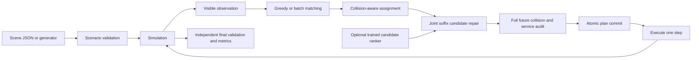

# Architecture and contracts

## Directory and ownership

```text
src/agv/
  domain.py             # immutable Task, validated Scenario, scenario generator
  simulation.py         # release/assign/advance, task ownership, atomic route commit
  planning/
    astar.py            # time-expanded reference/oracle
    sipp.py             # safe-interval search with edge and service constraints
    reservations.py     # invalidated per-cell time index
    pickup.py           # shelf side and pickup/delivery/return composition
    joint.py            # candidate neighborhoods and feasible improvement acceptance
  dispatch/
    greedy.py           # original visible-state policy
    optimized.py        # online driver and exact current-batch matching
    registry.py         # one set of named solver configurations
  learning/             # standard-library ridge ranking + reproducible training
  models/               # schema-validated trained artifact
  evaluation/           # metrics and independent trajectory/service validator
  io/                   # scene format/hash, atomic writes, public map import
  experiments/          # paired benchmark and isolated planner benchmark
  web/
    app.py              # local HTTP boundary, limits, run dispatch
    templates/          # one actual HTML template
    static/             # actual JavaScript and CSS, no chained source rewriting
  cli.py                # installed command entry point
```

`examples/` contains reusable inputs; `data/` contains one attributed public map and its provenance. `tests/unit/` checks contracts and `tests/integration/` checks installed CLI and HTTP behavior. `results/` contains compact statistics, validation evidence and selected representative traces. `runs/` is ignored and contains generated candidate training rows and full local experiment outputs. Historical v1 folders are not copied into current source; their complete evidence remains in Git history and a local backup outside the checkout.

## Data flow



The online driver may use only the observation. Full future order lists are allowed in the offline experiment builder and evaluator; they are never passed to dispatch, neighborhood selection or the learned feature function. The ranker changes search order only. It cannot change movement rules, task ownership, service durations, safety acceptance or the fallback plan.

## Persistence and boundaries

- `Scenario.from_dict()` checks shape, unknown fields and strict integer coordinates before building objects. Existing v1/v2 scene formats remain readable.
- `write_json()` writes and flushes a temporary file on the destination filesystem. Default exclusive link creation refuses to overwrite an existing output; explicit overwrite uses atomic replacement. A failed serialization never damages an existing result.
- The HTTP server serves fixed assets only, validates Host/Origin/body type/length and rejects simultaneous simulations with 429. Input dimensions/task counts are checked before reachability search. Request sockets have timeouts; unexpected failures are logged locally and return a bounded error.
- Batch parameter validation does not run an unnecessary extra simulation. There is no unbounded result cache or queue of expensive background runs.
- A replan is committed only after complete-route independent audit. Existing task IDs, assignment times, started services and executed path prefixes are preserved.
- Formal experiments flush rows incrementally, save `status=running` until complete, and reject a run if any measured source changes during execution. Reusing an output directory is rejected.

## Deliberate scope

This is an installable educational simulator, not a production fleet control service. There is no database, distributed queue, training framework or network service dependency. A single source of truth for solver definitions and small focused contracts are sufficient for the present scale. A linear learner is preferable here to an opaque large network because candidate labels and independent scenes are limited.
