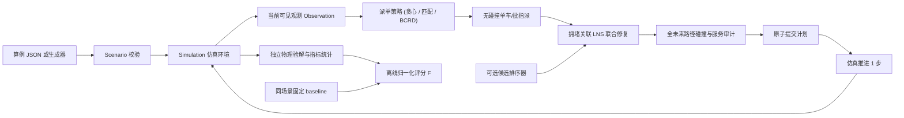

# 系统架构与模块说明（`src/agv/` v0.6.0）

本文档介绍自研通用调度引擎 `src/agv/` 的模块划分、在线执行数据流以及从 Legacy 到 V4 / V9 / V9.1 的核心建模与规划设计。核心引擎仅使用 Python 3.10+ 标准库，支持 CLI 与本地 Web 交互可视化。

---

## 1. 目录职责划分

```text
src/agv/
  domain.py             # Task / Scenario 不可变数据模型、坐标与参数校验、算例生成器
  warehouse/
    layout.py           # V4 分层货架、通道与出入口布局定义
    rules.py            # V4/V9 规则校验与同面层序解锁逻辑
    mixed.py            # V9/V9.1 混合背靠背货架布局与取货点目录
  simulation.py         # 唯一真实执行状态机：订单发布、任务指派、步进推进与原子轨迹提交
  planning/
    astar.py            # 时空扩展 A* 参照规划器
    sipp.py             # SIPP 安全区间路径规划（支持顶点/换边冲突与连续服务时长）
    reservations.py     # 增量索引式时空预约表与最大时域维护
    geometry.py         # 不可变地图几何与静态距离线程局部缓存
    pickup.py           # 货架取货侧选择与 取货→送货→返库 组合路径拼接
    joint.py            # 拥堵关联车队邻域选择与 LNS 联合后缀重排
    reposition.py       # 可选空闲定位移动与安全返库兜底
  dispatch/
    greedy.py           # 距离贪心基线派单
    optimized.py        # 在线驱动、当前批次最小代价匹配与联合修复调度
    initial_batch.py    # 静态场景首轮多车批次滚动规划（joint_batch / sipp_batch）
    registry.py         # 统一命名算法配置注册表
    positioning.py      # 静态安全待命点筛选与历史需求驱动定位
    stream.py           # V9.1 流式订单 SIPP-ETA 匹配与有限主动延迟
    bcrd.py             # 高积压可见订单影子试派与批次序列筛选（bcrd_budget / sipp_stream_bcrd）
  learning/             # 标准库 8 特征岭回归候选排序器与离线训练流程
  models/               # 带 schema 校验的候选排序模型权重
  evaluation/           # 综合指标汇总、V4/V9.1 归一化评分、小规模精确 Oracle 与独立物理验解
  io/                   # 场景 JSON 序列化/哈希校验、原子写盘、MovingAI 公开地图导入
  experiments/          # Legacy / V4 / V9.1 / BCRD 批量对照基准入口
  api.py                # 应用服务层：参数校验、算例构建与单次/批量执行
  web/                  # 本地 HTTP 服务、HTML 模板与前端回放 JS/CSS
  cli.py                # 统一命令行入口（agv / python -m agv）
```

配套目录职责：`examples/` 存放标准算例；`data/` 存放 MovingAI 公开地图及归属声明；`tests/` 分为单元测试（`unit/`）与 CLI/HTTP 集成测试（`integration/`）；`research/` 存放主线 B 最终采用的 WEPA 推荐方案（`recommended-20261024/`）与历史归档（`dqn-experiment-v2/`）；`results/` 存放现行敏感性实验报告与历史阶段证据；`runs/` 为本地临时输出目录（已 gitignore）。

---

## 2. 在线调度数据流



在线调度器仅读取当前已发布订单、在途任务与时空预约表，严格遵守因果信息边界；所有候选重规划在提交前均通过全未来路径冲突、逆向换边与服务连续性审计，确保每条轨迹 100% 物理可行。

---

## 3. 核心工程保障

- **输入与序列化安全**：`Scenario.from_dict()` 严格校验字段类型、整数坐标与地图边界；`write_json()` 通过同目录临时文件 + `fsync` 原子写入，默认拒绝覆盖已有文件（需显式 `--overwrite`）。
- **本地 Web 安全边界**：`agv serve` 仅绑定 `127.0.0.1`，提供固定静态资源，对请求体大小与地图维度做前置限流，并发重仿真时返回 429 保护本机资源。
- **独立物理验解**：`evaluation/validation.py` 独立检查最终输出轨迹的顶点碰撞、边交换冲突、装卸时长、同面货架层序解锁与返库约束，与调度器本身解耦。

---

## 4. 从 Legacy 到 V4 / V9 / V9.1 的建模演进

1. **Legacy 栅格模型**：基础多车取货与送货调度，引入 SIPP 安全区间压缩将 `(位置, 时刻)` 合并为 `(位置, 最大安全时间区间)`，并配合拥堵对 LNS 修复与静态首轮批滚动（`sipp_batch`）。
2. **V4 分层单面货架（`math-v4-integrated`）**：
   - 每个任务携带固定层高 `shelf_level`，装货时长为 `2 * shelf_level` 步，卸货 1 步；
   - 同一货架面与货位仅允许派发当前最高已发布层，前序取货完成前锁定该货架面；
   - 交付站作为终端服务资源，卸货后须立即驶离，路线拼接器支持最多 8 步延迟到达以绕开出口短暂拥堵；
   - 离线综合目标为 $F = 0.5\frac{T}{T_{\text{ref}}} + 0.3\frac{R}{R_{\text{ref}}} + 0.2\frac{D}{D_{\text{ref}}}$（以同场景时空 A* 贪心为参照 `1.0`）。
3. **V9 混合背靠背货架（`mixed-v9`）**：
   - 在 `warehouse/mixed.py` 中支持单排单层（两侧可取货）与水平/垂直背靠背多层货架混合布局，并支持显式 `(vehicle, task, pickup_point)` 取货侧选择与有限安全待命控制。
4. **V9.1 流式关闭与 BCRD 优化**：
   - 订单流在发布端显式发出关闭事件（`close`）后进入最终返库阶段，开放流期间空闲车辆可在安全普通通道待命或按历史需求分布执行可中断定位移动；
   - `dispatch/bcrd.py` 在高积压时基于当前可见世界构建轻量影子状态，对多个有序批次方案做保底滚动试派并择优提交；
   - `evaluation/bounds.py` 提供离线松弛下界参考，辅助评估优化空间。详见 [V9.1 建模说明](modeling-v9.1.md) 与 [V9.1 优化实验报告](v91-optimization.md)。
