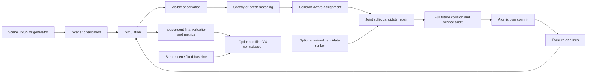

# Architecture and contracts

## Directory and ownership

```text
src/agv/
  core/                  # immutable Task/Profile/Cell and pure ranking features
  warehouse/             # validated Scenario, generators and frozen geometry rules
  rules/                 # legacy/V4/V9/V9.1 execution contracts
  orders/                # publisher-owned release and explicit close events
  world/                 # sole mutable kernel and command gateway
    state.py             # WorldState, policy-free tick and observation projection
    commands.py          # Assign/Hold/Reposition/ReplaceSuffix validation/commit
    itinerary.py         # immutable route storage, O(1) cursor advancement
    tasks.py             # one TaskBook and explicit lifecycle states
    reservations.py      # one absolute-time route index and filtered views
    observation.py       # immutable online view, detached legacy JSON adapter
    restore.py           # observation-only world reconstruction for forecasting
  planning/              # A*, SIPP, bounded static/ETA caches, composition and repair
  policy/                # observation-only assignment/idle/repair stages
  runner/                # one solver loop, composition, ordered batch execution
  registry.py            # typed SolverSpec compositions and historical aliases
  evaluation/            # trace metrics, fixed offline reference, independent audit
  io/                    # serialization, hashes, atomic writes and map import
  experiments/           # frozen protocols, local result cache, paired benchmarks
  learning/ models/      # optional transparent ranker and its trained artifact
  web/ cli.py            # HTTP/CLI applications
  domain.py              # compatibility re-export only
  simulation.py          # compatibility re-export of runner.Environment
  dispatch/              # historical import/run adapters; no solver loops
```

`examples/` contains reusable inputs; `data/` contains one attributed public map and its provenance. `tests/unit/` checks contracts and `tests/integration/` checks installed CLI and HTTP behavior. `results/` contains compact statistics, validation evidence and selected representative traces. `runs/` is ignored and contains generated candidate training rows and full local experiment outputs. Historical v1 folders are not copied into current source; their complete evidence remains in Git history and a local backup outside the checkout.

## Dependency direction and execution ownership

`core` has no project dependencies. Static `warehouse` geometry depends only on
core; `rules` and `orders` remain below the kernel. `world` imports no planner,
policy, runner or evaluator. `KernelServices` supplies planning, suffix scoring,
trace evaluation and independent audit functions at construction. `planning`
uses static geometry and world reservation views; `policy` uses those contracts
and receives only public observations. `runner` and `registry` compose concrete
implementations. The offline reference is a separate evaluation composition
adapter, never part of an online observation.

Run `python scripts/check_architecture.py` to enforce these directions, including
function-local imports. CI also rejects production imports of historical
compatibility facades, route/record/private-state writes outside world, solver
loops inside historical adapters, and extra kernel/reservation owners.
`evaluation/validation.py` still imports no execution or planning implementation.

The runner commits assignments before requesting a fresh observation for idle
positioning or joint repair. Reusing the earlier observation would change
available vehicles and reservations. Therefore this migration deliberately
preserves those extra observations rather than imposing one stale observation
per tick. A failed positioning command retains the safe fallback return.

`Environment.advance()` remains a convenience adapter for existing callers: it
requests a visible idle decision before each `tick()`. The runner makes that
sequence explicit. The underlying `WorldState.advance()/tick()` performs no
standby or dispatch decisions. All assignment, hold, reposition and suffix
replacement mutations are owned by `world/commands.py` and WorldState bookkeeping.

`WorldState.snapshot()` shares static geometry and immutable route buffers and
copies mutable state/router counters. It is not a general persistent copy-on-write
store. BCRD constructs a disposable world from **released observations only** and
injects the same world factory and tick implementation. It never snapshots the
live world's hidden future jobs. The old ShadowState API remains an adapter;
there is no second vehicle-execution kernel.

Result metrics are derived in `evaluation/execution.py` from a detached trace
export. Archived result JSON, route-record dictionaries and the independent
validator contract are preserved. `TaskBook` owns task dictionaries, assignment
membership, active records and lifecycle queries; legacy private attribute names
are aliases to those same objects, not duplicate state stores.

## Data flow



The online driver may use only the observation. Full future order lists are allowed in the offline experiment builder and evaluator; they are never passed to dispatch, neighborhood selection or the learned feature function. The ranker changes search order only. It cannot change movement rules, task ownership, service durations, safety acceptance or the fallback plan.

## Persistence and boundaries

- `Scenario.from_dict()` checks shape, unknown fields and strict integer coordinates before building objects. Existing v1/v2 scene formats remain readable. Explicit V4 scenes serialize as `agv-scene-v4`; the teammate's v3 envelope is accepted only if its enclosed scene passes the current explicit profile checks.
- `write_json()` writes and flushes a temporary file on the destination filesystem. Default exclusive link creation refuses to overwrite an existing output; explicit overwrite uses atomic replacement. A failed serialization never damages an existing result.
- The HTTP server serves fixed assets only, validates Host/Origin/body type/length and rejects simultaneous simulations with 429. Input dimensions/task counts are checked before reachability search. Request sockets have timeouts; unexpected failures are logged locally and return a bounded error.
- Web batch parameter validation does not run an unnecessary extra simulation. The HTTP application has no unbounded in-memory result cache or queue of expensive background runs. Formal V9.1 experiments can use a content-addressed local disk cache; hits are independently validated and retain their original timing provenance. See [architecture extensions](architecture-options.md).
- A replan is committed only after complete-route independent audit. Existing task IDs, assignment times, started services and executed path prefixes are preserved.
- Formal experiments flush rows incrementally, save `status=running` until complete, and reject a run if any measured source changes during execution. Reusing an output directory is rejected.

## V4 profiles and execution rules

The legacy profile retains its default serialized form and scene hashes. A V4 scene explicitly declares `map_info.model_version = "math-v4-integrated"`; its auxiliary geometry is not inferred from a file name or silently discarded. Unknown or mixed profiles are rejected. `warehouse/rules.py` validates a static metadata whitelist, paired face identifiers, registered obstacles and zone classifications. Generator seeds, future orders and offline normalization references are not carried into observations through metadata.

`Task.shelf_level` is immutable task input. V4 loading takes `2 * shelf_level` steps and unloading takes one step. Each back-to-back rack face has one legal outer pickup side. For the same face and bay, only the highest released pending layer is dispatchable, and a previous assignment reserves the face until its pickup ends. Opposite faces are independent. A higher layer released later does not invalidate or preempt an existing lower-layer assignment. These gates apply both to the online candidates and to the atomic assignment boundary; the independent validator derives the shelf resource from the task ID rather than trusting optional output metadata.

Delivery stations are terminal service resources. A route may enter its own delivery station for unloading, then must leave; other trips cannot use it as transit, and early waiting or parking after unloading is forbidden. Both A* and SIPP receive the same terminal-role and minimum-arrival constraints. The route composer currently tries up to eight delayed delivery arrivals when the earliest unload has no feasible immediate exit. This bounded fallback fixes a demonstrated case; it does not make the composition globally complete or optimal.

V4 allows `horizon=None`. The online driver then stops when all work is finished or no progress is possible after accounting for future releases and active routes; each low-level query still has a finite search bound. A stalled or unfinished run remains reportable but has no valid V4 score. The browser applies finite execution and import resource limits, so no-cutoff inputs use the CLI.

## V4 scoring and search objectives

`evaluation/objective.py` evaluates completed traces offline with `F = 0.5*T/Tref + 0.3*R/Rref + 0.2*D/Dref`, lower being better. `T` is the last unloading completion time, `R` is mean release-to-unload flow time and `D` counts all moves including returns. Final simulation time may include later returns and is a different field. The displayed `0.05*D` energy value is a distance proxy, not an additional objective term or a measured battery model.

The reference is the reviewed layer-aware distance-greedy policy with reservation-based time-space A* and no joint replanning, executed on the exact same serialized scene. Its score metadata uses `math-v4-reviewed-v1`. The reference is independently validated, cached for at most 32 scenes, and its denominators and scene digest are audited again when accepting scored output. Its retained policy identifier does not imply unmodified teammate code: the reference also uses the reviewed station-exit fallback. Reference data is never passed to online dispatch. V4 paired benchmarks prepare it before solver timing, avoiding an asymmetric cold-reference penalty.

The existing joint repair accepts strict lexicographic improvements in remaining delivery-time sum, return-path end time and moves. That local objective differs from the final weighted `F`; a valid accepted repair can worsen the final score or its tail response. `sipp_matching` adds current-batch minimum-cost matching to the same six-candidate SIPP repair configuration. The [V4 review](v4-review.md) records both gains and regressions and treats objective alignment as further work.

## Explicit V9 mixed-rack profile

`mixed-v9` / `agv-scene-v9` selects the latest reviewed mixed-rack family in `warehouse/mixed.py`. `Scenario.is_v4` keeps its original meaning; `uses_layer_rules` shares only the layer gates, strict terminal-D rule and immutable shelf identity. Catalog permissions supply two loading points for a one-layer single row, or one outer point for each independent horizontal/vertical paired row. The complete task-free canonical geometry validates all static fields and nested metadata; arbitrary layouts cannot claim this profile merely by setting its version string. Legacy/V4 serialization is unchanged.

The optional standby controller in `policy/idle.py` delays a discharged vehicle's fallback only on static ordinary transit floor. It audits the full delayed suffix against every other reservation before an atomic update, records waits separately, and spends an explicit finite per-assignment allowance. It never inspects future task count or release locations to decide whether to stay. The default allowance is zero. Final actual returns are independently checked against the last effective return event; old returns interrupted by a new assignment remain historical fallback metadata.

Explicit `(vehicle, task, pickup_point)` actions narrow the real planner's legal candidates after complete input validation; existing pairs keep automatic side choice. Standby plus BCRD is rejected until its observation/shadow recovery contract includes the consumed allowance and wait history. Unbounded structured waits and the teammate's unverified generic replanning adapter were not copied. The shared experiment runner can select the V9 generator explicitly and record standby/empty-distance metrics while retaining the same SIPP/no-joint controls and failure accounting.

## V9.1 stream optimizations

The current stream contract supersedes the finite V9 standby allowance. Only the
publisher knows the stream end in advance; dispatch observes the closure event
after it happens. An open stream with no current pending orders remains open.
The mandatory final-return phase starts after closure and completion of all
published deliveries. An opt-in positioning policy can also choose its own Home
earlier as a safe idle alternative; completion still waits for closure and all
published work.

`policy/stream.py` shares the observation boundary with the existing greedy
driver. ETA matching estimates each pair with SIPP and then passes a legal batch
to the real atomic assignment boundary. Optional intentional deferral compares
already committed soon-free vehicles; its age cap is not a service deadline.
`policy/positioning.py` selects safe ordinary-floor candidates using static
connectivity, past observed demand, zone capacity and assignment costs. It can
activate idle Home vehicles after observed demand exists. New orders interrupt
empty positioning, but cannot cancel task commitments. Positioning is opt-in at
the environment boundary and is independently audited from action events and
actual paths, including final Home returns and all empty mileage.

`world.ReservationTable` (historical alias `PlanReservations`) stores spatial membership and absolute route origins, with a
stationary override for inserted waits. Hold maintenance in this index is O(1);
the full hold action still constructs and checks its future suffix. Public static
geometry is frozen once at reset and shared by immutable `observe_view()` values.
The historical `observe()` still returns editable detached JSON-compatible values.

The V9.1 `ShadowState` reconstructs only released work. Open-flow forecasts stop
at the end of currently known deliveries without inventing closure or charging
unexecuted final returns. Closed-flow forecasts honor final returns. The optional
P90 guard compares visible forecasts, including completed historical flow times;
it does not bound actual response under unseen future demand. Positioning plus
BCRD and historical TTL combinations are rejected until separately validated.

`evaluation/bounds.py` computes optimistic offline relaxations only; it neither
changes the score reference nor enters an observation. `benchmark-v91` times raw
execution apart from these bounds, the A* reference, and independent validation.
Source hashes remain frozen while a protocol runs. See the
[optimization report](v91-optimization.md) for measured effects and limitations.

## Refactor regression gate

`tests/golden/manifest.json` records the pre-refactor source commit and resource
hashes. The compressed result snapshot covers all 23 solver names and every
supported profile, development seeds 10–19, plus V9.1 four-vehicle/twelve-order
cases: 580 independently validated executions. Only actual CPU/wall-clock
measurements are excluded from equality; paths, assignments, interval states,
metrics, F, router counters and algorithm metadata must match exactly.

```bash
python tests/golden/record.py replay --report tests/golden/full-replay.json
python -m unittest discover -s tests -t . -v
python scripts/check_architecture.py
```

Ordinary unittest runs replay seed 10's 58 representative combinations. The full
CLI replay checks all 580 and verifies that source/resource hashes are unchanged
during the run. The golden recorder refuses the current tree unless an explicit
independent archived source directory and baseline commit are supplied. Do not
regenerate expected results to make a failed refactor pass.

No objective alignment, top-k matching pruning, new positioning+BCRD combination,
new training or holdout algorithm selection is part of this structural migration.
Those alter policy behavior and require separate paired experiments. See the
[implementation and validation record](architecture-refactor.md).

## Deliberate scope

This is an installable educational simulator, not a production fleet control service. There is no database, distributed queue, training framework or network service dependency. A single source of truth for solver definitions and small focused contracts are sufficient for the present scale. A linear learner is preferable here to an opaque large network because candidate labels and independent scenes are limited.
