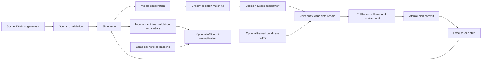

# Architecture and contracts

## Directory and ownership

```text
src/agv/
  domain.py             # immutable Task, validated Scenario, scenario generator
  warehouse/
    layout.py           # explicit V4 paired-rack/aisle/facility geometry
    rules.py            # V4 profile validation and visible-state layer gates
  simulation.py         # release/assign/advance, task ownership, atomic route commit
  planning/
    astar.py            # time-expanded reference/oracle
    sipp.py             # safe-interval search with edge and service constraints
    reservations.py     # invalidated per-cell time index
    pickup.py           # shelf side and pickup/delivery/return composition
    joint.py            # candidate neighborhoods and feasible improvement acceptance
  dispatch/
    greedy.py           # original visible-state policy
    optimized.py        # online driver and exact current-batch matching
    registry.py         # one set of named solver configurations
  learning/             # standard-library ridge ranking + reproducible training
  models/               # schema-validated trained artifact
  evaluation/           # metrics, offline V4 score, independent execution validator
  io/                   # scene format/hash, atomic writes, public map import
  experiments/          # legacy/V4 paired benchmarks and isolated planner benchmark
  web/
    app.py              # local HTTP boundary, limits, run dispatch
    templates/          # one actual HTML template
    static/             # actual JavaScript and CSS, no chained source rewriting
  cli.py                # installed command entry point
```

`examples/` contains reusable inputs; `data/` contains one attributed public map and its provenance. `tests/unit/` checks contracts and `tests/integration/` checks installed CLI and HTTP behavior. `results/` contains compact statistics, validation evidence and selected representative traces. `runs/` is ignored and contains generated candidate training rows and full local experiment outputs. Historical v1 folders are not copied into current source; their complete evidence remains in Git history and a local backup outside the checkout.

## Data flow



The online driver may use only the observation. Full future order lists are allowed in the offline experiment builder and evaluator; they are never passed to dispatch, neighborhood selection or the learned feature function. The ranker changes search order only. It cannot change movement rules, task ownership, service durations, safety acceptance or the fallback plan.

## Persistence and boundaries

- `Scenario.from_dict()` checks shape, unknown fields and strict integer coordinates before building objects. Existing v1/v2 scene formats remain readable. Explicit V4 scenes serialize as `agv-scene-v4`; the teammate's v3 envelope is accepted only if its enclosed scene passes the current explicit profile checks.
- `write_json()` writes and flushes a temporary file on the destination filesystem. Default exclusive link creation refuses to overwrite an existing output; explicit overwrite uses atomic replacement. A failed serialization never damages an existing result.
- The HTTP server serves fixed assets only, validates Host/Origin/body type/length and rejects simultaneous simulations with 429. Input dimensions/task counts are checked before reachability search. Request sockets have timeouts; unexpected failures are logged locally and return a bounded error.
- Batch parameter validation does not run an unnecessary extra simulation. There is no unbounded result cache or queue of expensive background runs.
- A replan is committed only after complete-route independent audit. Existing task IDs, assignment times, started services and executed path prefixes are preserved.
- Formal experiments flush rows incrementally, save `status=running` until complete, and reject a run if any measured source changes during execution. Reusing an output directory is rejected.

## V4 profiles and execution rules

The legacy profile retains its default serialized form and scene hashes. A V4 scene explicitly declares `map_info.model_version = "math-v4-integrated"`; its auxiliary geometry is not inferred from a file name or silently discarded. Unknown or mixed profiles are rejected. `warehouse/rules.py` validates a static metadata whitelist, paired face identifiers, registered obstacles and zone classifications. Generator seeds, future orders and offline normalization references are not carried into observations through metadata.

`Task.shelf_level` is immutable task input. V4 loading takes `2 * shelf_level` steps and unloading takes one step. Each back-to-back rack face has one legal outer pickup side. For the same face and bay, only the highest released pending layer is dispatchable, and a previous assignment reserves the face until its pickup ends. Opposite faces are independent. A higher layer released later does not invalidate or preempt an existing lower-layer assignment. These gates apply both to the online candidates and to the atomic assignment boundary; the independent validator derives the shelf resource from the task ID rather than trusting optional output metadata.

Delivery stations are terminal service resources. A route may enter its own delivery station for unloading, then must leave; other trips cannot use it as transit, and early waiting or parking after unloading is forbidden. Both A* and SIPP receive the same terminal-role and minimum-arrival constraints. The route composer currently tries up to eight delayed delivery arrivals when the earliest unload has no feasible immediate exit. This bounded fallback fixes a demonstrated case; it does not make the composition globally complete or optimal.

V4 allows `horizon=None`. The online driver then stops when all work is finished or no progress is possible after accounting for future releases and active routes; each low-level query still has a finite search bound. A stalled or unfinished run remains reportable but has no valid V4 score. The browser applies finite execution and import resource limits, so no-cutoff inputs use the CLI.

## V4 scoring and search objectives

`evaluation/objective.py` evaluates completed traces offline with `F = 0.5*T/Tref + 0.3*R/Rref + 0.2*D/Dref`, lower being better. `T` is the last unloading completion time, `R` is mean release-to-unload flow time and `D` counts all moves including returns. Final simulation time may include later returns and is a different field. The displayed `0.05*D` energy value is a distance proxy, not an additional objective term or a measured battery model.

The reference is the reviewed layer-aware distance-greedy policy with reservation-based time-space A* and no joint replanning, executed on the exact same serialized scene. Its score metadata uses `math-v4-reviewed-v1`. The reference is independently validated, cached for at most 32 scenes, and its denominators and scene digest are audited again when accepting scored output. Its retained policy identifier does not imply unmodified teammate code: the reference also uses the reviewed station-exit fallback. Reference data is never passed to online dispatch. V4 paired benchmarks prepare it before solver timing, avoiding an asymmetric cold-reference penalty.

The existing joint repair accepts strict lexicographic improvements in remaining delivery-time sum, return-path end time and moves. That local objective differs from the final weighted `F`; a valid accepted repair can worsen the final score or its tail response. `sipp_matching` adds current-batch minimum-cost matching to the same six-candidate SIPP repair configuration. The [V4 review](v4-review.md) records both gains and regressions and treats objective alignment as further work.

## Explicit V9 mixed-rack profile

`mixed-v9` / `agv-scene-v9` selects the latest reviewed mixed-rack family in `warehouse/mixed.py`. `Scenario.is_v4` keeps its original meaning; `uses_layer_rules` shares only the layer gates, strict terminal-D rule and immutable shelf identity. Catalog permissions supply two loading points for a one-layer single row, or one outer point for each independent horizontal/vertical paired row. The complete task-free canonical geometry validates all static fields and nested metadata; arbitrary layouts cannot claim this profile merely by setting its version string. Legacy/V4 serialization is unchanged.

The optional standby controller in `dispatch/idle.py` delays a discharged vehicle's fallback only on static ordinary transit floor. It audits the full delayed suffix against every other reservation before an atomic update, records waits separately, and spends an explicit finite per-assignment allowance. It never inspects future task count or release locations to decide whether to stay. The default allowance is zero. Final actual returns are independently checked against the last effective return event; old returns interrupted by a new assignment remain historical fallback metadata.

Explicit `(vehicle, task, pickup_point)` actions narrow the real planner's legal candidates after complete input validation; existing pairs keep automatic side choice. Standby plus BCRD is rejected until its observation/shadow recovery contract includes the consumed allowance and wait history. Unbounded structured waits and the teammate's unverified generic replanning adapter were not copied. The shared experiment runner can select the V9 generator explicitly and record standby/empty-distance metrics while retaining the same SIPP/no-joint controls and failure accounting.

## Deliberate scope

This is an installable educational simulator, not a production fleet control service. There is no database, distributed queue, training framework or network service dependency. A single source of truth for solver definitions and small focused contracts are sufficient for the present scale. A linear learner is preferable here to an opaque large network because candidate labels and independent scenes are limited.
