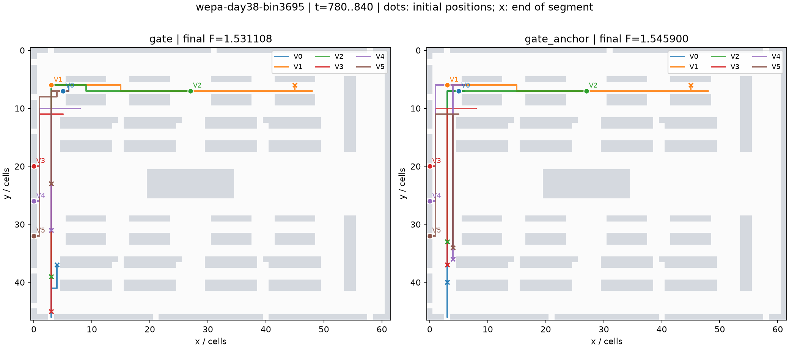
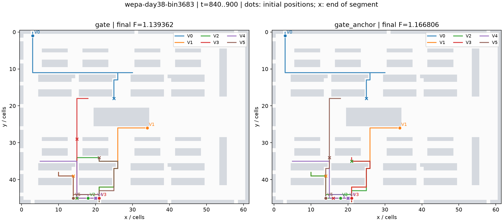
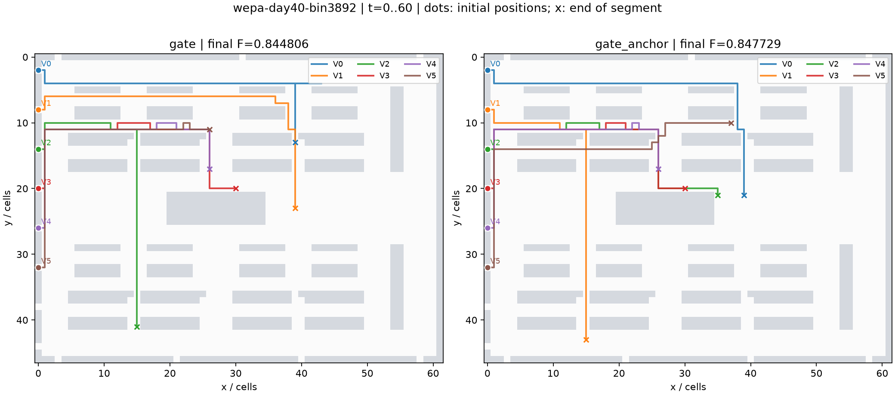
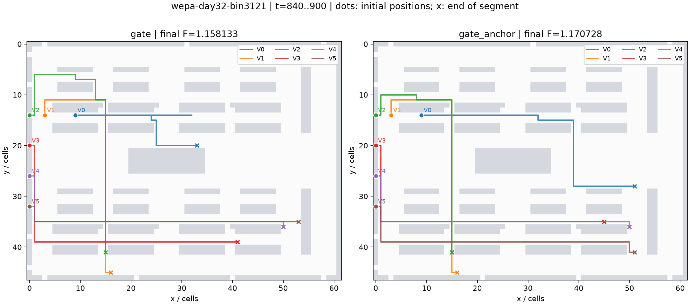
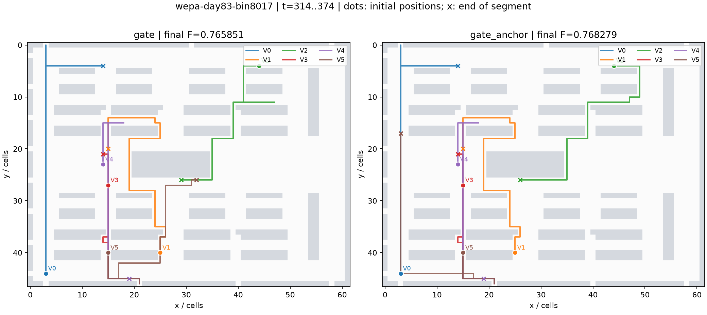

# gate_anchor 五个回退窗口的轨迹诊断

本次重读 `ccff577` 冻结协议下的原始轨迹，对开发集 3 个、验证集 2 个回退窗口的两种方案共 10 次运行重新独立验解和计分。没有重跑或重签历史算法测量，也没有读取旧封存集。

五例都在更低的可见任务 SIPP 预测分数被采纳后出现整窗回退；第一处分叉处的分数差严格大于数值容差，因此没有证据把它们归因于平局顺序。日志没有保存原始 GA 代理估价，不能据此确认代理误差占多数。下文统一标为 **b-consistent（与滚动决策的连锁效应一致）**，不把相关性当成因果证明。

预测 F 针对当时已发布的任务，实际 F 针对整窗最终执行；即使此刻已经没有后续订单，后续搜索和逐批提交也会改变预演的完整计划。两者相减不能直接解释为代理误差。要区分代理误差与执行连锁，需要另做冻结计划执行和候选互换的反事实实验。

| 窗口 | 集合 | 预测首次分叉 | 派单首次分叉 | 路径首次分叉 | 最终 ΔF | ΔT | ΔR | ΔD |
|---|---|---:|---:|---:|---:|---:|---:|---:|
| wepa-day38-bin3695 | development | 780 | 780 | 784 | +0.014791 | +23 | +4.263 | +16 |
| wepa-day38-bin3683 | development | 840 | 840 | 841 | +0.027443 | +48 | +2.553 | -2 |
| wepa-day40-bin3892 | development | 0 | 0 | 2 | +0.002923 | +5 | -4.897 | +48 |
| wepa-day32-bin3121 | validation | 840 | 840 | 845 | +0.012595 | +16 | +3.339 | +70 |
| wepa-day83-bin8017 | validation | 148 | 314 | 315 | +0.002428 | +1 | +3.618 | +18 |

## wepa-day38-bin3695

第一处分数差发生于 t=780，anchor 相对其基准预演改善 0.003880000；当时尚未发布任务 1 个。派单在 t=780 分叉，物理位置在 t=784 分叉。分类：b-consistent；未做因果干预。

| 策略 | 实际 F | T | R | D | P90 |
|---|---:|---:|---:|---:|---:|
| gate | 1.531108187 | 1976 | 510.658 | 7104 | 1038 |
| gate_anchor | 1.545899610 | 1999 | 514.921 | 7120 | 1066 |

分数首次分叉起的三次搜索如下。`baseline` 表示该次保留基准；`null` 分数表示候选被剪枝或没有完整评分，不表示零成本。车辆位置、候选评分和每辆车随后三个真实任务的完整紧凑记录见配套 JSON。

| 策略 | t | base_score | 选中预测 F | 选中来源 | 当步实际派单 |
|---|---:|---:|---:|---|---|
| gate | 780 | 1.567617778 | 1.567617778 | baseline | [[[0, 42], [2, 43], [3, 58], [4, 48], [5, 10]]] |
| gate | 848 | 1.567617778 | 1.567617778 | baseline | [[[2, 11]]] |
| gate | 856 | 1.562205166 | 1.557494639 | ga | [[[4, 68]]] |
| gate_anchor | 780 | 1.567617778 | 1.563737778 | hungarian_anchor | [[[0, 10], [2, 15], [3, 48], [4, 42], [5, 58]]] |
| gate_anchor | 850 | 1.560105185 | 1.559957037 | ga | [[[3, 49]]] |
| gate_anchor | 854 | 1.551305068 | 1.551305068 | baseline | [[[2, 75]]] |

图中两栏采用同一地图和时间窗；圆点为派单首次分叉时的位置，叉号为随后 60 步末的位置，线条为实际执行轨迹。

## wepa-day38-bin3683

第一处分数差发生于 t=840，anchor 相对其基准预演改善 0.022171852；当时尚未发布任务 1 个。派单在 t=840 分叉，物理位置在 t=841 分叉。分类：b-consistent；未做因果干预。

| 策略 | 实际 F | T | R | D | P90 |
|---|---:|---:|---:|---:|---:|
| gate | 1.139362086 | 1407 | 298.197 | 6974 | 561 |
| gate_anchor | 1.166805556 | 1455 | 300.750 | 6972 | 561 |

分数首次分叉起的三次搜索如下。`baseline` 表示该次保留基准；`null` 分数表示候选被剪枝或没有完整评分，不表示零成本。车辆位置、候选评分和每辆车随后三个真实任务的完整紧凑记录见配套 JSON。

| 策略 | t | base_score | 选中预测 F | 选中来源 | 当步实际派单 |
|---|---:|---:|---:|---|---|
| gate | 840 | 1.162813333 | 1.162813333 | baseline | [[[2, 58], [3, 53], [4, 63], [5, 68]]] |
| gate | 874 | 1.139362086 | 1.139362086 | baseline | [[[1, 69]]] |
| gate | 903 | 1.139362086 | 1.139362086 | baseline | [[[4, 70]]] |
| gate_anchor | 840 | 1.162813333 | 1.140641481 | hungarian_anchor | [[[2, 68], [3, 58], [4, 63], [5, 53]]] |
| gate_anchor | 874 | 1.172708577 | 1.167066764 | ga | [[[1, 69]]] |
| gate_anchor | 903 | 1.172708577 | 1.167066764 | incumbent | [[[4, 70]]] |

图中两栏采用同一地图和时间窗；圆点为派单首次分叉时的位置，叉号为随后 60 步末的位置，线条为实际执行轨迹。

## wepa-day40-bin3892

第一处分数差发生于 t=0，anchor 相对其基准预演改善 0.011309764；当时尚未发布任务 25 个。派单在 t=0 分叉，物理位置在 t=2 分叉。分类：b-consistent；未做因果干预。

| 策略 | 实际 F | T | R | D | P90 |
|---|---:|---:|---:|---:|---:|
| gate | 0.844805875 | 970 | 320.862 | 5372 | 688 |
| gate_anchor | 0.847729246 | 975 | 315.966 | 5420 | 775 |

分数首次分叉起的三次搜索如下。`baseline` 表示该次保留基准；`null` 分数表示候选被剪枝或没有完整评分，不表示零成本。车辆位置、候选评分和每辆车随后三个真实任务的完整紧凑记录见配套 JSON。

| 策略 | t | base_score | 选中预测 F | 选中来源 | 当步实际派单 |
|---|---:|---:|---:|---|---|
| gate | 0 | 0.672609428 | 0.672562290 | ga | [[[0, 1], [1, 0], [2, 2], [3, 12], [4, 17], [5, 22]]] |
| gate | 85 | 0.674221164 | 0.674221164 | baseline | [[[1, 27]]] |
| gate | 99 | 0.683185185 | 0.683185185 | baseline | [[[3, 23]]] |
| gate_anchor | 0 | 0.672609428 | 0.661299663 | hungarian_anchor | [[[0, 0], [1, 2], [2, 12], [3, 17], [4, 22], [5, 27]]] |
| gate_anchor | 87 | 0.674419048 | 0.674419048 | baseline | [[[0, 28]]] |
| gate_anchor | 99 | 0.670444444 | 0.670444444 | baseline | [[[3, 34]]] |

图中两栏采用同一地图和时间窗；圆点为派单首次分叉时的位置，叉号为随后 60 步末的位置，线条为实际执行轨迹。

## wepa-day32-bin3121

第一处分数差发生于 t=840，anchor 相对其基准预演改善 0.024253199；当时尚未发布任务 1 个。派单在 t=840 分叉，物理位置在 t=845 分叉。分类：b-consistent；未做因果干预。

| 策略 | 实际 F | T | R | D | P90 |
|---|---:|---:|---:|---:|---:|
| gate | 1.158132937 | 1597 | 260.732 | 4968 | 613 |
| gate_anchor | 1.170727513 | 1613 | 264.071 | 5038 | 634 |

分数首次分叉起的三次搜索如下。`baseline` 表示该次保留基准；`null` 分数表示候选被剪枝或没有完整评分，不表示零成本。车辆位置、候选评分和每辆车随后三个真实任务的完整紧凑记录见配套 JSON。

| 策略 | t | base_score | 选中预测 F | 选中来源 | 当步实际派单 |
|---|---:|---:|---:|---|---|
| gate | 840 | 1.186317172 | 1.185136700 | ga | [[[1, 53], [2, 47], [3, 40], [4, 35], [5, 30]]] |
| gate | 867 | 1.218380952 | 1.212738757 | ga | [[[0, 15]]] |
| gate | 926 | 1.210687831 | 1.210687831 | baseline | [[[1, 36], [5, 41]]] |
| gate_anchor | 840 | 1.186317172 | 1.162063973 | hungarian_anchor | [[[1, 53], [2, 48], [3, 30], [4, 35], [5, 40]]] |
| gate_anchor | 867 | 1.191152116 | 1.191152116 | baseline | [[[0, 45]]] |
| gate_anchor | 923 | 1.191152116 | 1.189335317 | ga | [[[5, 41]]] |

图中两栏采用同一地图和时间窗；圆点为派单首次分叉时的位置，叉号为随后 60 步末的位置，线条为实际执行轨迹。

## wepa-day83-bin8017

第一处分数差发生于 t=148，anchor 相对其基准预演改善 0.007618619；当时尚未发布任务 18 个。派单在 t=314 分叉，物理位置在 t=315 分叉。分类：b-consistent；未做因果干预。

| 策略 | 实际 F | T | R | D | P90 |
|---|---:|---:|---:|---:|---:|
| gate | 0.765851178 | 946 | 233.109 | 4390 | 577 |
| gate_anchor | 0.768279461 | 947 | 236.727 | 4408 | 576 |

分数首次分叉起的三次搜索如下。`baseline` 表示该次保留基准；`null` 分数表示候选被剪枝或没有完整评分，不表示零成本。车辆位置、候选评分和每辆车随后三个真实任务的完整紧凑记录见配套 JSON。

| 策略 | t | base_score | 选中预测 F | 选中来源 | 当步实际派单 |
|---|---:|---:|---:|---|---|
| gate | 148 | 0.640889890 | 0.640889890 | baseline | [[[3, 24]]] |
| gate | 207 | 0.649736842 | 0.618030214 | ga | [[[1, 13]]] |
| gate | 216 | 0.633923077 | 0.633923077 | baseline | [[[2, 37]]] |
| gate_anchor | 148 | 0.640889890 | 0.633271271 | hungarian_anchor | [[[3, 24]]] |
| gate_anchor | 207 | 0.649736842 | 0.618030214 | ga | [[[1, 13]]] |
| gate_anchor | 216 | 0.633923077 | 0.633381766 | hungarian_anchor | [[[2, 37]]] |

图中两栏采用同一地图和时间窗；圆点为派单首次分叉时的位置，叉号为随后 60 步末的位置，线条为实际执行轨迹。

## 结论与后续决策

五例首次预测分叉时都尚未正式闭流，而且确实还存在未发布任务（分别为 1、1、25、1、18 个）。因此可优先检验闭流后才启用 anchor 的假设，但这不是该规则有效的证明。正式闭流时间、已发布任务数和实际后续重规划属于不同状态。任何新触发规则都应在新的开发日期上预先定义，并在独立日期验证，不能用这五个回退窗口反复选规则。

当前没有证据要求修改平局规则，也没有证据证明 A3 代理校正会消除这些回退。默认策略仍保留 gate。

结构化证据：[anchor-regressions.json](../../results/review2-20261029/anchor-regressions.json)。复查脚本为 `scripts/analyze_anchor_regressions.py`，需要原始本地轨迹目录与可选 `plots` 依赖。公开仓库保留紧凑审计记录和五张图，未上传完整运行轨迹。
