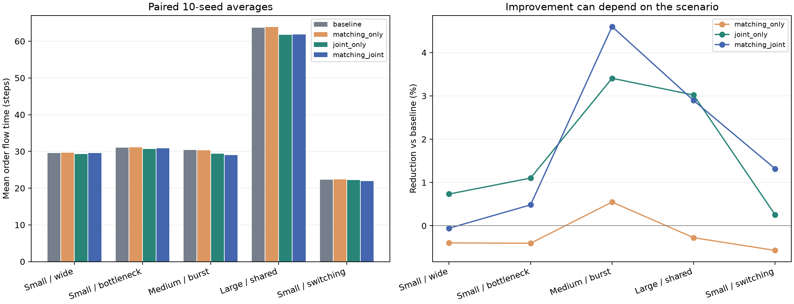

> 历史版本说明：本文记录 v1（提交 `d79aa07`）的设计与实验结果，文中的旧目录路径对应当时的项目结构。后续重构与改进请见 [v2 工程重构与算法报告](../v2-results.md)。

# v1 算法实现与实验报告

日期：2026-10-14 · 选题：任务 1——仓库穿梭无人车智能调度

本阶段完成了原版系统实测、MAPF/MAPD 文献调研、途中联合重规划与可选批次匹配的实现、240 次配对及消融实验、典型轨迹解析与复现脚本整理。综合表现最稳定的是 **原贪心分配 + RHCR/MAPF-LNS 思想启发的联合后缀重规划（`joint_only`）**；在此基础上叠加当前批次精确匹配（`matching_joint`）在动态突发场景收益更明显，而在部分静态场景略有波动，因此保留为可选方案。

## 1. 原版实测与瓶颈定位

首先在独立副本上运行原版代码（保持原始输入目录不变）：原版 55 项单元测试全部通过，4 组固定样例与 16 种动态组合运行正常，且通过原独立验证器检查（记录保存在历史产物 `baseline_tests.txt`、`baseline_run.txt`、`baseline_dynamic_run.txt` 与 `baseline_audit.txt`）。本地 HTTP 测试需配置 `NO_PROXY=127.0.0.1,localhost` 绕过系统代理，配置直连后全部通过。

在固定种子 0、4 车 12 单条件下，原版基线实测如下：

| 原版场景 | 完成单数 | 最后一单完成（makespan） | 全车返回（time） | 平均订单耗时 | 总移动 | 行驶阶段停留 |
|---|---:|---:|---:|---:|---:|---:|
| 静态宽通道 | 12/12 | 51 | 62 | 26.750 | 202 | 1 |
| 静态窄通道 | 12/12 | 52 | 67 | 27.333 | 212 | 5 |
| 动态宽通道 | 12/12 | 67 | 85 | 14.667 | 228 | 3 |
| 动态窄通道 | 12/12 | 71 | 89 | 14.667 | 232 | 3 |

说明：静态与动态场景的任务释放分布不同，比较指标需在同场景内配对进行；其中 `makespan` 指最后一单卸货完成时刻，而 `time` 还包含全车最终返库。

**问题根因**：在原版 `Environment.assign()` 中，先接单的车辆一次性预约了完整的“取货 → 交付 → 返程”路线，后车只能单方面绕行避让；`advance()` 严格按既定预约推进，缺少在执行途中联合调整多车未来路线的机制。单纯替换订单匹配规则只能改善接单时刻的选择，仍受限于忙车路线不可改写的瓶颈，因此需要同步改造执行环境接口与重规划算法。

## 2. 文献调研与算法选型

本阶段系统调研了 6 篇经典论文（完整书目与分析见 [MAPF/MAPD 论文调研与算法选择](../research/mapf-background.md)）。在保留原有时空 A*（属于 [Silver，AIIDE 2005](https://ojs.aaai.org/index.php/AIIDE/article/view/18726) 的预约式协作路径规划范式）的基础上，融合两项核心思想进行工程适配：

1. **[RHCR，AAAI 2021](https://ojs.aaai.org/index.php/AAAI/article/view/17344)**：将执行与周期性重新协调交替进行，使行驶中的车辆能够持续协商未来路径。
2. **[MAPF-LNS，IJCAI 2021](https://www.ijcai.org/proceedings/2021/568)**：从当前可行解出发，对车辆子集执行破坏与联合修复，仅在目标严格改善时提交新解。

本实现聚焦于结合项目业务规则的思想适配：重规划始终校验直至返库的完整剩余路线，保证环境随时持有完整可执行计划；同时采用轻量级有限邻域，便于教学仿真快速验证。

## 3. 核心机制实现

### 3.1 忙车与返程车的联合后缀重规划

`JointPlanner.propose(observation)` 严格基于当前可见观测运行。观测接口新增 `active_task` 与 `route_record`，仅包含已接任务与已执行服务记录，严格隔离未来订单与总订单数。

默认在成功接新订单后，或仿真时刻为 5 的倍数时触发重规划。候选生成分为两步：先对全车队剩余路线后缀按轮转、反序及固定种子打乱尝试最多 8 个优先顺序，再尝试按车辆列表相邻的若干车辆对，未选车辆保持原路线。低层按候选优先顺序逐车调用时空 A* 修复，并将多车更新后的未来路线打包为一个整体候选统一提交。

### 3.2 各执行阶段的状态保留规则

为保证途中改路的物理一致性，各阶段严格区分不可逆历史事实与可优化未来后缀：

| 阶段 | 固定事实 | 可修改部分 |
|---|---|---|
| 去取货 | 任务所有权、指派时刻、当前车位 | 停靠侧及剩余取送返回路线 |
| 装货中 | 装货开始/结束时刻、已服务量与停靠格 | 完成剩余连续装货之后的路线 |
| 载货行驶 | 已完成取货及服务记录 | 剩余交付与返回路线 |
| 卸货中 | 原卸货开始/结束时刻与位置 | 完成当前卸货之后的回程路线 |
| 返回中 | 已卸货完成记录 | 剩余返程路线 |

已执行的 `paths` 前缀始终保持不变，装卸服务不可中断或提前结束，也不改变已分配任务的归属。

### 3.3 字典序目标与原子提交

在同一时刻 `t` 下，算法针对当前已接任务按字典序最小化三元目标：

```text
(sum(max(0, delivery_end - t)), max(t + suffix_length - 1), remaining_moves)
```

三项依次为：当前未完成任务的预计剩余送达耗时之和、全车队最晚返库时刻、剩余移动步数之和（已完成任务的第一项贡献为 0）。算法优先缩短整体送达耗时，其次优化最晚回程时刻与总移动量；允许个别车辆适当让行，前提是车队整体目标严格改善。

`Environment.apply_replan()` 实行严格的提交前原子校验：先读取完整日志元数据，再核查所有未来路径的起点衔接、四邻接合法性、障碍与专属停车位权限、顶点冲突、对向边交换冲突、连续服务、时限与任务归属；随后在独立审计副本中推进完整剩余路线，调用 `validation.py` 全量验解并复算真实目标。仅当所有检查通过且目标严格下降时才一次性原子提交，否则保持原计划不变。每次成功提交都会写入 `replanning_events`，记录时刻、前后目标、尝试次数及各改路车辆的状态与前后路线后缀。

### 3.4 可选的当前批次精确匹配

`matching_action()` 基于位掩码动态规划（最多支持 8 辆车），在已释放待接订单与可用车辆间先最大化匹配数量，再最小化静态成本矩阵：

```text
min_p(distance(vehicle, p) + distance(p, delivery))
+ pickup_service + delivery_service
- 0.25 * (current_time - release)
```

其中 `p` 为货架合法停靠侧，年龄项用于照顾等待较久的订单。复杂度约为 `O(待接任务数 × 车辆数 × 2^车辆数)`，纯标准库即可实时求解。该模块对当前静态代价矩阵求精确最优（单元测试中对反例矩阵 `[[10,6],[14,8]]`，原贪心代价为 20，批次匹配代价降至 18），适合作为消融选项观察静态分配与动态避碰的交互影响。

## 4. 配对实验设计

正式实验包含 6 类场景 × 10 个种子（0–9）× 4 种配置 = 240 次完整运行，所有轨迹均通过独立验解。同一种子下四种配置共享完全一致的 JSON 输入与 SHA-256 指纹，在线策略均严格隔离未来订单。

| 场景 | 地图 | 车数 | 单数 | 到达/交付设置 | 时限 |
|---|---|---:|---:|---|---:|
| 小型静态宽通道 | 13×11 | 4 | 12 | 全部 t=0，分散交付，3 通行口 | 600 |
| 小型静态窄通道 | 13×11 | 4 | 12 | 全部 t=0，分散交付，1 通行口 | 600 |
| 中型动态突发 | 19×15 | 6 | 30 | 每 30 步 6 单，分散交付，1 通行口 | 600 |
| 大型动态集中交付 | 25×19 | 8 | 40 | 间隔 1–9 步，集中交付，1 通行口 | 600 |
| 小型动态热点切换 | 13×11 | 4 | 30 | 间隔 1–9 步，先偏左后偏右，1 通行口 | 600 |
| 短时限压力 | 19×15 | 6 | 30 | 全部 t=0，分散交付，1 通行口 | 100 |

四种消融配置为 `baseline`、`matching_only`、`joint_only`、`matching_joint`，所有参数在运行前预先固定。响应时间比较仅针对双方均完成全部订单且全车安全返库的成功配对；压力场景的未完成运行单独统计完成率与完成单数。改善率定义为 `(基线均值 - 算法均值) / 基线均值`，正值表示缩短耗时。

## 5. 实验结果与分析

前 5 类正常场景中，4 种算法均达到 10/10 全量完成；短时限压力场景均为 0/10。下表汇总正常场景的平均订单响应时间（单位：步）：

| 场景 | 原版 | 仅匹配 | 仅重规划 | 融合 | 重规划降低 | 融合降低 |
|---|---:|---:|---:|---:|---:|---:|
| 小型静态宽通道 | 29.525 | 29.642 | 29.308 | 29.542 | 0.73% | -0.06% |
| 小型静态窄通道 | 31.017 | 31.142 | 30.675 | 30.867 | 1.10% | 0.48% |
| 中型动态突发 | 30.427 | 30.260 | 29.390 | 29.027 | 3.41% | 4.60% |
| 大型动态集中交付 | 63.665 | 63.840 | 61.742 | 61.822 | 3.02% | 2.89% |
| 小型动态热点切换 | 22.270 | 22.397 | 22.213 | 21.977 | 0.25% | 1.32% |



以上为 10 个固定种子下的描述性统计，逐次明细与汇总保存在历史归档 `runs.csv` 与 `summary.json`。

### 5.1 逐种子胜负分布与负面结果分析

| 场景 | 仅重规划：改善/持平/变差种子数 | 融合：改善/持平/变差种子数 |
|---|---|---|
| 小型静态宽通道 | 8/2/0 | 4/3/3 |
| 小型静态窄通道 | 8/1/1 | 6/0/4 |
| 中型动态突发 | 10/0/0 | 8/0/2 |
| 大型动态集中交付 | 10/0/0 | 10/0/0 |
| 小型动态热点切换 | 6/0/4 | 7/0/3 |

可以看到，`joint_only` 在 5 类场景的均值上全面优于原版，且在中型动态突发与大型动态集中交付中取得 10/10 胜率。相比之下，静态批次匹配由于仅基于静态距离矩阵而未显式建模动态预约拥堵，有时会把车辆分配到预约冲突较密集的区域，导致 `matching_only` 在多类场景均值略差、`matching_joint` 在静态宽通道出现 −0.06% 的轻微波动。这一对比说明，在拥堵环境下将动态路线协调纳入调度比单纯优化静态匹配矩阵更为关键。

### 5.2 收益机制与计算开销

| 场景与算法 | 行驶阶段停留均值 | 移动均值 | 最后一单完成均值 | 整次运行秒数均值 |
|---|---:|---:|---:|---:|
| 中型动态突发 / baseline | 10.80 | 938.40 | 181.70 | 0.219 |
| 中型动态突发 / joint_only | 7.20 | 948.60 | 179.60 | 1.095 |
| 中型动态突发 / matching_joint | 7.10 | 931.40 | 178.70 | 1.026 |
| 大型动态集中交付 / baseline | 16.70 | 2256.40 | 333.60 | 0.587 |
| 大型动态集中交付 / joint_only | 10.80 | 2226.20 | 326.70 | 5.224 |
| 大型动态集中交付 / matching_joint | 12.40 | 2224.20 | 327.30 | 5.197 |

从中型动态突发的数据可见，`joint_only` 将行驶阶段停留从 10.80 步降至 7.20 步，总移动从 938.40 格小幅增至 948.60 格，体现出“以小幅绕行换取更快通行”的协调特征；`matching_joint` 则同时降低了响应时间、总移动和途中停留。大型集中交付中，两种重规划方案均同步降低了停留步数、总里程与 makespan，各项轨迹变化与设计预期一致。

在计算开销方面，表中耗时涵盖整次仿真、调度、时空搜索与提交前全量审计。大型场景单次运行从原版的 0.587 秒增至约 5.2 秒，表明 v1 的全车队多顺序重排与全量审计带来较高计算负担，这也直接促成了 v2 引入 SIPP 与小预算关联邻域的优化方向。

### 5.3 短时限压力案例

在 100 步强时限约束下，各算法均无法在时限内完成全部 30 单并返库：原版平均完成 20.7/30 单，仅重规划与融合方案均提升至 21.0/30 单。所有未完成轨迹均保持无碰撞并通过独立验解，反映当前规划器在该紧迫时限下的吞吐上限。

## 6. 典型途中改路轨迹解析

以中型动态突发、种子 0、`joint_only` 在时刻 120 的一次真实重规划为例（详情见 [途中联合重规划解释.html](https://github.com/Fallen-Crystal/agv-warehouse-scheduling-2026/blob/d79aa07/agv_modeling_shelf/%E9%80%94%E4%B8%AD%E8%81%94%E5%90%88%E9%87%8D%E8%A7%84%E5%88%92%E8%A7%A3%E9%87%8A.html)）：

该次提交将三元目标从 `(154, 184, 262)` 改善为 `(146, 181, 254)`——当前已接任务的预计剩余送达耗时合计减少 8 步，最晚返库提前 3 步，剩余移动减少 8 格。涉及改路的 4 辆车变化如下：

| 车辆 | 当时状态 | 原预计卸货结束 | 新预计卸货结束 | 变化 |
|---|---|---:|---:|---|
| 0 | 载货行驶 | 129 | 129 | 路径微调，完成时刻保持 |
| 1 | 去取货 | 151 | 154 | 延后 3 步 |
| 3 | 去取货 | 156 | 152 | 提前 4 步 |
| 5 | 去取货 | 159 | 152 | 提前 7 步 |

该实例清晰展示了多车联合重排的价值：让车辆 1 主动让行延后 3 步，换取车辆 3 与车辆 5 分别提前 4 步和 7 步完成交付，实现车队净收益 8 步，同时所有未改路车辆的轨迹作为固定约束通过了完整可行性验收。

## 7. 验证、复现与阶段小结

v1 最终通过全部 62 项单元测试（在原版 55 项基础上新增 7 项核心回归），覆盖忙车改路、三元目标严格下降、多步装卸状态保留、已执行前缀不变、在线信息隔离、非法候选原子拒绝、匹配反例与失败轨迹处理；并在审查中修复了提交前日志元数据校验顺序的边界问题。

**历史复现命令（对应 v1 目录结构）**：

```bash
cd agv_modeling_shelf
NO_PROXY=127.0.0.1,localhost no_proxy=127.0.0.1,localhost python3 -m unittest discover -v
python3 benchmark_algorithms.py --seeds 10 --output my_reproduction
python3 show_warehouse.py
```

**阶段局限与后续方向**：
- 方案属于有限预算的在线启发式：在有限优先顺序和邻域内寻找可行改进解，并逐段拼接取货、送货与回程路径，存在进一步压缩搜索开销与提升求解质量的空间。
- 物理模型聚焦于单车容量 1、离散格点运动与不可撤单的任务执行，暂未引入充电、加减速动力学与故障扰动。
- 静态匹配矩阵尚未计入时空拥堵成本；下一步可引入更高效的低层搜索（如 SIPP）与冲突关联邻域，以在保持调度质量的同时显著降低计算时间。

**分工与交付说明**：队友完成了原始环境建模、预约式规划与基础验证/可视化框架；本阶段新增了第 3 节所述的联合后缀重规划、批次匹配机制及配套配对实验与轨迹解释工具。
