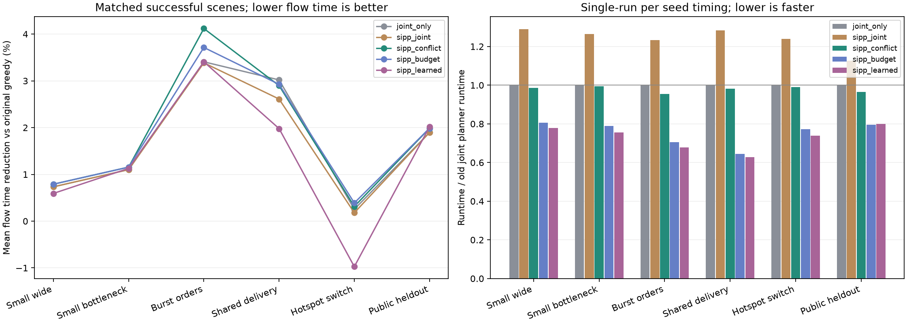

# v2 工程重构、算法与公开数据训练实测

日期：2026-10-15。此次目标是让现有项目结构清楚、行为稳健，并以有效的小改动改善规划效率；同时实际使用公开数据训练一个可解释的候选排序器。

结论：推荐 **SIPP＋拥堵关联候选选择＋六候选预算的规则方案 `sipp_budget`**。相比上一版联合重规划，正常场景整次运行时间降低约19%–36%，订单耗时总体接近；部分场景略有改善，大型集中交付约退步0.1%。训练模型已完成，但同预算泛化收益很小且并不稳定，因此保留为实验选项。

## 1. 结构发生了什么变化

原来所有源码、交付说明、截图、两轮重复大批次结果堆在 `agv_modeling_shelf/`。现在源码迁入可安装的 `src/agv/` 包，按领域、仿真、规划、派单、学习、评估、IO、实验和网页分工；测试按单元与集成分开。详见 [架构](architecture.md)。

旧大目录和重复交付材料已从当前Git树移除，本机备份在仓库之外，原Desktop输入保持原样。Git历史仍能检索旧版本；当前只保留v1摘要与历史说明。新结果保留396次逐次成绩、精简汇总和15条有意挑选的轨迹，不再重复提交每个场景的大量相同输入和中间文件。

工程参考来自实际读取的 w9-pathfinding、MAPF-LNS、RHCR、libMultiRobotPlanning 的源码、测试和CI；固定SHA及具体借鉴见 [工程与SIPP调研](research/engineering-and-sipp.md)。借鉴的是职责隔离、可替换求解器、独立验解、可复现输入与跨平台检查，未把外部求解器源码直接拷进项目。

## 2. 稳健性改进

- `pyproject.toml`声明Python版本、src包和统一`agv`入口，支持wheel；从源码目录之外运行CLI、加载网页资源和训练模型均已实际验证。
- 网页从连续字符串替换改为一份真实HTML模板、独立JS与CSS；API直接使用统一算法注册表。
- JSON先做结构/字段/严格整数坐标检查，HTTP先限制尺寸、任务量和正文长度，再执行昂贵的可达性/规划检查。
- 文件采用同目录临时文件、flush/fsync与原子提交；默认拒绝覆盖已有结果，序列化失败不损坏旧文件。
- 本地HTTP限制Host/Origin、固定静态路由和请求类型，拒绝路径穿越与并发重计算，设置请求超时，日志记录内部异常。测试不再依赖系统代理环境。
- 批量参数检查不再为验证参数额外运行一次完整仿真；移除无界排队与大结果缓存。
- 继续保留完整未来路线审计、服务冻结、已执行前缀不变及原方案回退，学习不能绕过这些规则。
- GitHub Actions配置Linux/macOS/Windows及Python3.10/3.12测试，并检查wheel安装后在源码外运行。远端是否通过以实际Actions记录为准。

这仍是课程小规模仿真，不是实车控制系统；没有为了目录复杂而引入数据库、任务队列或训练框架。

## 3. 比单纯换算法名称更有效的修改

### 3.1 SIPP：把重复等待合并成安全区间

原时空A*把 `(位置,t)` 当作不同状态，等待400步可能逐时扩展400次。SIPP改为 `(位置,安全时间区间)`，标签记录最早到达时刻。在同一区间内，早到的车辆可以安全等待到晚到时刻，因此只需保留最早到达标签。

[Phillips与Likhachev，ICRA2011](https://publications.ri.cmu.edu/sipp-safe-interval-path-planning-for-dynamic-environments) 是这一思想的来源。本实现适配单位步长、四邻接、连续服务、逆向边交换冲突和有限时限；与原A*共用单段接口，返回仍是可逐步执行的完整轨迹。

目标格只在某时刻空闲还不够：服务占位必须在闭区间 `[开始,开始+服务步数]` 持续安全，服务资源禁用按半开区间检查。必要时可以在目标格等到服务可用，或离开后进入下一个安全区间。逆向边预约单独检查，不能只靠顶点区间。

### 3.2 缓存必须与预约版本一致

取货停靠侧比较和三段路线搜索反复使用同一预约表。新增按格子索引的时间表，同一版本只构建一次；add/update/discard以及集合原地运算都会使索引失效。差分测试还覆盖“先建缓存、再修改预约、再搜索”，避免缓存陈旧制造漏碰撞。

### 3.3 搜索互相影响的车，而非相邻编号

原方案默认尝试多种全车队排列和编号相邻车辆对。新方案估计剩余耗时相对无预约下界的差，再结合已知路径共享格选择相关车辆对。这个差是可见计划的松弛代理，不把它全部解释成交通拥堵。

车辆对修复只撤销相关后缀，减少对良好路线的扰动和重算。正在装卸车辆的不可中断片段先预留；保留两个全车队候选，允许处理多车协调。完整方案按严格字典序目标验收，不改变任务归属。

### 3.4 小预算比全车队反复重排更划算

`sipp_budget`最多尝试6个候选，与上一版8个全队排列加若干车辆对相比明显减少低层搜索。它保持当前可行方案和两个全队后备候选，在本次样例中以少量质量变化换取明显计算节省。

## 4. 两类实验要分开看

### 4.1 单段搜索实验

`results/validation/routing-benchmark.json`独立比较单段A*与SIPP，75个案例，每例重复5次并取耗时中位数，所有案例可行性与最早完成长度一致。

| 来源 | A*扩展状态 | SIPP扩展状态 | A*合计秒 | SIPP合计秒 |
|---|---:|---:|---:|---:|
| 人工构造400步等待 | 403 | 3 | 0.000292 | 0.000017 |
| 74个真实仓库预约片段 | 2,556 | 1,586 | 0.013962 | 0.015226 |

长等待案例说明状态压缩机制有效；真实预约片段的扩展减少约38%，但耗时略升，说明Python区间处理与索引仍有成本。不能把人工案例约17倍的比例宣传成整场仓库加速，也不能因节点减少就断言CPU必更快。

### 4.2 完整配对实验

6类课程场景×10个种子×6配置=360次，加上公开地图测试区6个新种子×6配置=36次，共396次。全部独立轨迹、服务和指标验解通过。

配置：

| 名称 | 含义 |
|---|---|
| baseline | 初始距离贪心＋接单时固定预约 |
| joint_only | 上一版原分配＋时空A*联合重规划 |
| sipp_joint | 只把上一版低层换成SIPP |
| sipp_conflict | SIPP＋拥堵关联邻域，较大候选预算 |
| sipp_budget | 关联邻域，最多6候选，规则排序 |
| sipp_learned | 相同6候选预算，训练模型排序车辆对 |

输入、订单和发布时刻在同一种子下完全相同。运行秒数包含仿真、派单、低层搜索与提交前审计，不含进程启动和外部最终验解；每种子只计时一次，数字存在机器负载波动。源代码和模型在实验期间冻结并校验哈希，测量快照为[提交29d86e7](https://github.com/Fallen-Crystal/agv-warehouse-scheduling-2026/commit/29d86e780e3f7e445248dee3b43b3882b6eb6a1a)。测量后补充地图尺寸行与数据来源校验、显式UTF-8读取，并把CLI默认方案设为六候选规则，求解代码和模型没有改动；`scripts/verify_results.py`重新核对396行输入摘要、15条代表轨迹和测量源码快照。

## 5. 正式结果

下表平均订单响应时间（出现到卸货完成，单位步），仅比较两边全部任务完成且返回停车位的成功配对。前5类每个算法成功10/10，公开留出集每个算法成功6/6。

| 场景 | 初始原版 | 上一版联合 | 新关联修复 | 六候选规则 | 六候选学习 |
|---|---:|---:|---:|---:|---:|
| 小型静态宽通道 | 29.525 | 29.308 | 29.292 | 29.292 | 29.350 |
| 小型静态窄通道 | 31.017 | 30.675 | 30.658 | 30.658 | 30.667 |
| 中型动态突发 | 30.427 | 29.390 | 29.173 | 29.297 | 29.390 |
| 大型集中交付 | 63.665 | 61.742 | 61.820 | 61.803 | 62.405 |
| 小型热点切换 | 22.270 | 22.213 | 22.200 | 22.183 | 22.487 |
| 公开地图留出集 | 68.135 | 66.844 | 66.781 | 66.781 | 66.760 |

### 5.1 相对上一版的时间与质量取舍

| 场景 | 上一版运行秒 | 六候选规则秒 | 节省计算时间 | 订单响应时间变化 |
|---|---:|---:|---:|---:|
| 小型静态宽通道 | 0.141 | 0.114 | 19.36% | -0.057% |
| 小型静态窄通道 | 0.150 | 0.118 | 21.15% | -0.054% |
| 中型动态突发 | 1.075 | 0.759 | 29.44% | -0.318% |
| 大型集中交付 | 5.290 | 3.408 | 35.59% | +0.097% |
| 小型热点切换 | 0.522 | 0.403 | 22.81% | -0.135% |
| 公开地图留出集 | 0.612 | 0.487 | 20.48% | -0.094% |

响应时间变化中负数为更快送达、正数为退步。大型集中交付约+0.10%的质量损失换来约35.6%的整次计算节省；这属于质量/计算的取舍，不应写成每个指标都改善。若优先追求中型突发订单的响应时间，可选择较大预算`sipp_conflict`；它均值29.173步，相比上一版29.390步再减少约0.74%。



短时限压力场景每个算法均0/10完整成功。失败轨迹仍验证无碰撞，但未完成任务与返程；不把这类已完成子集的小均值混进成功对照。完成单数、诊断和全部逐次成绩保留在CSV和代表轨迹。

单独换SIPP在完整运行中通常更慢；节省主要来自关联车辆对、较小候选预算以及少做全车队修复。当前证据支持这个组合及取舍，而不是“SIPP名字更高阶所以一定更优”。

## 6. 公开数据与实际训练

使用MovingAI官方仓库地图，原始尺寸161×63、5699个可通行格。来源、ODC-By许可、SHA256和派生规则保留在`data/`。转换后是在线取送货MAPD模拟任务，不是官方一次性起终点MAPF任务；没有使用私密或所谓内部隐藏数据。

训练区与验证区各8/3个独立订单场景，产生3828/1542条候选行；测试区用200–205种子。三个裁剪区不重叠，训练/验证/测试种子不同。重复货架模式使它们仍属同一来源的区域留出，不证明未知仓库泛化。

模型为8特征ridge线性回归，500步确定性梯度下降；仅训练数据拟合均值、尺度、系数和截距。验证集从0.01、0.1、1.0中选择正则化，最终为1.0。验证MSE由常量预测0.577677降低至0.563146，约2.52%；同一验证集参与选参，该数字不等于无偏测试收益。

输入包括车辆数、已知后缀静止步数、路径共享格、剩余长度、首车信息及装卸状态。静止包含服务，空间重叠忽略时间；它们都是便宜代理特征。标签是候选相对搜索当时incumbent的主目标边际改善，截断[-5,10]，不可行=-1，次级目标单独改善=0。因此预测只能作排序，不能当成实际秒数或可行概率。

### 6.1 学习相对同预算规则的真实表现

| 场景 | 学习使平均响应时间变化 | 按种子：改善/持平/退步 |
|---|---:|---|
| 小型静态宽通道 | +0.199% | 0/7/3 |
| 小型静态窄通道 | +0.027% | 1/7/2 |
| 中型动态突发 | +0.319% | 3/3/4 |
| 大型集中交付 | +0.975% | 1/0/9 |
| 小型热点切换 | +1.367% | 0/5/5 |
| 公开地图留出集 | -0.031% | 1/3/2 |

公开留出集上，学习均值66.760步、规则66.781步，仅约0.03%的差别，不能据此宣称显著提升。课程热点切换中学习方案均值还高于初始原版。训练样本相互相关、场景数少、标签受搜索顺序影响，足以解释为何较好的验证误差没有稳定转化为调度收益。

因此当前交付将已训练模型和训练入口作为可解释实验选项，推荐默认使用规则排序。完整模型卡、参数含义和再训练步骤见 [模型卡](model-card.md)。

## 7. 验证证据与边界

- 本地75项测试通过，覆盖旧物理规则、时间分解、多步服务、原子提交、在线隔离、250例随机A*/SIPP差分、逆边、horizon端点、缓存修改、JSON结构、模型参数、无损写入、HTTP及源码目录外CLI。
- 后台独立审查另外执行12000例随机差分及5000例缓存变更差分，未发现当前合同内的路径或泄漏问题。这些额外审查是证据补充，仓库中可直接复现的固定测试仍以tests为准。
- 真实wheel已构建并安装进独立虚拟环境，在`/tmp`运行训练排序器并启动网页资源检查通过；不依赖当前工作目录恰好可导入源文件。
- 396次正式结果均通过独立验解，精选代表轨迹及源码哈希一起提交；不是采用外部论文图片或分数。
- 不保证全局最优/完备性。仍有限候选、逐段取送回程拼接、单车容量1、无电池/加速度/真实车体；局部严格改善不保证最终所有订单均改善。

## 8. 运行

```bash
python -m pip install -e .
agv serve
agv run --input examples/scenarios/dynamic_medium_burst.json --algorithm sipp_budget --output runs/demo.json
agv benchmark --seeds 10 --map data/maps/warehouse-10-20-10-2-1.map --output runs/reproduction
agv train --map data/maps/warehouse-10-20-10-2-1.map --output runs/my-training
```

输出目录必须是新的。训练不会自动替换已发布模型；替换后应重新跑同预算留出对照。详细路径和输出口径见 [复现指南](reproduction.md)。
