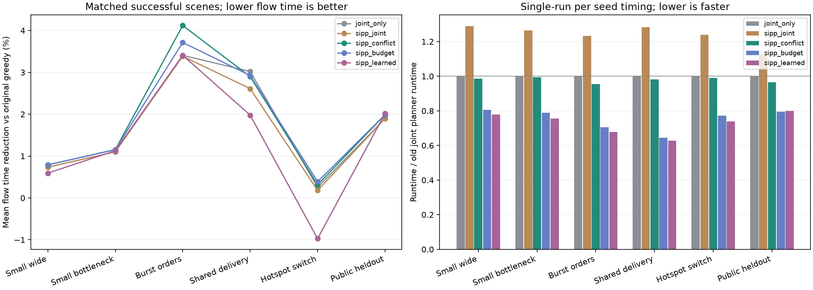

# v2 工程重构、SIPP 加速与公开数据训练实测

日期：2026-10-15

在 v1 验证途中联合重规划有效之后，本阶段重点解决两个问题：一是将原有单目录脚本重构为模块化、可安装、可测试的工程包；二是通过 **SIPP 安全区间搜索 + 冲突关联邻域 + 小候选预算** 显著降低计算耗时，并基于 MovingAI 公开仓库地图训练了一个可解释的线性候选排序器作为探索对照。

**核心结论**：推荐采用 **SIPP + 拥堵关联候选选择 + 六候选预算的规则方案 `sipp_budget`**。相比 v1 联合重规划（`joint_only`），`sipp_budget` 在正常场景中将整次运行耗时降低 **19%–36%**，同时保持订单响应时间基本持平甚至略有改善（仅大型集中交付略增约 0.1%）。已训练的线性排序模型完成了端到端验证，但在相同预算下对调度质量的泛化收益微弱且不稳定，因此保留为实验选项。

## 1. 工程结构重构

原有所有源码、文档、截图与大体积结果均堆叠在 `agv_modeling_shelf/` 目录下。本阶段将其重组为标准 `src/agv/` 可安装 Python 包，按领域模型、仿真引擎、路径规划、任务派单、学习排序、独立评估、数据 I/O、实验基准与 Web 可视化清晰分层，测试拆分为单元测试与集成测试，详见 [系统架构](architecture.md)。

工程架构参考了 w9-pathfinding、MAPF-LNS、RHCR 与 libMultiRobotPlanning 四个开源项目的设计实践（具体版本与剖析见 [工程结构参考与安全区间路径规划](research/engineering-and-sipp.md)），重点吸收了职责隔离、求解器可插拔接口、独立验解与跨平台 CI 检验，全部求解核心均独立以纯 Python 实现。

稳健性增强包括：
- 通过 `pyproject.toml` 提供统一 `agv` CLI 入口与 wheel 打包，支持在源码目录外直接运行并加载 Web 资源与模型参数。
- 前端改为独立的 HTML 模板、JS 与 CSS 文件，后端 API 统一对接算法注册表。
- 输入 JSON 执行严格的字段、类型与整数坐标校验，HTTP 入口对地图尺寸、任务量、请求体大小、Host/Origin 与并发请求施加上限。
- 结果写入采用同目录临时文件 + `flush`/`fsync` + 原子替换，默认拒绝覆盖已有结果。
- 持续保留完整未来轨迹审计、装卸服务冻结、历史前缀不变与安全回退机制，学习排序器只在合法候选范围内工作。
- 配置跨平台 GitHub Actions（Linux / macOS / Windows，Python 3.10 / 3.12），覆盖单元测试与 wheel 包外运行校验。

## 2. 算法改进：用针对性设计替代盲目重排

### 2.1 SIPP：将连续等待压缩为安全时间区间

原版时空 A* 将 `(位置, t)` 视为独立状态，长时等待会逐拍展开大量冗余节点。借鉴 [Phillips & Likhachev (ICRA 2011)](https://publications.ri.cmu.edu/sipp-safe-interval-path-planning-for-dynamic-environments) 的安全区间路径规划（SIPP），本实现将状态表示为 `(位置, 安全时间区间)`，并仅保留每个区间内最早到达标签。

为贴合仓库离散模型，实现完整支持单位步长、四邻接移动、连续服务占位、逆向边交换避碰与有限时限，并保持与原 A* 完全一致的单段路径接口与逐步轨迹输出。在目标格，服务必须满足闭区间 `[开始, 开始 + 服务步数]` 持续安全且服务资源在半开区间内可用；当区间不足时允许在目标格等待或离开后于下一安全区间重入，逆向边冲突则单独核查。

### 2.2 版本一致的预约索引缓存

单轮取货侧评估与三段路径规划会反复查询同一份预约表。为此新增按网格坐标索引的时间表，同一预约版本仅构建一次；任何预约增删或原地修改都会自动使缓存失效。差分测试专门覆盖“建缓存 → 修改预约 → 重新搜索”的场景，确保缓存与真实预约严格一致。

### 2.3 拥堵关联邻域与六候选小预算

v1 默认尝试多种全车队排列与编号相邻车辆对，计算开销集中在重复搜索无关车辆。v2 改为计算各车剩余耗时与无预约最短下界的差值（作为可见计划的松弛度代理），结合已知路径共享网格筛选真正存在交互的车辆对，仅撤销相关车辆的未来后缀进行局部修复；同时保留两个全车队候选以兼顾多车全局协调。

在此基础上，`sipp_budget` 将单轮重规划上限收缩至最多 6 个候选，并始终保留当前可行方案作为兜底，大幅削减低层搜索次数。

## 3. 实验设计与实测结果

### 3.1 单段搜索微基准

`results/validation/routing-benchmark.json` 在 75 个独立单段案例上对比了时空 A* 与 SIPP（每例重复 5 次取中位数），所有案例的可行性与最早完成长度完全一致：

| 案例来源 | A* 扩展状态数 | SIPP 扩展状态数 | A* 合计耗时（秒） | SIPP 合计耗时（秒） |
|---|---:|---:|---:|---:|
| 人工构造 400 步等待 | 403 | 3 | 0.000292 | 0.000017 |
| 74 个真实仓库预约片段 | 2,556 | 1,586 | 0.013962 | 0.015226 |

结果显示：在长等待场景下，SIPP 的状态压缩效果极为显著；在常规仓库片段中，SIPP 将扩展状态数减少约 **38%**，但由于 Python 层的区间构建与索引维护存在固定开销，单段绝对耗时略高于 A*。这说明整场加速的关键在于将 SIPP 与关联邻域、小候选预算协同配合。

### 3.2 完整配对实验设置

完整实验覆盖 **6 类课程场景 × 10 个种子 × 6 种配置 = 360 次**，以及 **MovingAI 公开仓库地图留出测试区 6 个新种子 × 6 种配置 = 36 次**，合计 **396 次**运行，全部通过独立轨迹、服务与指标验解。

| 配置名称 | 算法说明 |
|---|---|
| `baseline` | 初始距离贪心 + 接单时固定预约 |
| `joint_only` | v1 原分配 + 时空 A* 联合重规划 |
| `sipp_joint` | 将 v1 低层搜索替换为 SIPP |
| `sipp_conflict` | SIPP + 拥堵关联邻域（较大候选预算） |
| `sipp_budget` | SIPP + 拥堵关联邻域，最多 6 候选，规则排序（推荐） |
| `sipp_learned` | 相同 6 候选预算，使用线性回归模型排序车辆对 |

同一种子下所有配置共享完全相同的输入与任务释放时刻；测量快照固定于 [提交 `29d86e7`](https://github.com/Fallen-Crystal/agv-warehouse-scheduling-2026/commit/29d86e780e3f7e445248dee3b43b3882b6eb6a1a)，并通过 `scripts/verify_results.py` 核验全部 396 行输入摘要与 15 条精选轨迹。

### 3.3 调度质量与计算时间对比

下表为前 5 类课程场景（每算法 10/10 成功）与公开地图留出集（每算法 6/6 成功）的平均订单响应时间（单位：步）：

| 场景 | 初始原版 | 上一版联合 | 新关联修复 | 六候选规则 | 六候选学习 |
|---|---:|---:|---:|---:|---:|
| 小型静态宽通道 | 29.525 | 29.308 | 29.292 | 29.292 | 29.350 |
| 小型静态窄通道 | 31.017 | 30.675 | 30.658 | 30.658 | 30.667 |
| 中型动态突发 | 30.427 | 29.390 | 29.173 | 29.297 | 29.390 |
| 大型集中交付 | 63.665 | 61.742 | 61.820 | 61.803 | 62.405 |
| 小型热点切换 | 22.270 | 22.213 | 22.200 | 22.183 | 22.487 |
| 公开地图留出集 | 68.135 | 66.844 | 66.781 | 66.781 | 66.760 |

相对 v1 联合重规划（`joint_only`），推荐方案 `sipp_budget` 的时间节省与质量权衡如下（响应时间变化负值代表更快送达，正值代表略慢）：

| 场景 | 上一版运行秒 | 六候选规则秒 | 节省计算时间 | 订单响应时间变化 |
|---|---:|---:|---:|---:|
| 小型静态宽通道 | 0.141 | 0.114 | 19.36% | -0.057% |
| 小型静态窄通道 | 0.150 | 0.118 | 21.15% | -0.054% |
| 中型动态突发 | 1.075 | 0.759 | 29.44% | -0.318% |
| 大型集中交付 | 5.290 | 3.408 | 35.59% | +0.097% |
| 小型热点切换 | 0.522 | 0.403 | 22.81% | -0.135% |
| 公开地图留出集 | 0.612 | 0.487 | 20.48% | -0.094% |



**核心权衡**：
- `sipp_budget` 在 5 类场景上同时节省了 19.36%–29.44% 的运行时间并微幅缩短了响应时间；在大型集中交付中以约 +0.10% 的响应时间代价换取了 **35.59%** 的计算时间节省。
- 若更看重中型突发场景的极致响应时间，可选用预算更大的 `sipp_conflict`（均值 29.173 步，相对 v1 进一步降低约 0.74%）。
- 消融表明，单独将低层换成 SIPP（`sipp_joint`）在整场仿真中耗时略升，真正的速度收益主要源于“关联车辆对 + 小候选预算 + 减少无效全车队重排”的整体设计。
- 短时限压力场景中所有算法均 0/10 完整成功，所有失败轨迹均通过无碰撞验解并完整保留在 CSV 中。

## 4. 公开数据与线性排序器探索

为检验机器学习辅助候选排序的可行性，本阶段基于 MovingAI 官方仓库地图（`warehouse-10-20-10-2-1.map`，161×63、5,699 个可通行格，ODC-By 许可，原始元数据与派生规则保存在 `data/`）构建了在线取送货（MAPD）模拟任务。地图划分为互不重叠的训练区、验证区与测试区，并采用独立随机种子：训练区与验证区分别含 8/3 个场景（共生成 3,828 / 1,542 条候选记录），测试区使用种子 200–205。

排序模型采用 8 特征岭回归（Ridge Linear Regression，500 步确定性梯度下降），标准化参数与权重均在训练集拟合；在验证集上从 `{0.01, 0.1, 1.0}` 中选定正则系数 `1.0`，验证 MSE 从常量预测的 `0.577677` 降至 `0.563146`（下降约 2.52%）。特征涵盖车辆数、已知后缀静止步数、路径共享格数、剩余长度、首车信息及装卸状态，标签为候选相对当前最优解的主目标边际改善（截断至 `[-5, 10]`，不可行记为 `-1`），专用于候选相对排序。训练摘要见 [`training-report.json`](../results/training/training-report.json)。

在相同 6 候选预算下，学习排序（`sipp_learned`）相对规则排序（`sipp_budget`）的实测差异如下：

| 场景 | 学习相对规则的平均响应变化 | 按种子：改善/持平/退步 |
|---|---:|---|
| 小型静态宽通道 | +0.199% | 0/7/3 |
| 小型静态窄通道 | +0.027% | 1/7/2 |
| 中型动态突发 | +0.319% | 3/3/4 |
| 大型集中交付 | +0.975% | 1/0/9 |
| 小型热点切换 | +1.367% | 0/5/5 |
| 公开地图留出集 | -0.031% | 1/3/2 |

在公开留出集上，学习方案（66.760 步）与规则方案（66.781 步）仅相差约 0.03%，而在课程场景（尤其是大型集中交付与热点切换）上普遍出现退步。原因在于单次搜索内的候选样本高度相关、场景数量有限，且边际收益标签高度依赖搜索顺序，离线 MSE 的微弱下降难以稳定转化为整场调度改善。因此系统保留模型与训练入口用于可解释实验对比，默认推荐使用更稳健的规则排序 `sipp_budget`。

## 5. 验证与运行方式

- 本地 75 项单元与集成测试全部通过，覆盖物理约束、多步服务、原子提交、在线隔离、250 例随机 A*/SIPP 差分、逆向边、时限边界、缓存失效、JSON 校验、原子写入及包外 CLI 运行；另补充执行了 12,000 例随机差分与 5,000 例缓存变更差分测试均零异常。
- 已完成 wheel 构建与独立虚拟环境安装验证，在源码目录外正常运行训练排序器并加载前端静态资源。
- 全部 396 次正式结果与 15 条代表轨迹均通过独立验解并附带源码哈希。本阶段模型沿用单车容量 1 与逐段拼接假设，侧重课程小规模仿真中的工程稳健性与规划效率权衡。

```bash
python -m pip install -e .
agv serve
agv run --input examples/scenarios/dynamic_medium_burst.json --algorithm sipp_budget --output runs/demo.json
agv benchmark --seeds 10 --map data/maps/warehouse-10-20-10-2-1.map --output runs/reproduction
agv train --map data/maps/warehouse-10-20-10-2-1.map --output runs/my-training
```

输出目录需为尚不存在的新路径，训练脚本不会自动覆盖内置模型参数。更多命令与输出口径请见 [使用说明](usage.md)。
