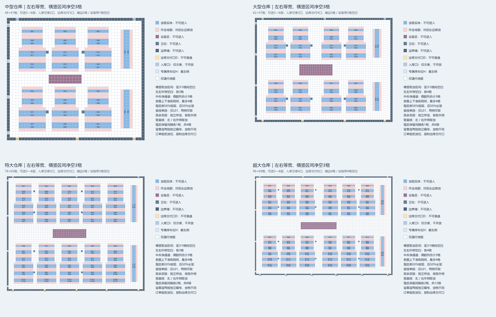

# V6/V9 选择性集成与待命实验

本次审核队友V6和后续V9，采用最新 `mixed-v9` 作为独立模型入口。V6的单排/背靠背双排、横竖朝向和每货位层数概念已经包含在V9中，不另复制一套扁平源码。旧V4仍代表原场景与规则，历史结果不覆盖。

**结论：模型与安全接口值得接纳；待命有减少空驶的潜力，但本轮留出平均F改善0.121%，区间跨零，不能替代返库默认。现有BCRD在新静态积压场景仍有可重复收益，平均F改善2.283%。两条机制分别验证，尚未组合。**



图来自队友V9包，整合生成器的39组身份核对见[来源证据](../results/v9/source-review.json)。图中尺寸与净空属于教学仿真配置。

## 已接纳的模型与接口

| 内容 | 实现 | 含义 |
|---|---|---|
| 横竖混合、短长架对齐、净空和稀疏柱 | `warehouse/mixed.py` | 四种规格46×41、62×47、78×65、96×69（默认作业通道2格）；V9固定设备与立柱 |
| 单排双侧取货 | catalog `loading_points` | 同一货位、同一库存身份、同一把锁；单排只有1层，不增加同bay并发容量 |
| 背靠背独立排 | 横向U/D、竖向L/R | 每排只能使用本排外侧，3–8层，装货2×层号；不模拟前后深位挡货或库存消耗 |
| 显式选侧 | `Environment.assign([(vehicle, task, pickup_point)])` | 二元组兼容原自动选择；三元组先检查整个输入批次，再运行真实规划器 |
| 有限待命 | `dispatch/idle.py` | 只延迟已卸货车辆的安全返程，普通通行区、完整预约检查、有限额度；不是空闲游走 |
| 独立profile和评分来源 | `domain.py`、`io/scenes.py`、`objective.py` | `agv-scene-v9`与`mixed-v9-reviewed-v1`，同一新场景重新计算固定返库基线 |

核心仍仅依赖Python标准库，V4/legacy默认与场景身份保持。输入V9几何须完整匹配其声明的生成规格、宽度、层数与布局变体；所有嵌套catalog、设施和元数据都与任务无关的规范几何逐项核对。这个profile只接受该明确生成族，自定义布局需要独立profile，不能凭一个版本字符串放宽权限。

## 原包审核与修复

V6原包50项测试、V9原包79项测试均在隔离副本通过。它们是回归覆盖证据，不是算法优势或完整安全证明。39组V9完整场景哈希与本项目生成器一致：四尺寸×三通道宽×三变体36组，另三组含8层动态任务。

- V6允许未知顶层/目录字段、矛盾规则名、布尔层数、浮点几何和11车等反例。目录字段可进入观察，不能直接复制到本项目全量公开元数据的接口。新profile按规范几何和精确JSON类型拒绝这些反例。
- V9原自动待命读取完整任务总数来判断“是否还有未来单”。两个当前观察完全相等的环境，仅增添尚未发布订单，下一步一个返库、另一个停留。新控制器不读取任务总数、未来释放或未来目的地，只消耗固定可见待命额度。
- V9旧式非catalog待命会检查所有未来任务的取送点。新机制只支持显式V9静态普通通行区，不从订单流推断停车权限。
- V9的重规划和完整计划评价入口可接受伪造的最终 `return_end`：位置仍在D却声明已经返H。新增验解检查最后有效返程事件与实际轨迹；旧历史返程可能被后单打断，不能要求每两单之间实际返H。
- 不导入可无限绕过停滞检测的结构化主动等待，以及尚未满足本项目合同的通用 `apply_replan/evaluate_schedule`。原有经过冻结承诺与独立验解的联合修复继续保留。
- V9原取送路径未保留本项目D站出口受阻后的延迟到达修复。继续使用当前A*/SIPP和取送组合器，防止旧反例回归。

## 待命的公平边界

对照的“返库”本来就允许卸货后从返程当前位置接新单，不要求每次接单前先到H。有限待命只改变无单时的空载位置轨迹；不撤销订单归属、不打断服务、不占D或取货区、不放宽碰撞约束。

每车每次接单后重新获得有限额度。卸货并退出到普通通行地面后，尝试停1步，同时将完整返程后缀延后1步；若任意未来顶点或反向边预约冲突则拒绝该停留，继续原安全返程。成功停留扣除额度，达到上限后继续返H，即使此时不知道未来是否还有订单。最后一单同样等待这个固定额度，不能用隐藏的“订单流结束”信号提前返库。因此B可能增加，而T定义为最后卸货不含收尾。

待命计入空闲并单列 `standby_steps`，不计作交通避让等待。D计入所有实际空载、载货与最终返库移动，等待不产生这个距离项。0.05D仍是移动能耗代理；没有建模真实待机耗电。

BCRD在V9支持**返库模式**，仍只根据可见订单试算。暂不把待命与BCRD相乘组合：该组合需要在影子中恢复已消费额度及等待历史，未经验证的组合会被显式拒绝。

## 可复现运行

```bash
python -m pip install -e '.[dev]'
agv run --profile v9 --tasks 12 --vehicles 4 --algorithm sipp_greedy_dispatch --output runs/v9-return.json
agv run --profile v9 --tasks 12 --vehicles 4 --algorithm sipp_standby8_dispatch --output runs/v9-wait8.json
agv run --input examples/scenarios/v9-medium-dynamic.json --algorithm bcrd_budget --output runs/v9-bcrd.json
agv serve
```

V9默认中型、双排3层；`--layers 8`正式支持8层，单排仍为1层。V9不接受小型和关闭柱/设备的生成选项。网页显式选择V9，导出使用新格式；有限网页执行资源上限不等于新的物理截止期，无截止输入用CLI。

正式实验使用Git检出和可编辑安装，冻结参数/源码后独立保存开发、留出、泛化结果。不同模型几何、参考实现与分母不同，V9和V4的F不可直接横向排名；原包F=1的自归一化结果也不当作新算法提升。

## 实验设计与冻结

开发种子10–12，三类模板、四种待命额度0/8/16/32，共36次。仅用该开发集选8步：九场景为6胜/0负/3平，平均F改善0.626%，CPU/G0为1.020；16步平均改善0.666%，但有1负且CPU/G0为1.043；32步为0.396%、2负和1.065。选择较小且更一致的额度，不依据后来的留出结果再改参数。

随后固定30–39新种子，三类模板×十种子×三策略=90次；另用60–62种子，在特大稀疏8层与超大稠密8层两个模板跑18次。合计**144次执行，45个不同场景，其中36个未见质量场景**。开发、留出与泛化不混算。

| 模板 | 地图/车辆/订单 | 到达过程 |
|---|---|---|
| dense_static | 中型，4车12单 | 全部t=0发布 |
| sparse_uniform | 中型，4车12单 | 原均匀间隔乘16，每80步发布1单 |
| large_sparse_switch | 大型，4车12单，共享D、热点切换 | 原不规则1–9步间隔乘12，即12–108步 |
| xlarge_sparse_8layers | 特大，4车12单，双排8层 | 每80步1单 |
| xxlarge_dense_8layers | 超大，6车18单，双排8层 | 全部t=0发布 |

稀疏到达缩放是本次设计的合成工况，用于检验待命机制，不能当成真实仓库到达数据。种子控制任务位置与层号；相同场景完整序列化和SHA在策略之间相同。G0、wait8与G2均使用同一SIPP、无联合修复；G2沿用已冻结的四候选、队列比例三及480路由调用/120000扩展软限/2400步预览预算，没有为V9调参。

开发测量源码为 `d6b713e`；正式测量为 `bb3b0f5`。正式测量前又补上了完整结果不准把最后返库时刻写到执行结束之后、返库零服务时间一致性和跨profile reset检查，未改变合法轨迹的原始策略行为。开发结果也通过更严格的当前验解。正式完成后只限定了网页新货位提示的V9适用范围，未改变已测调度源码。

计时仅覆盖原始策略运行，固定A*返库参考、独立验解及离线评分在计时之外；算法顺序按实例轮换。CPU/墙钟每次各测一次，是本机描述性数据，不提供计时置信区间。质量区间使用固定4000次配对bootstrap，仅反映这些固定模板；未校正多算法选择，也不代表任意地图泛化。原始配置、CSV、诊断及每模板首个种子的完整轨迹保存在[结果目录](../results/v9/)。

## 新种子的真实效果

F下降是逐实例配对改善率的均值，正数为好；CPU/G0也是配对比率均值。下表中两种策略分别与G0比较，不是相互比较。

| 工况 | n | 待命8步：F改善 | BCRD返库：F改善 |
|---|---:|---:|---:|
| 中型静态积压 | 10 | 0.119% | **2.283%** |
| 中型稀疏均匀 | 10 | 0.257% | 0.000% |
| 大型稀疏热点切换 | 10 | **−0.012%** | 0.000% |
| **留出合计** | **30** | **0.121%** | **0.761%** |
| 特大稀疏8层 | 3 | 0.915% | 0.000% |
| 超大稠密8层 | 3 | 0.000% | 2.111% |
| **尺寸/层数泛化合计** | **6** | **0.458%** | **1.055%** |

| 留出合计的约束与成本 | 待命8步 | BCRD返库 |
|---|---:|---:|
| F改善95%区间 | **[−0.040%, 0.282%]** | [0.090%, 1.689%] |
| F胜/负/平 | 13/7/10 | 5/0/25 |
| P90响应变差场景 | 2/30 | 3/30 |
| 最坏响应变差场景 | 1/30 | 0/30 |
| CPU/G0 | 1.000 | 1.124 |
| 完整成功且通过独立验解 | 30/30 | 30/30 |

本轮全部144次执行均完成且通过独立验解。泛化六场景中，待命为3胜/0负/3平、CPU/G0为1.015；BCRD为3胜/0负/3平、CPU/G0为1.164。泛化每模板只有三个种子，属于探索性证据，不凭小样本区间宣布普遍有效。

待命留出区间跨零，并有7例F退化，开发集的0.626%没有完整复现。8步不是“最优待命时长”。BCRD的收益集中于已知订单积压：中型静态区间[0.400%, 4.666%]，5胜/0负/5平；两个稀疏模板均因队列压力低而没有影子搜索，结果保持G0。**这支持按问题机制选算法，而不是所有场景强行加前瞻或待命。**

## 空载、响应与D邻域的制衡

[分项重算](../results/v9/holdout-effects.json)显示，待命在30个留出场景中平均减少总移动0.796%、空载1.302%，但平均响应相对变差0.181%，最终返库结束B平均晚7.7步；全场交通等待平均多0.067步。CPU约相同，不能从一次计时的微小差异声称更快。

在稀疏均匀组，空载平均减少2.668%，平均响应却变差0.230%；大型共享D/热点切换组，空载减少1.071%，平均响应变差0.349%，综合F略差。原因是留在D附近可能少走一段回库路，但下一张货架订单可能更接近H或另一辆车。等待改变车辆池和后续贪心匹配，不能只从“少回库”推导全局改善。

每模板首种子还记录了D的L1距离1–2格、排除D本格的邻域占用。稀疏均匀seed30的车辆位置样本从75增到169，其中96个为待命；该邻域交通等待均为0。这个量只说明待命增加了D周边占用，不等于有96步交通拥堵，也不证明未来高负载不会堵。控制器保证不破坏已经承诺的预约，无法替未知未来车辆预留最优位置。

## 可以复核的负例和正例

[待命双栏回放](../results/v9/standby-replay.html)固定使用稀疏均匀留出的首种子30，保留一个真实退化例：

| 指标 | 返库G0 | 待命8步 |
|---|---:|---:|
| T | 924 | 934 |
| R | 58.167 | 58.917 |
| 总移动D | 1034 | 1044 |
| 空载移动 | 687 | 695 |
| 最终结束B | 961 | 991 |
| F | 1.000000 | 1.011214 |

任务ID 2因换车早交付5步，但任务ID 11从车辆2改到车辆1，单排取货侧从(18,25)改到(18,23)，最后卸货晚10步。T项+0.005411、R项+0.003868、D项+0.001934，合计F+0.011214。该例说明局部节省/提前可能被后续匹配抵消，不能只展示有利案例。

[BCRD双栏回放](../results/v9/bcrd-replay.html)使用超大8层模板首种子60：F从1降至0.988207，作为同规则下有序批次试算的正例。它和上面的退化例都只是解释机制；平均效果始终以完整矩阵为准。

## 选型、保留内容和后续动作

- **保留中型地图。** 它适合快速定位选侧、层序和预约错误，也已经暴露待命退化；大尺寸与8层由额外模板覆盖。删除中型不会让算法结论更可信。
- **默认继续返库，可在途中接单。** 待命8步作为明确标注的实验选项；当前留出证据不足以默认启用，更不能直接移植原版窥视未来的自动待命。
- **积压订单可选BCRD。** 本轮新几何支持其在静态积压场景的作用，但P90仍有退化，不作全局最优或全指标改善承诺。
- **下一步先研究位置，再加时长。** 若继续待命方向，优先根据可见任务、与D距离及通道重要性选择临时位置，并设计面向未知到达的固定超时规则；另划新未见种子，验证响应尾部和B。不要根据本次留出重选8/16/32，也不直接组合尚未恢复待命状态的BCRD影子。
- **旧文件按职责保留。** 仓库V4模块仍用于旧场景、独立对照和历史复现，并非无效副本；未撤回。V6未发布的整合候选由最新V9实现吸收，没有上传两个重复运行树。原包HTML、重复文档、缓存和批量交付目录不整体上传。

## 验证与重现证据

186项项目单元/集成测试通过；新测试覆盖单排实际双侧、非法选侧整批拒绝、8层16步服务、隐藏未来置换、TTL完整收尾、冲突原子拒绝、伪造返库事件、未知元数据、协议与CLI/HTTP入口。wheel0.5.0在源码目录外隔离安装完成V9任务和待命核验。回放已验证输入轨迹与脚本语法，未声称逐按钮人工浏览器检查。

三个结果目录通过[独立审计](../results/v9/verification.json)：矩阵144行、源码Git树与产物哈希、配对算术、bootstrap以及27份精选完整轨迹。旧V4的54行数据、18个参考、9个汇总和6份精选轨迹也通过历史来源复核；没有覆盖旧成绩。

```bash
agv benchmark-bcrd --protocol examples/experiments/v9-idle-holdout.json --output runs/v9-holdout-new
agv benchmark-bcrd --protocol examples/experiments/v9-idle-generalization.json --output runs/v9-generalization-new
python scripts/verify_bcrd.py results/v9/development --revision d6b713e
python scripts/verify_bcrd.py results/v9/holdout --revision bb3b0f5
python scripts/verify_bcrd.py results/v9/generalization --revision bb3b0f5
python scripts/summarize_v9.py results/v9/holdout --output runs/v9-effects-new.json
python scripts/verify_v4.py --source-revision 8551943 --output runs/v4-audit-new.json
```

固定权重和移动能耗代理都未重拟合；没有引入新训练数据或训练新模型。结果适用于本次合成模板与测量环境，不延伸为实际仓库容量、建筑规范或电池能耗结论。
