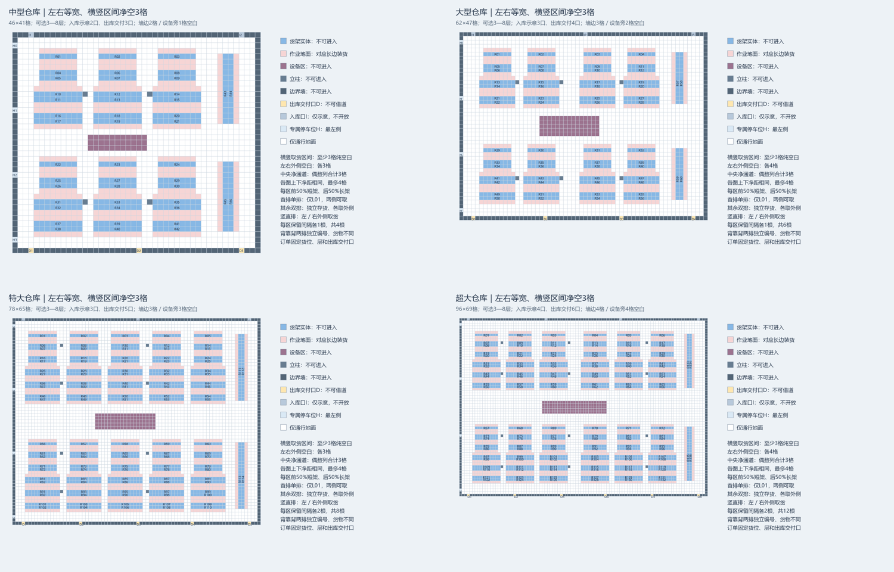

# V6/V9 立体货架集成与有限待命实验报告

本阶段审核了队友提交的 V6 与 V9 建模方案，采用最新的 `mixed-v9` 作为独立场景入口（V6 的单排/背靠背双排、横竖混排与货位层数概念已完整融入 V9）。旧版 V4 与历史实验归档保持不变，新旧模型分别独立维护与评估。

**核心结论**：
- V9 的横竖混合货架、单排双侧取货与显式选侧接口均已稳定接入，并修复了原包中的未来信息读取与验解漏洞。
- **有限待命（8 步）** 能够平均减少 1.302% 的空驶里程，但在 30 个留出场景上综合分数 `F` 平均仅改善 **0.121%**（95% 区间 `[−0.040%, 0.282%]` 跨零），因此作为实验选项保留，默认维持“可中途接单返库”。
- **BCRD（返库模式）** 在 V9 静态积压场景依然表现出稳定收益：中型静态积压平均 `F` 改善 **2.283%**，超大 8 层稠密场景改善 **2.111%**。两套机制本轮各自独立验证。



上图展示了 V9 四档教学仿真仓库布局，集成后的生成器在 39 组基准配置上与队友 V9 源包逐项哈希一致，核对记录见 [来源审计](../results/v9/source-review.json)。

## 1. 集成的建模特性与接口

| 特性 | 模块位置 | 建模定义与实现要点 |
|---|---|---|
| 横竖混合布局、短长架对齐、净空与稀疏立柱 | `warehouse/mixed.py` | 支持四档尺寸：46×41、62×47、78×65、96×69（默认作业通道宽 2 格）及固定设备与立柱 |
| 单排双侧取货 | catalog `loading_points` | 同一货位共享唯一库存身份与资源锁，单排固定 1 层，两辆车不可并发取同一货位 |
| 背靠背独立双排 | 横向 U/D、竖向 L/R | 每排仅从各自外侧取货，支持 3–8 层，装货耗时 `2×层号` |
| 显式选侧派单 | `Environment.assign([(vehicle, task, pickup_point)])` | 兼容原有二元组自动选侧；三元组先整批校验合法性再调用真实规划器 |
| 有限安全待命 | `dispatch/idle.py` | 卸货退出至普通通行地面后，在有限额度内按步延迟安全返程，逐拍核查预约冲突 |
| 独立 profile 与评分体系 | `domain.py`、`io/scenes.py`、`objective.py` | 标识为 `agv-scene-v9` 与 `mixed-v9-reviewed-v1`，在同一新场景上独立计算固定返库参考 |

核心包继续保持零第三方依赖。加载 V9 场景时，系统会将嵌套货位目录、设施与元数据与对应规格的规范几何逐项比对，确保输入几何与声明规则严格一致。

## 2. 原包审核发现与关键修复

队友 V6 原包 50 项测试与 V9 原包 79 项测试在隔离副本上全部通过，且 39 组 V9 场景（4 尺寸 × 3 通道宽 × 3 变体 = 36 组，另含 3 组 8 层动态场景）与本项目生成器哈希完全匹配。代码审核进一步排查并修复了以下边界问题：

- **严格输入校验**：V6 原包允许未知目录字段、矛盾规则名、布尔层数、浮点几何与超限车数；新 `v9` profile 通过规范几何与精确 JSON 类型检查统一拦截。
- **消除未来信息依赖**：V9 原版自动待命读取了完整任务总数以判断“后续是否还有订单”。改造后的待命控制器完全屏蔽任务总数、未来释放时刻与未来目的地，仅按固定可见额度运行。
- **明确待命区域规则**：改造为仅依据 V9 显式静态普通通行地面判定合法待命区，与订单流彻底解耦。
- **补全最终返库验解**：修复原版重规划/评价接口允许伪造最终 `return_end`（车仍在 D 站却标记已返 H）的漏洞，改为核验最后一次有效返库事件与真实轨迹的一致性，同时兼容被后续订单打断的历史返程。
- **延续交付退出修复**：保留本项目在 D 站出口受阻时的延迟到达重试机制与冻结承诺验证，防止 V4 阶段已修复的反例回归。

## 3. 有限待命的公平对照设计

对照基线“返库”允许车辆在回库途中随时接单改道，无需先抵达停车位 `H`。有限待命仅改变车辆无单时的空载停留策略，保持原有任务归属、服务连续性、D 站禁用与避碰约束。

具体执行逻辑如下：每辆车每次接单后重置有限待命额度；卸货并退出到普通通行地面后，每步尝试原地停留 1 拍并将完整安全返程后缀整体后移 1 拍。若与任意既有顶点或逆向边预约冲突，则放弃停留并沿原安全返程继续行驶；额度耗尽后直接返库。最后一张订单同样遵守这一固定额度，严格遵守在线信息边界。待命步数单独记录为 `standby_steps`，与交通避让等待区分统计；总里程 `D` 计入全部实际移动，能耗代理仍为 `0.05×D`。

BCRD 在 V9 中支持返库模式并复用原有冻结参数；待命与 BCRD 组合需要影子环境同步恢复已消耗待命额度，本轮分开独立验证。

## 4. 实验设计与参数冻结

本轮实验分开发调参、留出检验与尺寸/层数泛化三阶段严格隔离：
- **开发集（种子 10–12）**：3 模板 × 4 档待命额度（0 / 8 / 16 / 32）= 36 次。综合收益与稳定性选定 **8 步**：9 场景取得 6 胜 / 0 负 / 3 平，平均 `F` 改善 **0.626%**，`CPU/G0` 为 1.020（16 步平均 +0.666% 但有 1 负且 CPU 升至 1.043；32 步降至 +0.396% 且 2 负）。选定后即冻结参数。
- **留出集（种子 30–39）**：3 模板 × 10 种子 × 3 策略 = 90 次。
- **尺寸/层数泛化集（种子 60–62）**：特大稀疏 8 层与超大稠密 8 层 2 模板 × 3 种子 × 3 策略 = 18 次。

全轮合计 **144 次执行、45 个独立场景（其中 36 个为未见质量场景）**，全部完成并通过独立验解：

| 模板 | 地图 / 车辆 / 订单 | 合成到达过程 |
|---|---|---|
| `dense_static` | 中型，4 车 12 单 | 全部 `t = 0` 发布 |
| `sparse_uniform` | 中型，4 车 12 单 | 均匀间隔放大 16 倍，每 80 步发布 1 单 |
| `large_sparse_switch` | 大型，4 车 12 单，共享 D、热点切换 | 间隔放大 12 倍（12–108 步） |
| `xlarge_sparse_8layers` | 特大，4 车 12 单，双排 8 层 | 每 80 步发布 1 单 |
| `xxlarge_dense_8layers` | 超大，6 车 18 单，双排 8 层 | 全部 `t = 0` 发布 |

三种对比策略（`G0` 返库贪心、`wait8` 8 步待命、`G2` 返库 BCRD）均采用相同 SIPP 后端与无联合修复；`G2` 直接沿用 V4 阶段冻结的四候选、队列比例 3 与 `480 / 120000 / 2400` 预算，未针对 V9 重新调参。开发与正式测量源码分别冻结在 `d6b713e` 与 `bb3b0f5`，计时仅包含算法主体运行，并按场景轮换策略顺序。原始数据与轨迹见 [结果目录](../results/v9/)。

## 5. 留出与泛化实测效果

下表为两种候选策略各自相对 `G0` 的逐场景配对 `F` 改善均值（正值为改善）：

| 工况 | 场景数 `n` | 待命 8 步：`F` 改善 | BCRD 返库：`F` 改善 |
|---|---:|---:|---:|
| 中型静态积压 | 10 | 0.119% | **2.283%** |
| 中型稀疏均匀 | 10 | 0.257% | 0.000% |
| 大型稀疏热点切换 | 10 | **−0.012%** | 0.000% |
| **留出合计** | **30** | **0.121%** | **0.761%** |
| 特大稀疏 8 层 | 3 | 0.915% | 0.000% |
| 超大稠密 8 层 | 3 | 0.000% | 2.111% |
| **尺寸/层数泛化合计** | **6** | **0.458%** | **1.055%** |

| 留出合计（30 场景）指标与开销 | 待命 8 步 | BCRD 返库 |
|---|---:|---:|
| `F` 改善 95% 配对 bootstrap 区间 | **[−0.040%, 0.282%]** | [0.090%, 1.689%] |
| `F` 胜 / 负 / 平 | 13 / 7 / 10 | 5 / 0 / 25 |
| P90 响应变差场景数 | 2 / 30 | 3 / 30 |
| 最坏响应变差场景数 | 1 / 30 | 0 / 30 |
| `CPU / G0` | 1.000 | 1.124 |
| 完整成功且独立验解通过 | 30 / 30 | 30 / 30 |

在 6 个泛化场景上，待命与 BCRD 均取得 3 胜 / 0 负 / 3 平，`CPU/G0` 分别为 1.015 与 1.164。整体来看：
- **待命 8 步**：留出集 95% 区间跨零并有 7 例退化，开发集的 0.626% 收益在未见种子上明显衰减，说明固定时长原地待命对到达模式与空间分布高度敏感。
- **BCRD 返库**：在中型静态积压（95% 区间 `[0.400%, 4.666%]`，5 胜 0 负 5 平）与超大 8 层稠密场景中收益稳定；在稀疏场景因队列压力低而自动回退至 `G0`，体现出“按工况特征触发机制”的清晰边界。

## 6. 机制拆解：空载、响应与 D 邻域占用

[分项指标重算](../results/v9/holdout-effects.json) 显示，待命 8 步在 30 个留出场景中平均减少总移动 **0.796%**、减少空载移动 **1.302%**，但同时平均订单响应相对变差 **0.181%**、最终返库完成时刻 `B` 平均延后 **7.7 步**，全场交通等待微增 0.067 步：
- 在稀疏均匀组中，空载减少 2.668%，平均响应变差 0.230%；
- 在大型共享 D/热点切换组中，空载减少 1.071%，平均响应变差 0.349%，综合 `F` 略降（−0.012%）。

原因在于车辆停留在 D 站附近虽然减少了当下回库距离，但当下一单的货架位置更靠近停车区 `H` 或热点切换至另一侧时，原地停留反而不如提前向 `H` 方向移动的车辆响应快，同时会改变后续贪心派单的车辆匹配组合。此外，首种子统计显示稀疏均匀 seed 30 中 D 站 L1 距离 1–2 格邻域的占用采样从 75 增至 169（其中 96 次来自待命，该邻域交通等待为 0），提示高负载下需进一步关注 D 站周边的待命选点设计。

## 7. 典型正反案例回放

**[待命负例回放](../results/v9/standby-replay.html)**（稀疏均匀留出首种子 30）：

| 指标 | 返库 G0 | 待命 8 步 |
|---|---:|---:|
| `T`（最后卸货） | 924 | 934 |
| `R`（平均响应） | 58.167 | 58.917 |
| 总移动 `D` | 1034 | 1044 |
| 空载移动 | 687 | 695 |
| 最终结束 `B` | 961 | 991 |
| 综合分数 `F` | 1.000000 | 1.011214 |

该例中，任务 2 因换车提前 5 步交付，但任务 11 从车辆 2 改派给车辆 1 且单排取货侧由 `(18,25)` 变为 `(18,23)`，导致最后一单晚完成 10 步（三项贡献为 `T +0.005411`、`R +0.003868`、`D +0.001934`，合计 `F +0.011214`），清晰展现了局部空驶节省被后续匹配连锁变化抵消的过程。

**[BCRD 正例回放](../results/v9/bcrd-replay.html)**（超大 8 层模板首种子 60）：BCRD 在大规模深层积压下将 `F` 从 `1.000000` 降至 `0.988207`，直观展示了有序批次试算在深层静态场景下的改善效果。

## 8. 选型建议与复现验证

- **默认策略**：保留“可中途接单返库”作为 V9 默认行为；待命 8 步作为显式实验选项提供。
- **积压场景**：可在存在明显待派积压时启用 `bcrd_budget`，同时关注其 P90 尾部指标与综合 `F` 的权衡。
- **下一步研究方向**：比起延长固定待命时长，更值得优先研究基于可见需求热度与通道重要性的**安全待命选点**（即后续 V9.1 的核心工作）。
- **验证与复现**：全项目 **186 项**单元/集成测试通过，wheel `0.5.0` 包外安装核验通过；三个实验目录共 144 行数据与 27 份精选轨迹均通过 [独立审计](../results/v9/verification.json)。

```bash
python -m pip install -e '.[dev]'
agv run --profile v9 --tasks 12 --vehicles 4 --algorithm sipp_greedy_dispatch --output runs/v9-return.json
agv run --profile v9 --tasks 12 --vehicles 4 --algorithm sipp_standby8_dispatch --output runs/v9-wait8.json
agv run --input examples/scenarios/v9-medium-dynamic.json --algorithm bcrd_budget --output runs/v9-bcrd.json
agv benchmark-bcrd --protocol examples/experiments/v9-idle-holdout.json --output runs/v9-holdout-new
agv benchmark-bcrd --protocol examples/experiments/v9-idle-generalization.json --output runs/v9-generalization-new
python scripts/verify_bcrd.py results/v9/development --revision d6b713e
python scripts/verify_bcrd.py results/v9/holdout --revision bb3b0f5
python scripts/verify_bcrd.py results/v9/generalization --revision bb3b0f5
python scripts/summarize_v9.py results/v9/holdout --output runs/v9-effects-new.json
python scripts/verify_v4.py --source-revision 8551943 --output runs/v4-audit-new.json
agv serve
```

注：V9 默认中型、双排 3 层（支持 `--layers 8`，单排固定 1 层）；不同模型几何与参考分母的综合分数 `F` 各自独立评估。
