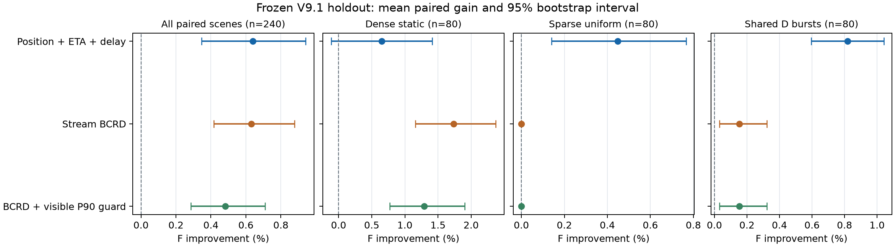

# V9.1 调度与待命优化：实现、消融与留出评估

日期：2026-10-17 · Python 包版本 `0.6.0`（基于上游 `e53bf95` 的 V9.1 真实订单流合同）

本阶段围绕 V9.1 规则开展了系统性的分阶段优化与评估：先构建松弛下界与配对基准工具，再依次实现**安全待命选点（Positioning）**、**SIPP ETA 矩形匹配与有限延迟（Matching + Delay）**、**订单流语义 BCRD 与预测 P90 尾部保护**，并在 240 个全新未见种子上完成了 960 次冻结留出实验。

**核心实测结论**（960/960 全部完成并通过独立验解）：
- **`G4`（选点 + ETA 匹配 + 有限延迟）**：平均综合分数 `F` 改善 **+0.640%**（95% 区间 `[0.347%, 0.942%]`，154 胜 / 55 负 / 31 平），在稀疏与共享 D 站批次场景表现突出，但也存在 67/240 例 P90 退化与交通等待微增。
- **`B0`（流式 BCRD）**：平均 `F` 改善 **+0.630%**（95% 区间 `[0.416%, 0.879%]`），在密集静态场景改善达 **+1.738%**，伴随 13/240 例 P90 退化。
- **`B1`（流式 BCRD + 预测 P90 保护）**：平均 `F` 改善 **+0.481%**（95% 区间 `[0.286%, 0.709%]`），将实际 P90 退化例数由 **13/240 降至 0/240**，清晰验证了综合收益与尾部稳定性之间的可控权衡。
- 鉴于各策略在不同工况下各有优势且默认策略更为轻稳，本版保留 `sipp_stream_dispatch` 为默认入口，将上述新策略作为显式可选算法提供。

## 1. 分阶段实现概览

| 阶段 | 本轮核心实现 | 设计范围与取舍 |
|---|---|---|
| Stage 0：基准与下界 | `benchmark-v91`、固定协议、源码/输入哈希、独立验解、T/R/D/F 松弛下界与 bootstrap 区间 | 下界专用于离线诊断，与在线策略完全隔离 |
| Stage 1：安全选点待命 | Tarjan 割点/窄道/业务入口过滤、历史取货热度、区域容量上限、最小费用分配、迟滞与原子可中断重定位 | 通过静态图安全过滤与真实预约冲突拒绝实现防阻塞，保持轻量高效 |
| Stage 2：ETA 派单与延迟 | 基于真实 SIPP 完成时刻的矩形匹配、即将完工忙车预测、最多 16 步主动延迟、有单优先派单 | 单对 ETA 独立估算后顺序原子提交，保持低计算开销 |
| Stage 3：流式 BCRD 与 P90 保护 | 完整 open/closed 订单流影子状态、已发布订单 rollout、历史响应合并、可见 P90 保护约束 | 与定位机制各自独立验证，聚焦单变量因果清晰性 |
| Stage 4：窗口联合重排 | 本轮暂缓启用 | 开发集基线平均交通等待仅 1.36 步（总移动 1,466.67 格），当前负载下优先投入决策层优化更具性价比 |

所有新策略均通过独立算法名显式调用，完整遵守 V9.1 货位身份、层序、选侧、专属 `H` 与严格 `D` 站合同，并完整记录所有实际空驶、重定位、等待与最终返库轨迹。

## 2. 核心算法机制与模块分工

整个执行链路清晰分层：`simulation.py` 维护唯一真实状态并向策略提供深拷贝 `observe()`；`dispatch/stream.py` 负责 ETA 派单与短暂延迟决策；`dispatch/positioning.py` 负责空闲车辆热度选点；`planning/reposition.py` 负责重定位外出段与兜底返库后缀的原子规划；`evaluation/validation.py` 从轨迹独立核验全部业务合同。

### 2.1 安全待命选点与主动重定位

- **静态安全候选过滤**：在地图初始化阶段排除 `H`、`D`、装卸作业格、业务入口邻格、迭代版 Tarjan 割点及度数不超过 2 的窄通道格，优先保障主干道与关键节点畅通。
- **历史取货热度估计**：仅基于已观察到的历史订单取货点累计热度（每单计一次，双侧均分），按时间指数衰减 `exp(-age/200)`、空间曼哈顿核 `exp(-L1/18)` 扩散，每 10 步或有车新空闲时触发评估。尚无历史订单时，保持初始 `H` 中车辆原地不动。
- **区域容量与最小费用分配**：候选代价定义为 `distance - 32 × normalized_heat + switch_penalty`（实际距离采用含障碍静态最短路，切换惩罚为 3）；按最近 `D` 站分区，每区最多分配 2 个共享停车目标，同时保留有效旧目标与返回自身 `H` 的选项，通过纯 Python 矩形 Hungarian 算法完成全局分配。
- **原子可中断执行**：`Environment.reposition(vehicle, target)` 同步规划 SIPP 外出段与完整返 `H` 兜底后缀，全部检验通过后原子提交；新单随时可从当前实际位置打断空驶段，目标点停留每步核查同伴预约，冲突时无缝沿兜底返程让行。

### 2.2 SIPP ETA 矩形匹配与有限主动延迟

对每个“可用车辆—可派订单”组合，使用真实 SIPP（考虑合法停靠侧、连续服务及同伴已有预约）估算交付完成时刻，以预计订单响应时间减去小幅订单年龄奖励构建匹配代价，用矩形 Hungarian 求解当轮配对。

当存在即将于 16 步内完成当前服务的忙车，且等待该车接单的预计交付时刻比当前可用车提前超过 3 步、同时该订单年龄小于 16 步时，策略可暂缓绑定并在下一步重新评估（超过 16 步即停止主动延期）。该阈值限定策略的主动等待窗口，实际总派单等待仍取决于整体车队负载与预约冲突情况。有可派订单时优先执行派单，不与待命选点并发执行。

### 2.3 流式 BCRD 与预测 P90 尾部保护

针对 V9.1 订单流特性，影子环境完整重建当前可见待办、忙车承诺、等待历史与流关闭状态：当订单流仍开放时，rollout 仅预测当前已发布订单完工，不虚构关闭事件与提前最终返库；当流已关闭时，则按最终全车返库合同完整评估。

预算沿用冻结配置（可派订单数 ≥ 3 × 可用车数时触发、最多 4 个候选批次、`480` 次路由调用 / `120,000` 次扩展软上限 / `2,400` 步预览上限），异常或超限时自动回退贪心方案。

在此基础上，`sipp_stream_bcrd_tail`（`B1`）将已完成订单的历史响应与影子预测剩余响应合并计算完整 P90，要求候选批次的预测 P90 不劣于当轮贪心预测 P90，从源头过滤以牺牲尾部体验换取 `T` 缩短的激进批次。

## 3. 实验设计与结果分析

实验沿用固定综合目标 `F = 0.5 T/Tref + 0.3 R/Rref + 0.2 D/Dref`（每场景以同规则 A* 距离贪心为固定离线分母），逐场景计算改善率 `100 × (1 - F_candidate / F_baseline)` 后取平均，并同步统计 P90 与本机 CPU 开销：

| 批次 | 实验规模 | 用途与冻结快照 |
|---|---|---|
| Stage 0 | 4 尺寸 × 3 工况 × 3 种子 × 2 基线（A*/SIPP）= 72 次 | 工具校验、松弛下界与基线等价核查，`73c56b9` |
| Development | 同 36 场景（种子 10–12）× 7 策略 = 252 次 | 单因素消融与最终候选筛选，`689735f` |
| Holdout | 4 尺寸 × 3 工况 × 20 新种子（200–219）× 4 策略 = 960 次 | 冻结参数与源码后的独立留出验证，`ace242e` |

场景均采用 V9.1 四档尺寸（medium / large / xlarge / xxlarge）、4 车 12 单、双排 3 层、作业宽 2、固定立柱与设备，涵盖密集静态、稀疏均匀（发布间隔放大 20 倍）与共享 D 站突发（放大 8 倍）三类合成工况；同版本基准统一为当前 V9.1 默认策略 `G0`（`sipp_stream_dispatch`）。

### 3.1 开发集单因素消融（36 场景）

相对 `G0` 的平均 `F` 收益与逐项分解（用于开发选型）：

| 策略 | 平均 `F` 收益 | 配对 95% 区间 | 胜 / 负 / 平 | P90 变差数 |
|---|---:|---:|---:|---:|
| `G1`：仅 ETA 匹配 | +0.469% | [0.071%, 0.990%] | 12 / 4 / 20 | 8 |
| `G2`：仅安全选点 | +0.347% | [-0.003%, 0.707%] | 17 / 7 / 12 | 1 |
| `G3`：选点 + 匹配 | +0.844% | [0.316%, 1.421%] | 23 / 7 / 6 | 8 |
| `G4`：选点 + 匹配 + 延迟 | +0.942% | [0.441%, 1.508%] | 24 / 6 / 6 | 8 |
| `B0`：流式 BCRD | +0.795% | [0.121%, 1.646%] | 6 / 1 / 29 | 0 |
| `B1`：BCRD + 预测 P90 保护 | +0.795% | [0.121%, 1.646%] | 6 / 1 / 29 | 0 |

分项贡献分解显示：`G2` 贡献为 `T +0.200`、`R +0.376`、`D -0.230` 个百分点（提前就位缩短响应，但增加少量空驶）；`G4` 提升至 `T +0.572`、`R +0.480`、`D -0.110`；`B0` 则为 `T +0.620`、`R +0.027`、`D +0.148`。连续递进增益为 `G2→G3` +0.498%、`G3→G4` +0.098%。首种子保留的 12 份 `G4` 轨迹共触发 118 次重定位与 32 次延迟检查，12 份 `B1` 轨迹拦截了 2 个高尾部风险候选。据此选定 `G4`、`B0`、`B1` 进入冻结留出测试。

### 3.2 冻结留出结果（240 新场景，960 次运行）

全部 960/960 次运行完整有效，零验解与下界异常。相对 `G0` 的总体与分工况表现如下：

| 策略 | 平均 `F` 收益 | 配对 95% 区间 | 胜 / 负 / 平 | P90 变差数 | 本机平均 CPU 比 / G0 |
|---|---:|---:|---:|---:|---:|
| `G4`：选点 + 匹配 + 延迟 | +0.640% | [0.347%, 0.942%] | 154 / 55 / 31 | 67 / 240 | 1.125 |
| `B0`：流式 BCRD | +0.630% | [0.416%, 0.879%] | 43 / 1 / 196 | 13 / 240 | 1.192 |
| `B1`：BCRD + 预测 P90 保护 | +0.481% | [0.286%, 0.709%] | 31 / 1 / 208 | 0 / 240 | 1.192 |

| 工况（各 80 场景） | `G4` `F` 收益与 95% 区间 | `B0` `F` 收益与 95% 区间 | `B1` `F` 收益与 95% 区间 |
|---|---:|---:|---:|
| 密集静态 | +0.652% [-0.112%, 1.412%] | +1.738% [1.159%, 2.372%] | +1.292% [0.770%, 1.904%] |
| 稀疏 uniform | +0.448% [0.141%, 0.766%] | 0 | 0 |
| 共享 D burst | +0.820% [0.596%, 1.042%] | +0.152% [0.030%, 0.324%] | +0.152% [0.030%, 0.324%] |



**关键指标分解与权衡**：
- **目标分解**：`G4` 的总体贡献为 `T +0.421`、`R +0.301`、`D -0.082` 个百分点（最差单场景退化 10.670%）；`B0` 为 `T +0.654`、`R -0.127`、`D +0.103`（主要压缩完工时间 `T`）；`B1` 为 `T +0.469`、`R -0.079`、`D +0.091`（`B0/B1` 最差单场景退化 0.280%）。
- **尾部保护效果**：在 240 个配对场景上，`B1` 相对 `B0` 平均让渡了 **0.156%** 的综合 `F`（95% 区间 `[-0.269%, -0.066%]`，变化全部集中于密集静态组），换来实际 P90 退化例数从 **13 例清零至 0 例**。
- **交通等待变化**：`G0` 平均交通等待为 1.0875 步，`G4`、`B0`、`B1` 分别增加 0.2125、0.1708 与 0.0958 步，绝对增幅很小但未实现交通等待零增长。

### 3.3 按场景选型建议

- **密集静态且注重尾部服务质量**：优先选择 `B1`（`sipp_stream_bcrd_tail`），密集静态平均改善 1.292%，在当前留出样本中实现零 P90 退化（本机 CPU 比约 1.53）。
- **密集积压且优先追求综合 `F`**：选择 `B0`（`sipp_stream_bcrd`），平均收益最高，需接受少量 P90 权衡。
- **稀疏到达或共享 D 站批次**：选择 `G4`（`sipp_position_delay_dispatch`），通过主动靠近热点与 ETA 匹配获得明显响应收益。
- **低计算预算或作为稳定基线**：保持默认 `G0`（`sipp_stream_dispatch`）。

### 3.4 三个典型机制回放（首种子 200）

1. **[共享 D 站正例](../results/v91/position-positive-replay.html)**（medium 共享批次）：`G0 → G4` 使 `T` 从 415 降至 404、`R` 从 93.167 降至 91.000、`P90` 从 156 降至 155、`D` 从 998 微增至 1002，综合 `F` 改善 **1.943%**。过程中触发 6 次重定位（无主动延迟），由选点与匹配协同将任务 10 与任务 11 分别提前 11 步完成。
2. **[ETA 匹配负例](../results/v91/matching-negative-replay.html)**（large 静态）：`F` 退化 **3.776%**（`T` 329→351、`R` 185.417→188.083、`P90` 315→329、`D` 持平 1448、交通等待反从 4 降至 0）。未触发定位与延迟，仅因时刻 77 车辆 2 改接任务 8 打乱了后续任务链，导致任务 1 完工由 315 推迟至 351，直观说明单步近视最优与长链条全局衔接的差异。
3. **[P90 保护取舍](../results/v91/tail-guard-replay.html)**（medium 静态）：`B0` 选用 `oldest` 批次（预测 P90 = 213）；`B1` 因 213 超过贪心预测 211 而改选 `longest`（预测 P90 = 196）。最终实际 P90 由 213 降至 **196**、`T` 由 242 降至 227，而 `R` 由 132.167 升至 140.083、`D` 由 832 增至 888，`F` 仅由 `0.973335` 微升至 `0.976627`，清晰呈现尾部保护机制的预期权衡。

## 4. 松弛下界与工程性能优化

为科学诊断优化空间，本阶段推导并实现了针对多 `H`、双侧取货与离散服务的可证松弛下界（含独立任务时间界、开放链工作量界与闭合完美指派移动界，详细证明见 [V9.1 可证下界与待命选点研究](research/v91-bounds-positioning.md)）。Stage 0 中 SIPP 基线相对松弛下界的平均差距为：**`T` 28.14%、`R` 72.65%、`D` 25.11%、`F` 36.79%**。由于下界放松了避碰、层序与多车一致性约束，该差距代表理论松弛上界；结合基线交通等待很低（约 1 步）的事实，这一诊断直接支持了本轮优先优化派单与待命选点的决策方向。

工程性能方面，针对原有 `hold_return` 每步全量扫描全车路径的开销，新增了按网格索引的候选车辆结构（显式保留逆向边与最终静止尾部），使索引自身在待命延期时的更新达到 `O(1)`，并在 `reset()` 阶段缓存静态公共地图（`observe()` 仍保持深拷贝隔离）。Stage 0 与 Development 的 36 份 `G0` 质量结果逐项一致；48 次索引与暴力扫描的差分对照完全一致；在 8 种模板的完整 raw 计时中，7 种模板的索引/暴力中位 CPU 比为 `0.961–1.005`，第 8 种受本机负载抖动影响测得 `1.618`（单次 `observe` 微测缓存比约为 `0.59–0.61`）。

**文献借鉴**：选点过滤借鉴了 [Ma 等（AAMAS 2017）](https://jiaoyangli.me/files/2017-AAMAS.pdf) 非阻塞端点的思想，移动下界证明思路借鉴了 [Treleaven 等（TAC 2013）](https://stanfordasl.github.io/wp-content/papercite-data/pdf/Treleaven.Pavone.ea.TAC13.pdf) 的匹配映射框架；后续高拥堵负载下的窗口联合重排可进一步参考 [RHCR](https://github.com/Jiaoyang-Li/RHCR)。

## 5. 发布前验证与复现命令

冻结留出后，提交 `32a6797` 修复了车辆已在自身 `H` 时重复请求返 `H` 导致历史记录延后的边界问题，以及 Web 界面新策略摘要显示异常的问题。修复后验证结果如下：
- 全部 **251 项**单元测试通过（耗时 150.033 秒），`ruff` 与前端 JS 语法检查通过。
- `0.6.0` wheel 在全新虚拟环境包外安装运行 `G4`/`B1` 并独立验解通过，浏览器端实测 `G4` 2 车 4 单动态场景完整交付返库且摘要正确显示。
- 将冻结留出的全部 **48 份代表轨迹** 用当前源码完整重跑，剔除计时字段后，全部路径、指标与派单日志 **48/48 逐项严格一致**（记录见 [`release-replay.json`](../results/v91/release-replay.json)）。

完整归档结构与审计说明见 [`results/v91/README.md`](../results/v91/README.md)。复现命令如下（使用全新输出目录）：

```bash
agv benchmark-v91 --protocol examples/experiments/v91-stage0.json --output runs/re-stage0 --workers 4
agv benchmark-v91 --protocol examples/experiments/v91-development.json --output runs/re-dev --workers 4
agv benchmark-v91 --protocol examples/experiments/v91-holdout.json --output runs/re-holdout --workers 4
python scripts/verify_v91.py runs/re-holdout
python scripts/analyze_v91.py runs/re-holdout --output runs/re-holdout-effects.json
python scripts/benchmark_standby_index.py --output runs/re-index.json
python scripts/verify_v91_release.py runs/v91-evidence/holdout --output runs/release-replay.json --workers 4
# 可选绘图依赖
python -m pip install -e '.[plots]'
python scripts/plot_v91.py results/v91/holdout-effects.json --output runs/holdout-effects.png
```
