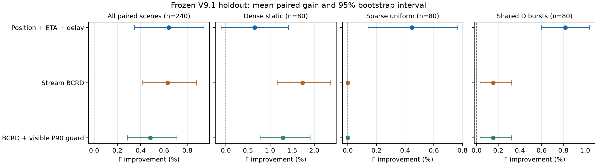

# V9.1 调度与待命优化：实现、对照与边界

2026-10-17，Python 包0.6.0。基于仓库上游 `e53bf95` 的真实订单流合同，按用户截图提出的顺序实现、消融和验证。截图中的性能百分比是待验证建议；本报告只把本次实际运行作为新版本的效果依据。

960次新种子留出运行全部完成并通过验解。G4平均F改善0.640%，流式BCRD改善0.630%；加入预测P90保护后F改善0.481%，实际P90变差场景由13/240降至0/240。保护的代价是放弃部分综合收益。G4仍有55例F退化、67例P90变差，交通等待也小幅增加；本轮不改默认策略，按负载和尾部偏好提供显式可选入口。

## 做了什么

| 建议阶段 | 本轮实现 | 有意保留的边界 |
|---|---|---|
| 0：先能测 | `benchmark-v91`、固定协议、同场景配对、源码和输入哈希、独立验解、T/R/D/F松弛下界、bootstrap区间 | 离线下界不进入在线策略；差距不等于可实现收益 |
| 1：选点再停 | 割点/窄道/业务入口过滤、历史取货热度、区域容量、最小费用分配、迟滞、原子可中断重定位 | 未实现“对每个阻挡点再算无车反事实绕行是否超过7步”的主动疏散；目前靠候选过滤与真实预约冲突拒绝 |
| 2：改进派单 | SIPP完成时间的矩形匹配；即将完成车辆的可见路线预测；最多16步的主动延迟；有可派订单时优先派单 | ETA分别估算，实际批次仍顺序原子提交；没有全车队联合优化承诺 |
| 3：BCRD与尾部 | 真实open/closed流影子状态、已发布订单rollout、历史响应合并、可见P90不劣于贪心的候选约束 | 与定位机制分别验证，尚未提供组合入口；未来订单可能改变实际P90 |
| 4：窗口联合重排 | 本轮未启用 | 当前开发模板中基线平均交通等待仅1.36步、移动1466.67格，暂不支持优先投入大规模联合重排 |

所有新机制通过新算法名显式启用，默认 `sipp_stream_dispatch` 保持。库存身份、层序、取货侧、专属H和卸货业务规则保持现有合同。每份正式结果包含所有实际空驶、定位、等待与最终返H轨迹。

## 从运货全流程解释接口

在线发布器发布订单 → 观察已发布待办及车辆已提交路线 → 选择车辆与订单 → 规划空载到合法取货侧 → 连续装货 → 载货到D → 连续卸货 → 空闲车接新单或重定位/待命 → 发布器明确关闭且已发布订单全完成 → 最终回自己的H。

`simulation.py` 是唯一真实执行状态；策略只能消费脱离环境的 `observe()`。新 `dispatch/stream.py` 决定派谁、是否短暂等待；`dispatch/positioning.py` 决定空闲车去哪里；`planning/reposition.py` 负责完整路线的原子合法性；`evaluation/validation.py` 从真实轨迹独立核对动作、装卸、任务身份、计账和最终返库。下界与归一化分母只在离线评分阶段计算。

### 安全待命位置

每张静态地图预计算普通通行候选，排除H、D、装卸作业格、业务入口邻格、Tarjan割点及度不超过2的通道格。Tarjan采用迭代实现，避免大图递归深度问题。该过滤只解决一部分明显阻塞，不能推出MAPD完备性。

需求历史只累计已经实际观察到的取货点，同一订单只加入一次，双侧候选均分质量。权重随时间按 `exp(-age/200)` 衰减；每10步或有车辆新空闲时考虑重定位。热度扩散采用曼哈顿核 `exp(-L1/18)`，实际移动费用使用有障碍静态图最短距离。与截图建议相比，本轮只使用取货热度，没有额外叠加卸货热度；热度不是未来需求预测模型。

候选费用为 `distance - 32 × normalized_heat + switch_penalty`，切换惩罚3。每个按最近D划分的区域最多2个共享停车目标，保留有效旧目标，并允许回自己的H；其他车辆H不可选。由无依赖矩形Hungarian匹配分配。普通出口上碰巧停下的位置不能作为合法的隐式“原地不动”选项，只有安全候选位置或自己的H可以保留。尚无需求历史时不把初始H中的车辆盲目开出去。

`Environment.reposition(vehicle,target)` 先构造SIPP外出段和完整返H后缀，全部检查通过后才提交。新单可从当前实际位置打断空载段，已经承诺的装卸与载货服务不可撤销。目标点等待每一步都检查同伴预约；如果不能安全延长，沿已审定返程继续行驶。这里没有固定TTL，也没有通过偷看未来订单决定何时停止。

### ETA匹配与有限延迟

每个可用车辆—可派订单组合用真实SIPP估计交付完成时刻，包括取货侧、连续服务和同伴已有预约，再以预计flow time减去小幅订单年龄奖励作为匹配费用。D当前占用已经体现在预约中，没有额外添加旧规则的服务窗口或层序锁。

延迟机制只看已提交服务即将在16步内完成的忙车。如果等它完成后的预测交付比现在可用车更快超过3步，且该订单年龄小于16步，本轮可以暂不绑定。每步重新评估，到16步停止这种主动延期。**16步仅限制策略主动延迟，不保证实际派单等待或订单响应不超过16步**，冲突与车辆不足仍可能导致更长等待。

有可派订单时先派单，不同时进行待命选点。ETA估计和真实提交均有预约校验，但各配对单独估算不能预先包含整个新批次的互相影响。延迟也没有提前给忙车绑定新单，同一辆即将空闲的车可能同时成为多个订单的乐观估计对象，之后仍需重新竞争；这是短视预测会退化的一种机制边界。实现没有修改已绑定订单，也没有使用未来释放表。

### BCRD的订单流语义与P90保护

原影子仿真把“当前待办为空”视为结束会错误计入提前返库。本轮从观察重建可见待办、忙车承诺、等待历史与关闭状态；流仍开放时，只预测已发布订单完成，不虚构关闭事件，不把尚未执行的最终返H当作已产生移动。流关闭后按实际最终返库合同预测。

沿用积压门槛（可派订单数至少是可用车数的3倍）、最多4批次和480次route调用/120000次展开/2400步预算。复杂候选被拒绝或预算耗尽时保留贪心方案。展开和调用预算在候选边界检查，属于软预算，单次规划可能超过剩余额度；不宣称硬实时上限。

`sipp_stream_bcrd_tail` 在相同候选、目标权重与预算下，加上可见rollout的P90不超过当轮贪心预测P90的约束。已完成订单的历史flow time纳入分位数，避免只看剩余订单而扭曲尾部。它约束的是预测候选，未知后续订单与实际预约变化会影响整段执行，不能据此宣称真实P90绝不退化。

## 实验设计与来源

目标仍为 `F = 0.5 T/Tref + 0.3 R/Rref + 0.2 D/Dref`，越低越好。T是最后交付时刻，R是平均订单交付减发布时间，D是全程移动格数。50/30/20是项目偏好权重，不是从数据估计出的因素影响比重；P90不属于F，另外作为尾部指标和预测保护条件。每场景既有A*距离贪心产生固定离线分母，不进入观察。比较收益逐场景算 `100 × (1 - Fcandidate/Fbaseline)` 后求平均；不同版本/不同分母的F不合并。

| 批次 | 输入与规模 | 作用与测量源码 |
|---|---|---|
| Stage0 | 4尺寸 × 3工况 × 3种子 × A*/SIPP两入口 = 72次 | 工具、下界与基线核查，`73c56b9` |
| Development | 同36场景 × 7策略 = 252次 | 单因素消融与候选筛选，`689735f` |
| Holdout | 4尺寸 × 3工况 × 20新种子 × 4冻结策略 = 960次 | 未见种子200—219，协议与源码在 `ace242e` 冻结，未据留出调参 |

每种地图4辆车、12单；四图为medium/large/xlarge/xxlarge。生成器默认双排3层、作业通道宽2、layout_variant=0，使用固定柱与中央设备。工况为密集静态、稀疏uniform（发布时间放大20倍）、共享D burst（发布时间放大8倍）。四尺寸仍属于同一布局家族；本轮没有证明更高车数/订单数、8层质量收益或全新布局泛化。不是公开真实订单数据，不是MovingAI榜单任务，也没有使用私密数据或训练新模型。此前的学习排序器仍只对应旧规则，本轮不参与正式对照。

Development种子10—12；在留出开始前，将G4（定位+匹配+延迟）及B0/B1选为最终候选，G1—G3只保留在开发消融中。四图×三工况按模板等权；95%区间是固定模板混合下的配对bootstrap（4000次），不代表对全新地图分布的保证，也没有消除开发选型的偏差。单场景仅一次raw计时；并行worker的CPU/墙钟描述本机开销，不能作为稳定速度比。

本轮严格同版本控制是当前V9.1近卸货出口待命的G0。历史“全程返H / 有限待命”A、B实验采用V9及不同参考，不能把其+2.71%或-0.32%直接充当本轮验收门槛，也不能据本轮结果声称同时击败那两个历史处理。截图的全部阶段性验收尚未逐项满足，因此新入口保留为可选策略。

### 开发消融结果

相对G0的36场景平均F收益（开发选择用，非留出结论）：

| 策略 | 平均F收益 | 配对95%区间 | 胜/负/平 | P90变差数 |
|---|---:|---:|---:|---:|
| G1：ETA匹配 | +0.469% | [0.071%, 0.990%] | 12/4/20 | 8 |
| G2：仅定位 | +0.347% | [-0.003%, 0.707%] | 17/7/12 | 1 |
| G3：定位+匹配 | +0.844% | [0.316%, 1.421%] | 23/7/6 | 8 |
| G4：定位+匹配+延迟 | +0.942% | [0.441%, 1.508%] | 24/6/6 | 8 |
| B0：流式BCRD | +0.795% | [0.121%, 1.646%] | 6/1/29 | 0 |
| B1：BCRD+预测P90约束 | +0.795% | [0.121%, 1.646%] | 6/1/29 | 0 |

G2的F贡献分解为T +0.200个百分点、R +0.376个百分点、D -0.230个百分点：响应收益被额外空驶部分抵消。G4对应T +0.572、R +0.480、D -0.110个百分点。B0对应T +0.620、R +0.027、D +0.148个百分点。分解使用同场景固定分母和原权重，三项和严格等于F收益，不把相关性解释成唯一因果。

连续单因素比较为G2→G3平均F改善0.498%、G3→G4改善0.098%、B0→B1为0。前两项是在各自前阶段作分母，不能与相对G0的收益百分点直接相加。开发集中B0/B1最终质量相同；即使保护拒绝了某些候选，也不能据此称其提高了实际P90。ETA在稀疏工况单独没有收益；定位在密集静态工况没有收益。G4仍有6例F退化、8例P90变差，必须保留负面结果。

机制并非只登记名字：首种子保留的12份G4代表轨迹实际产生118个定位事件、32次主动延迟检查；12份B1轨迹拒绝了2个预测尾部更差的候选，但没有改变最终最佳选择。这里只统计代表轨迹，不把这些计数扩展为全部开发运行。

### 留出结果

240个新场景 × 4策略 = 960次，960/960完整有效，0次执行/验解/下界检查失败。留出开始后未修改算法或参数。相对G0的逐场景配对结果：

| 策略 | 平均F收益 | 配对95%区间 | 胜/负/平 | P90变差数 | 本机平均CPU比/G0 |
|---|---:|---:|---:|---:|---:|
| G4：定位+匹配+延迟 | +0.640% | [0.347%, 0.942%] | 154/55/31 | 67/240 | 1.125 |
| B0：流式BCRD | +0.630% | [0.416%, 0.879%] | 43/1/196 | 13/240 | 1.192 |
| B1：BCRD+预测P90约束 | +0.481% | [0.286%, 0.709%] | 31/1/208 | 0/240 | 1.192 |

CPU列是逐配对CPU比的平均，包含全部派单估算与影子执行，仅描述本机并行实验开销。质量收益区间不包含零，不等于每个场景都改善；G4最差场景F退化10.670%，B0/B1同一个最差场景退化0.280%。

| 工况（各80场景） | G4 F收益与95%区间 | B0 F收益与95%区间 | B1 F收益与95%区间 |
|---|---:|---:|---:|
| 密集静态 | +0.652% [-0.112%, 1.412%] | +1.738% [1.159%, 2.372%] | +1.292% [0.770%, 1.904%] |
| 稀疏uniform | +0.448% [0.141%, 0.766%] | 0 | 0 |
| 共享D burst | +0.820% [0.596%, 1.042%] | +0.152% [0.030%, 0.324%] | +0.152% [0.030%, 0.324%] |



G4的总体F贡献分解：T +0.421个百分点、R +0.301个百分点、D -0.082个百分点；定位与派单缩短响应的收益部分被额外移动抵消。B0为T +0.654、R -0.127、D +0.103个百分点，说明其主要收益来自完工时间，平均响应反而付出代价。B1为T +0.469、R -0.079、D +0.091个百分点，保护P90没有让平均R也必然改善。

在相同240配对场景上，B1相对B0平均F退化0.156%（95%区间[-0.269%, -0.066%]）；13例F变差、227例相同。改变全部发生在密集静态组，B0在该组13例P90变差，B1为0例；另两组B0/B1最终质量相同。**本样本的实际尾部改善是测得的结果，不是对未来订单流的保证。**

G0平均交通等待1.0875步，G4增加0.2125步、B0增加0.1708步、B1增加0.0958步。绝对变化较小，但G4没有达到截图中“交通等待不增加”的门槛，不能写成阶段1全部验收通过。新增机制保留为实验入口，默认不切换。

### 如何选，以及边际收益在哪里

- **密集静态、重视尾部**：优先试B1。留出平均F改善1.292%，本样本P90无退化；本机CPU比约1.53，需要接受额外搜索成本。
- **密集积压、优先综合F**：B0的平均收益较高，但13例P90退化；使用前应依据课程目标说明这个取舍。
- **稀疏或共享D批次**：G4更有针对性，收益主要来自更接近下一单的空闲位置及匹配；存在额外空驶、尾部退化与个别较大F损失，保持显式选择。
- **稳定复现或计算预算严格**：继续使用G0，三套新机制均不强制启用。下阶段若改主动疏散、高负载联合重排或热度模型，应另立开发/新留出种子，不能继续在200—219上调参。

### 三个可解释回放

以下均来自预先保留的首种子200，只作机制展示，不能替代全240场景统计：

1. [共享D正例](../results/v91/position-positive-replay.html)：medium共享批次，G0→G4：T 415→404，R 93.167→91，D 998→1002，P90 156→155，F改善1.943%。实际发生6次定位、没有主动延迟；第二批中任务10由288提前至277完成，任务11由415提前至404完成。这里是定位与匹配共同作用，不能单凭一条轨迹把收益全归因于停车。
2. [ETA匹配负例](../results/v91/matching-negative-replay.html)：large静态，F退化3.776%，T 329→351，R 185.417→188.083，D同为1448；P90 315→329，而交通等待4→0。定位与延迟均未触发；车辆2在77时从选任务5改为任务8，后续任务1完成由315延至351。这说明单批ETA较好仍可能破坏后续任务链，不能把该退化归咎于拥堵。
3. [P90保护取舍](../results/v91/tail-guard-replay.html)：medium静态，B0选oldest批次；B1拒绝预测P90=213、超过贪心211的oldest，改选longest（预测196）。实际P90 213→196，T 242→227，但R 132.167→140.083、D 832→888，F由0.973335变为0.976627。尾部保护有效，同时确实付出其他指标代价。

## 下界如何帮助选型

截图中 `release + initial_home_distance` 会重复计算发布前可并行移动的时间；不含H的D→Q完美匹配会错误闭合有限车辆任务链。实现已改为可证的独立任务时间界、开放链工作量界及含初始/最终H的指派松弛；证明、手算反例和文献在 [下界研究](research/v91-bounds-positioning.md)。

Stage0的SIPP基线平均松弛差距：T 28.14%、R 72.65%、D 25.11%、F 36.79%。这些差距包含被放松的碰撞、层序、资源与车辆一致性约束，不表示R有72.65%的可实现改进。交通等待较少、响应差距较大，支持先研究派单与定位；还不能证明拥堵在更高负载下不重要。未来窗口重排应增加车辆数/订单数与窄通道负载后另做针对实验。

## 工程性能与一致性

旧 `hold_return` 每步扫描所有车辆完整未来路径。本轮增加按格子的候选车辆索引，显式保留逆向边冲突和最终静止尾部；用绝对时间基准及等待区间使索引自身的hold更新为O(1)。完整hold动作仍需构造候选后缀并做冲突检查，不能把整个操作称为O(1)。

静态公共map在reset时缓存，`observe()`仍深拷贝隔离输出；无可用车或可派订单时跳过不必要的贪心几何重建。Stage0与Development的36份G0在场景哈希及9项质量字段上完全相同。索引与暴力参考8场景×3重复×2后端的48次raw运行完整结果一致；优化前后同样一致，仅去掉真实计时字段。

开发期单独observe微测的缓存/原始CPU比约0.59—0.61，只描述该调用；该旧诊断没有独立源码manifest，不作为正式速度证据。正式完整raw的索引/暴力中位CPU比在7种模板为0.961—1.005，第8种为1.618且原始样本强烈非平稳。保留完整原数，不据此声称总体稳定加速或稳定退化61.8%。这些性能实验是开发种子上的本机描述，不能替代调度质量留出。

## 文献借鉴与未实现项

[AAMAS 2017 MAPD论文](https://jiaoyangli.me/files/2017-AAMAS.pdf) 的非阻塞端点设计支持避开业务入口与必经通道的方向，本项目没有声称满足其全部well-formed条件；[取送货指派松弛论文](https://stanfordasl.github.io/wp-content/papercite-data/pdf/Treleaven.Pavone.ea.TAC13.pdf) 提供将实际空驶连接映射到匹配的证明思路，当前多H与双侧约束由本项目推导。所用技术包括Tarjan、Hungarian、SIPP与短时可见rollout的组合，收益来自决策层的适配，不依赖把基础算法换成更复杂的名字。

[RHCR作者项目](https://github.com/Jiaoyang-Li/RHCR) 针对持续目标流用滚动窗口求多车路径，是未来高拥堵实验的可行参考。本轮未复现完整RHCR、小规模CBS或主动反事实阻挡检测，也没有把定位与BCRD尚未验证的组合开放给用户。

## 复现与审计

先按README可编辑安装，使用全新输出目录：

```bash
agv benchmark-v91 --protocol examples/experiments/v91-stage0.json --output runs/re-stage0 --workers 4
agv benchmark-v91 --protocol examples/experiments/v91-development.json --output runs/re-dev --workers 4
agv benchmark-v91 --protocol examples/experiments/v91-holdout.json --output runs/re-holdout --workers 4
python scripts/verify_v91.py runs/re-holdout
python scripts/analyze_v91.py runs/re-holdout --output runs/re-holdout-effects.json
python scripts/benchmark_standby_index.py --output runs/re-index.json
```

所有运行在raw计时外执行独立验解；不合法/未完成行保留但不进入质量收益计算。每模板首种子保留完整轨迹。另行审计核对完整矩阵、哈希、逐行评分/差距算术、配对区间，并重新验解保留轨迹及其评分参照；**没有为每个未保留种子重新独立执行一次A*分母**。下界有穷举小例及真实规则测试，不等于对任意未见输入完成数学形式验证。

发布的归档包含原始CSV、bounds、diagnostics、摘要、manifest和代表轨迹；归档外的audit/effects不插入原始目录，避免破坏原artifact清单。详细文件、提取与固定源码审计命令见 [结果索引](../results/v91/README.md)。

### 发布前修复与实际验证

冻结留出结束后，在 `32a6797` 修复已在自身H重复请求返H会延后历史记录的API边界，以及网页新策略摘要显示undefined的问题。新增回归先复现失败、修复后通过；完整251项unittest通过，用时150.033秒。Ruff对发布Python文件及Node对网页JS的检查通过。最终0.6.0 wheel在全新环境安装、从源码目录外运行G4/B1各4单并独立验解；已安装包的返H边界及静态JS资源一致性也通过。浏览器实际操作G4的2车4单动态场景，完整交付和返库，摘要正确显示。

修复后进一步把冻结留出的全部48份代表轨迹用当前源码完整重跑：原/新两边都独立验解，只剔除三个真实计时字段，路径、所有指标、派单日志和其他元数据严格一致48/48。源码、脚本、输入前后稳定；[完整记录](../results/v91/release-replay.json) 单独标明源提交与变化的两个源文件。该检查覆盖代表轨迹，不冒称重新运行所有960行。新算法默认仍未切换；远端跨平台CI状态以GitHub checks为准。

```bash
python scripts/verify_v91_release.py runs/v91-evidence/holdout \
  --output runs/release-replay.json --workers 4
# 绘图为可选依赖，不进入仿真运行核心
python -m pip install -e '.[plots]'
python scripts/plot_v91.py results/v91/holdout-effects.json --output runs/holdout-effects.png
```
