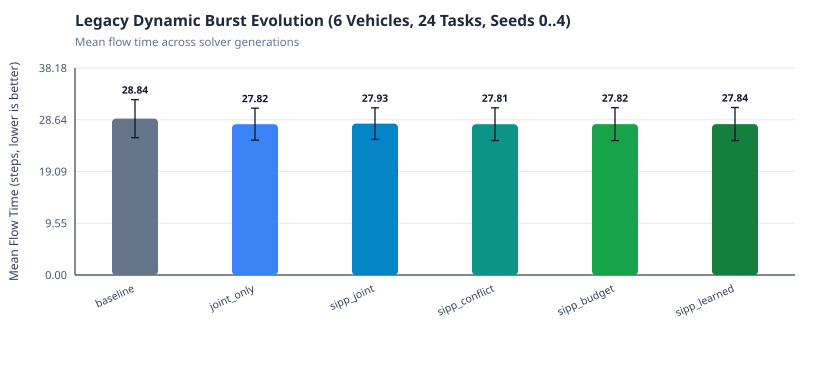
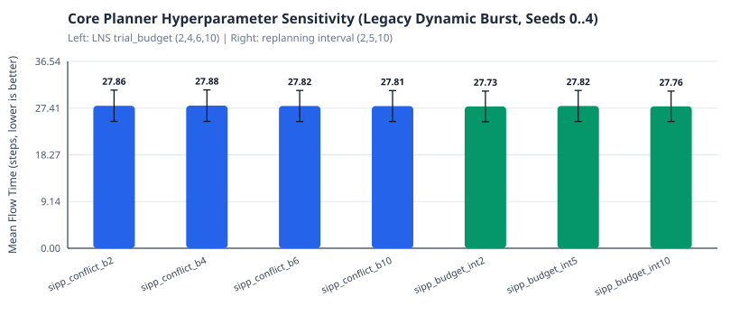

# 核心引擎（src/agv）多 Seed 演进与超参数敏感性实验（core-sensitivity-20261121）

## 结论

1. **V4 动态**：`bcrd_budget` 的 F 改善 +3.01%（0.9699±0.0191），完工时间 139.6→132.8，CPU 0.17 秒，为该场景推荐方案；`sipp_budget`、`sipp_matching` 与 `baseline` 差异在标准差内。
2. **Legacy 静态**：`sipp_batch` 平均流程时间改善 +2.62%（50.82→49.49），总移动步数减少 4.24%，CPU 0.08→10.27 秒；`joint_batch` 流程时间相同但 CPU 更高（14.15 秒）。
3. **Legacy 动态**：各改进方案平均流程时间约 27.8，相对 `baseline`（28.84）改善约 +3.5%，但跨 seed 标准差约 ±3；各 SIPP 变体之间差异小于 0.15，无可分辨差别。
4. **参数敏感性**：`trial_budget` 在 2–10 范围内结果几乎相同，`b2` 耗时最低（0.28 秒）；重规划间隔 2/5/10 无明显差异，间隔 10 的 CPU 最低（0.40 秒）。
5. **V9.1 动态**：除 `sipp_stream_matching` 外，所有方案与 `baseline` 的流程时间与完工时间完全相同（134.16 / 330.20），改进在该场景下未生效（队列未达 BCRD 触发阈值）。
6. **V9.1 静态**：`sipp_stream_matching` 与 BCRD 系 F 改善约 +1.53%；`max_batches` 从 1 增至 2 有收益，2/4/6 结果完全相同，取 2 即可。

## 方法

- 每个配置 5 个随机种子（`[0, 1, 2, 3, 4]`），共 **205 / 205** 次运行全部通过 `validate()` 独立物理验解且全部可行。
- 指标定义：`T` = 完工时间（Makespan），`R` = 平均流程时间（Flow Time），`D` = 总移动步数；V4 / V9.1 的归一化目标 $F = 0.5\,T/T_{\text{ref}} + 0.3\,R/R_{\text{ref}} + 0.2\,D/D_{\text{ref}}$ 以同场景 `baseline` 为 1.0；Legacy 无固定参照基线，不计算 F（表中以 `-` 标示）。
- 配对改善率约定：同一 seed 下计算 `100% × (1 − 候选/基线)`，正数表示候选更优，再对 5 个 seed 取均值并记录胜/平/负次数。

## 局限

每个配置仅有 5 个合成随机种子，多数方案间的跨场景均值差小于 seed 标准差；结论以同 seed 配对改善表为主要参照，不做统计显著性声明。

## 同 Seed 配对改善（相对同组 baseline）

| 实验组 | 候选方案 | 评价指标 | 5-seed 平均改善 | 范围 [min, max] | 胜/平/负 (seed) |
|---|---|---|---:|---|---:|
| legacy_static_evolution | `joint_only` | R 平均流程时间 | +1.84% | [+0.71%, +2.82%] | 5/0/0 |
| legacy_static_evolution | `joint_batch` | R 平均流程时间 | +2.64% | [+1.03%, +3.70%] | 5/0/0 |
| legacy_static_evolution | `sipp_joint` | R 平均流程时间 | +1.98% | [+1.03%, +2.82%] | 5/0/0 |
| legacy_static_evolution | `sipp_conflict` | R 平均流程时间 | +1.71% | [+0.95%, +2.82%] | 5/0/0 |
| legacy_static_evolution | `sipp_budget` | R 平均流程时间 | +1.96% | [+0.95%, +2.99%] | 5/0/0 |
| legacy_static_evolution | `sipp_batch` | R 平均流程时间 | +2.63% | [+1.27%, +3.32%] | 5/0/0 |
| legacy_static_evolution | `sipp_learned` | R 平均流程时间 | +1.50% | [+0.87%, +2.10%] | 5/0/0 |
| legacy_dynamic_evolution | `joint_only` | R 平均流程时间 | +3.38% | [+1.23%, +7.35%] | 5/0/0 |
| legacy_dynamic_evolution | `sipp_joint` | R 平均流程时间 | +2.99% | [+0.35%, +7.35%] | 5/0/0 |
| legacy_dynamic_evolution | `sipp_conflict` | R 平均流程时间 | +3.44% | [+0.88%, +6.06%] | 5/0/0 |
| legacy_dynamic_evolution | `sipp_budget` | R 平均流程时间 | +3.39% | [+0.88%, +6.06%] | 5/0/0 |
| legacy_dynamic_evolution | `sipp_learned` | R 平均流程时间 | +3.33% | [+0.88%, +6.06%] | 5/0/0 |
| v4_dynamic_evolution | `sipp_budget` | F 归一化目标 | +0.52% | [+0.00%, +1.51%] | 3/2/0 |
| v4_dynamic_evolution | `sipp_matching` | F 归一化目标 | +0.01% | [-2.90%, +2.76%] | 3/0/2 |
| v4_dynamic_evolution | `bcrd_budget` | F 归一化目标 | +3.01% | [+0.00%, +5.00%] | 4/1/0 |
| v91_dynamic_evolution | `sipp_stream_dispatch` | F 归一化目标 | +0.02% | [+0.00%, +0.07%] | 2/3/0 |
| v91_dynamic_evolution | `sipp_stream_matching` | F 归一化目标 | +0.65% | [-3.72%, +5.63%] | 3/0/2 |
| v91_dynamic_evolution | `sipp_position_dispatch` | F 归一化目标 | +0.02% | [+0.00%, +0.07%] | 2/3/0 |
| v91_dynamic_evolution | `sipp_stream_bcrd` | F 归一化目标 | +0.02% | [+0.00%, +0.07%] | 2/3/0 |
| v91_dynamic_evolution | `sipp_stream_bcrd_tail` | F 归一化目标 | +0.02% | [+0.00%, +0.07%] | 2/3/0 |
| v91_static_evolution | `sipp_stream_dispatch` | F 归一化目标 | +0.05% | [+0.00%, +0.10%] | 4/1/0 |
| v91_static_evolution | `sipp_stream_matching` | F 归一化目标 | +1.55% | [+0.08%, +3.74%] | 5/0/0 |
| v91_static_evolution | `sipp_position_dispatch` | F 归一化目标 | +0.05% | [+0.00%, +0.10%] | 4/1/0 |
| v91_static_evolution | `sipp_stream_bcrd` | F 归一化目标 | +1.53% | [+0.00%, +3.74%] | 4/1/0 |
| v91_static_evolution | `sipp_stream_bcrd_tail` | F 归一化目标 | +1.53% | [+0.00%, +3.74%] | 4/1/0 |

## 各组汇总指标

| 实验组 | 方案/参数 | 次数 | 可行 | R 平均流程时间 (±SD) | T 完工时间 (±SD) | D 总移动步数 | 归一化 F (±SD) | CPU (s) |
|---|---|---:|---:|---:|---:|---:|---:|---:|
| legacy_static_evolution | `baseline` | 5 | 5 | 50.82 (±4.37) | 114.60 (±7.30) | 622.8 | - | 0.078 |
| legacy_static_evolution | `joint_only` | 5 | 5 | 49.88 (±4.18) | 112.00 (±13.32) | 614.4 | - | 2.192 |
| legacy_static_evolution | `joint_batch` | 5 | 5 | 49.49 (±4.52) | 111.20 (±14.17) | 614.0 | - | 14.152 |
| legacy_static_evolution | `sipp_joint` | 5 | 5 | 49.80 (±4.16) | 111.60 (±13.43) | 609.6 | - | 2.156 |
| legacy_static_evolution | `sipp_conflict` | 5 | 5 | 49.94 (±4.23) | 112.00 (±13.13) | 609.2 | - | 1.543 |
| legacy_static_evolution | `sipp_budget` | 5 | 5 | 49.81 (±4.13) | 109.20 (±9.31) | 607.2 | - | 0.975 |
| legacy_static_evolution | `sipp_batch` | 5 | 5 | 49.49 (±4.40) | 109.40 (±10.90) | 596.4 | - | 10.270 |
| legacy_static_evolution | `sipp_learned` | 5 | 5 | 50.06 (±4.37) | 111.80 (±12.83) | 613.2 | - | 0.905 |
| legacy_dynamic_evolution | `baseline` | 5 | 5 | 28.84 (±3.52) | 139.80 (±8.41) | 754.8 | - | 0.093 |
| legacy_dynamic_evolution | `joint_only` | 5 | 5 | 27.82 (±2.94) | 141.60 (±9.81) | 751.2 | - | 1.830 |
| legacy_dynamic_evolution | `sipp_joint` | 5 | 5 | 27.93 (±2.91) | 141.00 (±10.32) | 753.6 | - | 2.357 |
| legacy_dynamic_evolution | `sipp_conflict` | 5 | 5 | 27.81 (±3.02) | 139.00 (±9.41) | 752.8 | - | 1.573 |
| legacy_dynamic_evolution | `sipp_budget` | 5 | 5 | 27.82 (±3.04) | 139.00 (±9.41) | 753.2 | - | 0.977 |
| legacy_dynamic_evolution | `sipp_learned` | 5 | 5 | 27.84 (±3.05) | 140.00 (±10.70) | 762.0 | - | 0.740 |
| legacy_dynamic_trial_budget | `sipp_conflict_b2` | 5 | 5 | 27.86 (±3.06) | 138.60 (±8.68) | 764.8 | - | 0.284 |
| legacy_dynamic_trial_budget | `sipp_conflict_b4` | 5 | 5 | 27.88 (±3.08) | 140.40 (±10.33) | 756.4 | - | 0.372 |
| legacy_dynamic_trial_budget | `sipp_conflict_b6` | 5 | 5 | 27.82 (±3.04) | 139.00 (±9.41) | 753.2 | - | 0.452 |
| legacy_dynamic_trial_budget | `sipp_conflict_b10` | 5 | 5 | 27.81 (±3.02) | 139.00 (±9.41) | 752.8 | - | 0.729 |
| legacy_dynamic_interval | `sipp_budget_int2` | 5 | 5 | 27.73 (±3.00) | 138.80 (±9.36) | 752.4 | - | 1.862 |
| legacy_dynamic_interval | `sipp_budget_int5` | 5 | 5 | 27.82 (±3.04) | 139.00 (±9.41) | 753.2 | - | 1.077 |
| legacy_dynamic_interval | `sipp_budget_int10` | 5 | 5 | 27.76 (±2.98) | 138.80 (±9.36) | 752.8 | - | 0.401 |
| v4_dynamic_evolution | `baseline` | 5 | 5 | 41.87 (±3.49) | 139.60 (±7.89) | 684.8 | 1.0000 (±0.0000) | 0.105 |
| v4_dynamic_evolution | `sipp_budget` | 5 | 5 | 41.62 (±3.29) | 138.60 (±6.77) | 684.4 | 0.9948 (±0.0066) | 0.466 |
| v4_dynamic_evolution | `sipp_matching` | 5 | 5 | 41.19 (±3.31) | 139.60 (±5.37) | 698.8 | 0.9999 (±0.0252) | 0.505 |
| v4_dynamic_evolution | `bcrd_budget` | 5 | 5 | 41.37 (±2.87) | 132.80 (±10.94) | 675.6 | 0.9699 (±0.0191) | 0.173 |
| v91_dynamic_evolution | `baseline` | 5 | 5 | 134.16 (±5.42) | 330.20 (±18.02) | 1226.8 | 1.0000 (±0.0000) | 1.493 |
| v91_dynamic_evolution | `sipp_stream_dispatch` | 5 | 5 | 134.16 (±5.42) | 330.20 (±18.02) | 1225.6 | 0.9998 (±0.0003) | 1.451 |
| v91_dynamic_evolution | `sipp_stream_matching` | 5 | 5 | 135.00 (±7.18) | 325.00 (±15.86) | 1220.8 | 0.9935 (±0.0337) | 1.405 |
| v91_dynamic_evolution | `sipp_position_dispatch` | 5 | 5 | 134.16 (±5.42) | 330.20 (±18.02) | 1225.6 | 0.9998 (±0.0003) | 0.700 |
| v91_dynamic_evolution | `sipp_stream_bcrd` | 5 | 5 | 134.16 (±5.42) | 330.20 (±18.02) | 1225.6 | 0.9998 (±0.0003) | 1.322 |
| v91_dynamic_evolution | `sipp_stream_bcrd_tail` | 5 | 5 | 134.16 (±5.42) | 330.20 (±18.02) | 1225.6 | 0.9998 (±0.0003) | 2.357 |
| v91_bcrd_max_batches | `v91_bcrd_m1` | 5 | 5 | 154.05 (±8.25) | 329.20 (±18.94) | 1207.2 | 0.9995 (±0.0004) | 2.273 |
| v91_bcrd_max_batches | `v91_bcrd_m2` | 5 | 5 | 152.51 (±8.46) | 321.40 (±15.76) | 1205.6 | 0.9847 (±0.0180) | 2.597 |
| v91_bcrd_max_batches | `v91_bcrd_m4` | 5 | 5 | 152.51 (±8.46) | 321.40 (±15.76) | 1205.6 | 0.9847 (±0.0180) | 3.059 |
| v91_bcrd_max_batches | `v91_bcrd_m6` | 5 | 5 | 152.51 (±8.46) | 321.40 (±15.76) | 1205.6 | 0.9847 (±0.0180) | 3.416 |
| v91_static_evolution | `baseline` | 5 | 5 | 154.05 (±8.25) | 329.20 (±18.94) | 1210.0 | 1.0000 (±0.0000) | 0.643 |
| v91_static_evolution | `sipp_stream_dispatch` | 5 | 5 | 154.05 (±8.25) | 329.20 (±18.94) | 1207.2 | 0.9995 (±0.0004) | 0.472 |
| v91_static_evolution | `sipp_stream_matching` | 5 | 5 | 152.46 (±8.51) | 321.40 (±15.76) | 1205.2 | 0.9845 (±0.0178) | 0.872 |
| v91_static_evolution | `sipp_position_dispatch` | 5 | 5 | 154.05 (±8.25) | 329.20 (±18.94) | 1207.2 | 0.9995 (±0.0004) | 0.448 |
| v91_static_evolution | `sipp_stream_bcrd` | 5 | 5 | 152.51 (±8.46) | 321.40 (±15.76) | 1205.6 | 0.9847 (±0.0180) | 1.195 |
| v91_static_evolution | `sipp_stream_bcrd_tail` | 5 | 5 | 152.51 (±8.46) | 321.40 (±15.76) | 1205.6 | 0.9847 (±0.0180) | 1.049 |

> 注：Legacy 场景无固定归一化参照基线，表中 `归一化 F` 记为 `-`。

## 对比图表

