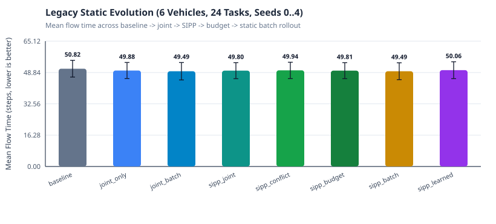

# 核心引擎（src/agv）多 Seed 演进与超参数敏感性实验

- 总运行次数：**205 / 205** 全部通过 `validate()` 独立物理验解，全部可行（`feasible = 205/205`）。
- 随机种子：`[0, 1, 2, 3, 4]`（每个配置 5 个独立随机种子）。

## 各组汇总指标

| 实验组 | 方案/参数 | 次数 | 可行 | 平均 Flow Time (±SD) | Makespan (±SD) | 总移动步数 | 归一化 F (±SD) | CPU (s) |
|---|---|---:|---:|---:|---:|---:|---:|---:|
| legacy_static_evolution | `baseline` | 5 | 5 | 50.82 (±4.37) | 114.60 (±7.30) | 622.8 | - | 0.078 |
| legacy_static_evolution | `joint_only` | 5 | 5 | 49.88 (±4.18) | 112.00 (±13.32) | 614.4 | - | 2.192 |
| legacy_static_evolution | `joint_batch` | 5 | 5 | 49.49 (±4.52) | 111.20 (±14.17) | 614.0 | - | 14.152 |
| legacy_static_evolution | `sipp_joint` | 5 | 5 | 49.80 (±4.16) | 111.60 (±13.43) | 609.6 | - | 2.156 |
| legacy_static_evolution | `sipp_conflict` | 5 | 5 | 49.94 (±4.23) | 112.00 (±13.13) | 609.2 | - | 1.543 |
| legacy_static_evolution | `sipp_budget` | 5 | 5 | 49.81 (±4.13) | 109.20 (±9.31) | 607.2 | - | 0.975 |
| legacy_static_evolution | `sipp_batch` | 5 | 5 | 49.49 (±4.40) | 109.40 (±10.90) | 596.4 | - | 10.270 |
| legacy_static_evolution | `sipp_learned` | 5 | 5 | 50.06 (±4.37) | 111.80 (±12.83) | 613.2 | - | 0.905 |
| legacy_dynamic_evolution | `baseline` | 5 | 5 | 28.84 (±3.52) | 139.80 (±8.41) | 754.8 | - | 0.093 |
| legacy_dynamic_evolution | `joint_only` | 5 | 5 | 27.82 (±2.94) | 141.60 (±9.81) | 751.2 | - | 1.830 |
| legacy_dynamic_evolution | `sipp_joint` | 5 | 5 | 27.93 (±2.91) | 141.00 (±10.32) | 753.6 | - | 2.357 |
| legacy_dynamic_evolution | `sipp_conflict` | 5 | 5 | 27.81 (±3.02) | 139.00 (±9.41) | 752.8 | - | 1.573 |
| legacy_dynamic_evolution | `sipp_budget` | 5 | 5 | 27.82 (±3.04) | 139.00 (±9.41) | 753.2 | - | 0.977 |
| legacy_dynamic_evolution | `sipp_learned` | 5 | 5 | 27.84 (±3.05) | 140.00 (±10.70) | 762.0 | - | 0.740 |
| legacy_dynamic_trial_budget | `sipp_conflict_b2` | 5 | 5 | 27.86 (±3.06) | 138.60 (±8.68) | 764.8 | - | 0.284 |
| legacy_dynamic_trial_budget | `sipp_conflict_b4` | 5 | 5 | 27.88 (±3.08) | 140.40 (±10.33) | 756.4 | - | 0.372 |
| legacy_dynamic_trial_budget | `sipp_conflict_b6` | 5 | 5 | 27.82 (±3.04) | 139.00 (±9.41) | 753.2 | - | 0.452 |
| legacy_dynamic_trial_budget | `sipp_conflict_b10` | 5 | 5 | 27.81 (±3.02) | 139.00 (±9.41) | 752.8 | - | 0.729 |
| legacy_dynamic_interval | `sipp_budget_int2` | 5 | 5 | 27.73 (±3.00) | 138.80 (±9.36) | 752.4 | - | 1.862 |
| legacy_dynamic_interval | `sipp_budget_int5` | 5 | 5 | 27.82 (±3.04) | 139.00 (±9.41) | 753.2 | - | 1.077 |
| legacy_dynamic_interval | `sipp_budget_int10` | 5 | 5 | 27.76 (±2.98) | 138.80 (±9.36) | 752.8 | - | 0.401 |
| v4_dynamic_evolution | `baseline` | 5 | 5 | 41.87 (±3.49) | 139.60 (±7.89) | 684.8 | 1.0000 (±0.0000) | 0.105 |
| v4_dynamic_evolution | `sipp_budget` | 5 | 5 | 41.62 (±3.29) | 138.60 (±6.77) | 684.4 | 0.9948 (±0.0066) | 0.466 |
| v4_dynamic_evolution | `sipp_matching` | 5 | 5 | 41.19 (±3.31) | 139.60 (±5.37) | 698.8 | 0.9999 (±0.0252) | 0.505 |
| v4_dynamic_evolution | `bcrd_budget` | 5 | 5 | 41.37 (±2.87) | 132.80 (±10.94) | 675.6 | 0.9699 (±0.0191) | 0.173 |
| v91_dynamic_evolution | `baseline` | 5 | 5 | 134.16 (±5.42) | 330.20 (±18.02) | 1226.8 | 1.0000 (±0.0000) | 1.493 |
| v91_dynamic_evolution | `sipp_stream_dispatch` | 5 | 5 | 134.16 (±5.42) | 330.20 (±18.02) | 1225.6 | 0.9998 (±0.0003) | 1.451 |
| v91_dynamic_evolution | `sipp_stream_matching` | 5 | 5 | 135.00 (±7.18) | 325.00 (±15.86) | 1220.8 | 0.9935 (±0.0337) | 1.405 |
| v91_dynamic_evolution | `sipp_position_dispatch` | 5 | 5 | 134.16 (±5.42) | 330.20 (±18.02) | 1225.6 | 0.9998 (±0.0003) | 0.700 |
| v91_dynamic_evolution | `sipp_stream_bcrd` | 5 | 5 | 134.16 (±5.42) | 330.20 (±18.02) | 1225.6 | 0.9998 (±0.0003) | 1.322 |
| v91_dynamic_evolution | `sipp_stream_bcrd_tail` | 5 | 5 | 134.16 (±5.42) | 330.20 (±18.02) | 1225.6 | 0.9998 (±0.0003) | 2.357 |
| v91_bcrd_max_batches | `v91_bcrd_m1` | 5 | 5 | 154.05 (±8.25) | 329.20 (±18.94) | 1207.2 | 0.9995 (±0.0004) | 2.273 |
| v91_bcrd_max_batches | `v91_bcrd_m2` | 5 | 5 | 152.51 (±8.46) | 321.40 (±15.76) | 1205.6 | 0.9847 (±0.0180) | 2.597 |
| v91_bcrd_max_batches | `v91_bcrd_m4` | 5 | 5 | 152.51 (±8.46) | 321.40 (±15.76) | 1205.6 | 0.9847 (±0.0180) | 3.059 |
| v91_bcrd_max_batches | `v91_bcrd_m6` | 5 | 5 | 152.51 (±8.46) | 321.40 (±15.76) | 1205.6 | 0.9847 (±0.0180) | 3.416 |
| v91_static_evolution | `baseline` | 5 | 5 | 154.05 (±8.25) | 329.20 (±18.94) | 1210.0 | 1.0000 (±0.0000) | 0.643 |
| v91_static_evolution | `sipp_stream_dispatch` | 5 | 5 | 154.05 (±8.25) | 329.20 (±18.94) | 1207.2 | 0.9995 (±0.0004) | 0.472 |
| v91_static_evolution | `sipp_stream_matching` | 5 | 5 | 152.46 (±8.51) | 321.40 (±15.76) | 1205.2 | 0.9845 (±0.0178) | 0.872 |
| v91_static_evolution | `sipp_position_dispatch` | 5 | 5 | 154.05 (±8.25) | 329.20 (±18.94) | 1207.2 | 0.9995 (±0.0004) | 0.448 |
| v91_static_evolution | `sipp_stream_bcrd` | 5 | 5 | 152.51 (±8.46) | 321.40 (±15.76) | 1205.6 | 0.9847 (±0.0180) | 1.195 |
| v91_static_evolution | `sipp_stream_bcrd_tail` | 5 | 5 | 152.51 (±8.46) | 321.40 (±15.76) | 1205.6 | 0.9847 (±0.0180) | 1.049 |

## 对比图表

