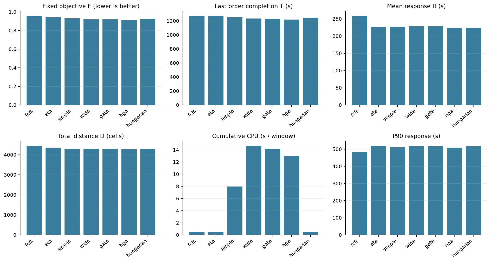
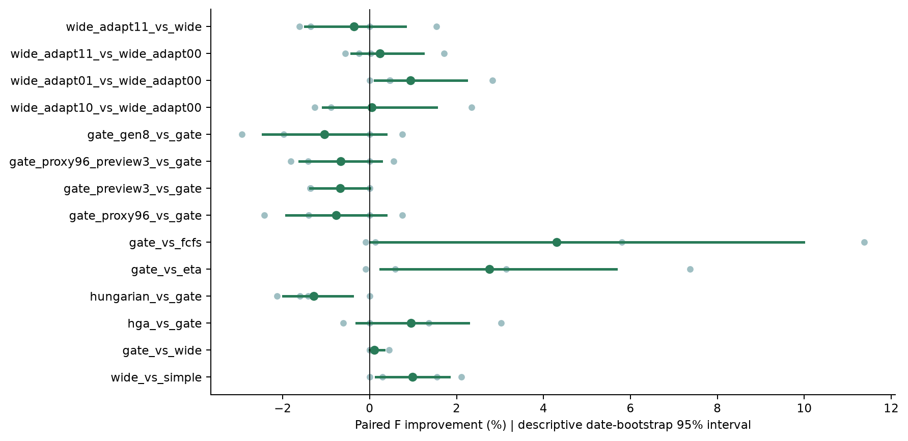
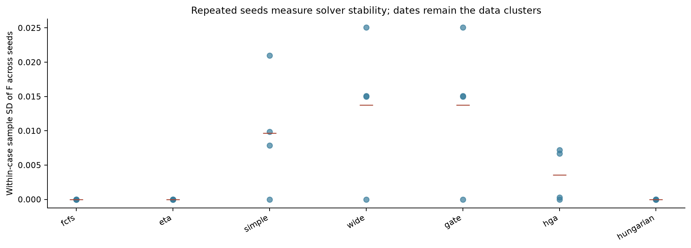
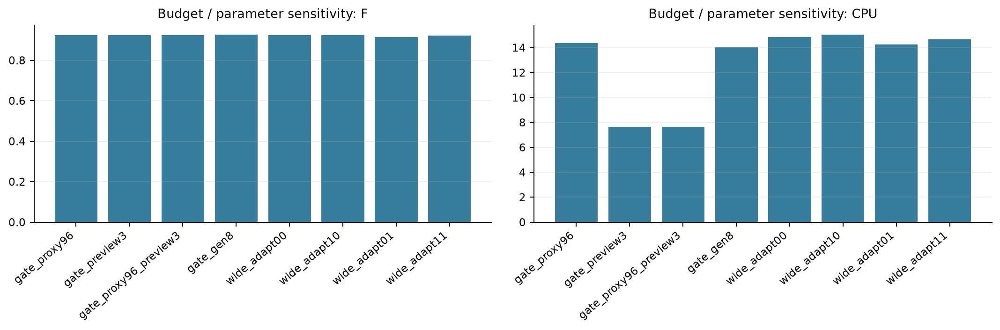
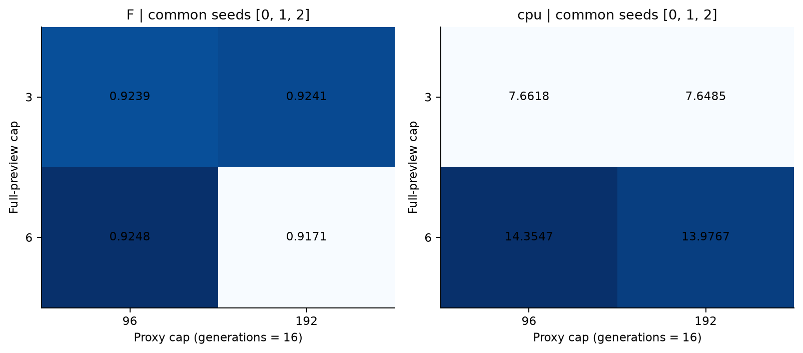
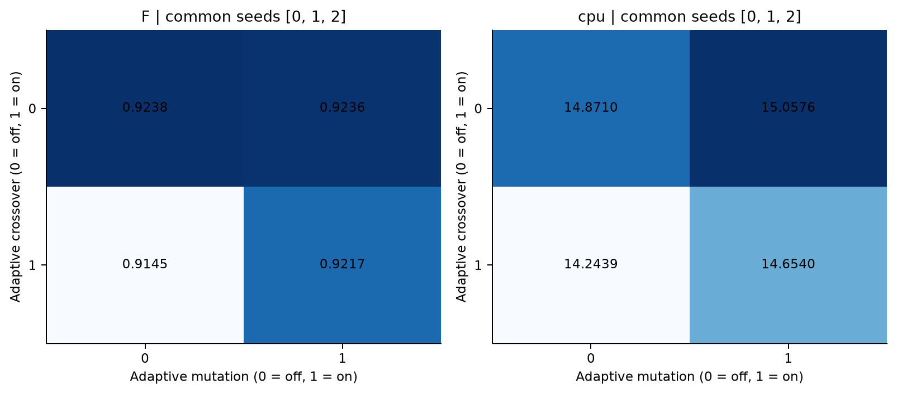
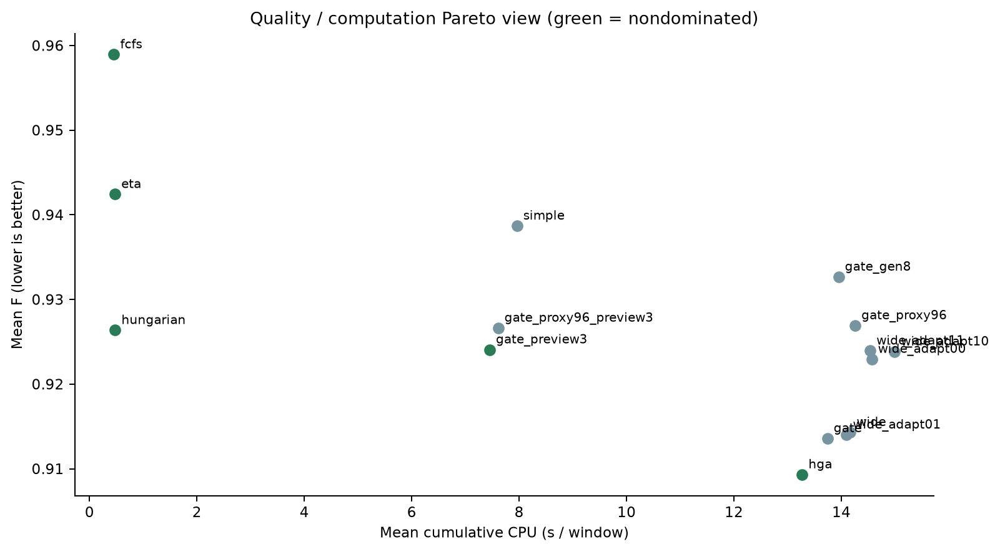
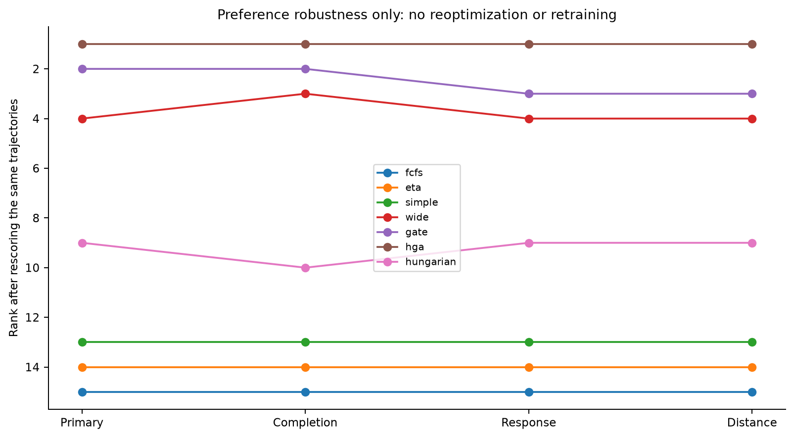

# 稳定性与敏感性实验：wepa-multiseed-sensitivity-20261120-v2

计划200次，已记录200次；4个窗口、4个来源日期。状态：全部计划比较完整。

本轮200次方法/seed运行复用4个窗口，共201条唯一源请求；独立业务场景仍为4个来源日期。重复求解不增加唯一订单数或独立业务样本数。

先在同一窗口内平均随机seed，再在来源日期内平均窗口，最后对日期等权平均。seed重复不增加独立业务日期；日期bootstrap 95%区间仅作描述。四个或少量日期、既有数据复用与开发选择均不支持统计显著或普遍获益结论。

本计划使用既有开发窗口，属于回顾性评价；本轮不据开发结果自动更换默认算法。

失败和缺失运行计入计划总数；对应方案和比较标记incomplete，不使用成功子样本均值参与排名。aggregate.json保留全部运行状态和失败详情。

## 同输入核心演进及资源消耗

|方案|状态|有效/计划|F|T|R|D|CPU秒|日期内seed SD|
|---|---|---:|---:|---:|---:|---:|---:|---:|
|fcfs|complete|8/8|0.9589|1273.5000|259.0665|4457.0000|0.4559|0.0000|
|eta|complete|8/8|0.9424|1270.7500|226.4797|4346.0000|0.4752|0.0000|
|simple|complete|20/20|0.9307|1252.3000|227.4812|4297.0000|7.9592|0.0097|
|wide|complete|20/20|0.9205|1233.0000|228.2925|4303.5000|14.6911|0.0138|
|gate|complete|20/20|0.9198|1231.7500|228.2113|4303.5000|14.2002|0.0138|
|hga|complete|20/20|0.9101|1218.5000|224.2554|4275.8000|12.9675|0.0035|
|hungarian|complete|8/8|0.9264|1246.2500|224.4473|4298.0000|0.4784|0.0000|
|gate_proxy96|complete|12/12|0.9248|1240.9167|227.6938|4307.8333|14.3547|0.0116|
|gate_preview3|complete|12/12|0.9241|1238.2500|228.3926|4320.5000|7.6485|0.0122|
|gate_proxy96_preview3|complete|12/12|0.9239|1239.0833|227.5272|4311.5000|7.6618|0.0111|
|gate_gen8|complete|12/12|0.9276|1247.0000|227.1274|4296.8333|14.0217|0.0112|
|wide_adapt00|complete|12/12|0.9238|1239.7500|227.7385|4295.8333|14.8710|0.0077|
|wide_adapt10|complete|12/12|0.9236|1240.1667|227.3769|4289.0000|15.0576|0.0075|
|wide_adapt01|complete|12/12|0.9145|1226.0000|226.4542|4262.1667|14.2439|0.0135|
|wide_adapt11|complete|12/12|0.9217|1235.8333|228.3781|4292.1667|14.6540|0.0085|

CPU是模拟执行累计计算耗时，不是实际AGV物理时间或单次决策延迟；F/T/R/D仍按计划的统一目标与物理规则评价。不同历史模型或不同输入的绝对F不能直接横比。



## 固定配对与逐日期差异

改善率为每日期先分别平均同case/seed的F，再计算相对基线的下降百分比；正数表示候选F更低。pair键固定为case/seed，禁止按最佳seed选择。

比较仅使用两组预声明seed的交集；交集在读取成绩前由计划确定。缺失/失败不会缩小该交集，其余seed仍完整保留在各方案稳定性统计。
正文展示计划显式声明的比较；JSON和paired.csv另保留所有方案相对gate的完整配对。

|比较|类型|配对seed|状态|有效/计划配对|平均F改善%|日期bootstrap 95%|胜/平/负日期|
|---|---|---|---|---:|---:|---|---|
|wide_vs_simple|wide vs simple|0,1,2,3,4|complete|20/20|0.9879|[0.1473, 1.8284]|3/1/0|
|gate_vs_wide|gate vs wide|0,1,2,3,4|complete|20/20|0.1116|[0.0000, 0.3349]|1/3/0|
|hga_vs_gate|hga vs gate|0,1,2,3,4|complete|20/20|0.9462|[-0.3022, 2.2722]|2/1/1|
|hungarian_vs_gate|hungarian vs gate|0,1|complete|8/8|-1.2855|[-1.9939, -0.4001]|0/1/3|
|gate_vs_eta|gate vs eta|0,1|complete|8/8|2.7525|[0.2492, 5.6722]|3/0/1|
|gate_vs_fcfs|gate vs fcfs|0,1|complete|8/8|4.3010|[0.0163, 9.9802]|3/0/1|
|gate_proxy96_vs_gate|gate_proxy96 vs gate|0,1,2|complete|12/12|-0.7703|[-1.9160, 0.3755]|1/1/2|
|gate_preview3_vs_gate|gate_preview3 vs gate|0,1,2|complete|12/12|-0.6831|[-1.3662, 0.0000]|0/2/2|
|gate_proxy96_preview3_vs_gate|gate_proxy96_preview3 vs gate|0,1,2|complete|12/12|-0.6691|[-1.6117, 0.2735]|1/1/2|
|gate_gen8_vs_gate|gate_gen8 vs gate|0,1,2|complete|12/12|-1.0412|[-2.4579, 0.3755]|1/1/2|
|wide_adapt10_vs_wide_adapt00|wide_adapt10 vs wide_adapt00|0,1,2|complete|12/12|0.0544|[-1.0783, 1.5357]|2/0/2|
|wide_adapt01_vs_wide_adapt00|wide_adapt01 vs wide_adapt00|0,1,2|complete|12/12|0.9376|[0.1163, 2.2330]|3/1/0|
|wide_adapt11_vs_wide_adapt00|wide_adapt11 vs wide_adapt00|0,1,2|complete|12/12|0.2344|[-0.4171, 1.2268]|2/0/2|
|wide_adapt11_vs_wide|wide_adapt11 vs wide|0,1,2|complete|12/12|-0.3562|[-1.4824, 0.8169]|1/1/2|

|比较|来源日|状态|基线F|候选F|F改善%|ΔT|ΔR|ΔD|ΔCPU秒|
|---|---|---|---:|---:|---:|---:|---:|---:|---:|
|wide_vs_simple|12|complete|0.9770|0.9741|0.2946|-7.4000|0.5443|28.4000|9.9929|
|wide_vs_simple|32|complete|0.9736|0.9531|2.1057|-36.2000|-0.2386|-8.4000|8.0705|
|wide_vs_simple|33|complete|1.1259|1.1084|1.5512|-33.6000|2.9395|6.0000|8.0717|
|wide_vs_simple|45|complete|0.6463|0.6463|0.0000|0.0000|0.0000|0.0000|0.7922|
|gate_vs_wide|12|complete|0.9741|0.9741|0.0000|0.0000|0.0000|0.0000|-0.3023|
|gate_vs_wide|32|complete|0.9531|0.9531|0.0000|0.0000|0.0000|0.0000|-0.3619|
|gate_vs_wide|33|complete|1.1084|1.1084|0.0000|0.0000|0.0000|0.0000|0.4304|
|gate_vs_wide|45|complete|0.6463|0.6434|0.4466|-5.0000|-0.3250|0.0000|-1.7295|
|hga_vs_gate|12|complete|0.9741|0.9446|3.0296|-41.8000|-10.4721|-75.6000|-2.5160|
|hga_vs_gate|32|complete|0.9531|0.9589|-0.6045|12.4000|-2.4491|-8.4000|0.9700|
|hga_vs_gate|33|complete|1.1084|1.0933|1.3597|-23.6000|-2.9023|-26.8000|-3.3760|
|hga_vs_gate|45|complete|0.6434|0.6434|0.0000|0.0000|0.0000|0.0000|-0.0091|
|hungarian_vs_gate|12|complete|0.9784|0.9940|-1.6006|32.0000|-3.9098|-22.0000|-20.8271|
|hungarian_vs_gate|32|complete|0.9380|0.9579|-2.1250|41.0000|-7.3158|-11.0000|-15.1083|
|hungarian_vs_gate|33|complete|1.0946|1.1101|-1.4164|28.5000|-0.9884|0.0000|-17.1074|
|hungarian_vs_gate|45|complete|0.6434|0.6434|0.0000|0.0000|0.0000|0.0000|-0.0052|
|gate_vs_eta|12|complete|0.9842|0.9784|0.5912|-14.0000|3.8770|18.0000|20.8488|
|gate_vs_eta|32|complete|1.0126|0.9380|7.3658|-123.0000|-0.8596|-161.0000|15.0839|
|gate_vs_eta|33|complete|1.1302|1.0946|3.1461|-63.5000|0.9419|-16.0000|17.1287|
|gate_vs_eta|45|complete|0.6428|0.6434|-0.0929|1.0000|0.1250|0.0000|-0.0002|
|gate_vs_fcfs|12|complete|1.0386|0.9784|5.7967|-64.0000|-47.9426|-234.0000|20.8501|
|gate_vs_fcfs|32|complete|1.0584|0.9380|11.3746|-164.0000|-58.5965|-263.0000|15.0980|
|gate_vs_fcfs|33|complete|1.0960|1.0946|0.1255|16.5000|-19.8488|-106.0000|17.1818|
|gate_vs_fcfs|45|complete|0.6428|0.6434|-0.0929|1.0000|0.1250|0.0000|0.0084|
|gate_proxy96_vs_gate|12|complete|0.9782|0.9709|0.7510|-8.0000|-1.2240|-67.3333|0.5056|
|gate_proxy96_vs_gate|32|complete|0.9451|0.9680|-2.4248|37.6667|0.7836|46.6667|0.4360|
|gate_proxy96_vs_gate|33|complete|1.1017|1.1172|-1.4073|26.6667|-0.1550|20.0000|0.5749|
|gate_proxy96_vs_gate|45|complete|0.6434|0.6434|0.0000|0.0000|0.0000|0.0000|-0.0044|
|gate_preview3_vs_gate|12|complete|0.9782|0.9782|0.0000|0.0000|0.0000|0.0000|-9.9613|
|gate_preview3_vs_gate|32|complete|0.9451|0.9580|-1.3704|20.3333|0.7427|38.0000|-6.8713|
|gate_preview3_vs_gate|33|complete|1.1017|1.1167|-1.3620|25.3333|1.4574|12.0000|-8.4673|
|gate_preview3_vs_gate|45|complete|0.6434|0.6434|0.0000|0.0000|0.0000|0.0000|-0.0127|
|gate_proxy96_preview3_vs_gate|12|complete|0.9782|0.9729|0.5470|-7.0000|-0.6831|-33.3333|-9.2258|
|gate_proxy96_preview3_vs_gate|32|complete|0.9451|0.9622|-1.8127|28.3333|-0.1988|39.3333|-7.3568|
|gate_proxy96_preview3_vs_gate|33|complete|1.1017|1.1172|-1.4106|27.6667|-0.3798|8.0000|-8.6637|
|gate_proxy96_preview3_vs_gate|45|complete|0.6434|0.6434|0.0000|0.0000|0.0000|0.0000|-0.0132|
|gate_gen8_vs_gate|12|complete|0.9782|0.9709|0.7510|-8.0000|-1.2240|-67.3333|0.3840|
|gate_gen8_vs_gate|32|complete|0.9451|0.9728|-2.9397|48.6667|0.4561|16.0000|0.0601|
|gate_gen8_vs_gate|33|complete|1.1017|1.1234|-1.9762|40.0000|-2.0930|6.6667|-0.2546|
|gate_gen8_vs_gate|45|complete|0.6434|0.6434|0.0000|0.0000|0.0000|0.0000|-0.0093|
|wide_adapt10_vs_wide_adapt00|12|complete|0.9800|0.9570|2.3448|-32.6667|-4.2678|-92.0000|0.4185|
|wide_adapt10_vs_wide_adapt00|32|complete|0.9555|0.9640|-0.8917|11.3333|1.1170|50.0000|0.6423|
|wide_adapt10_vs_wide_adapt00|33|complete|1.1131|1.1272|-1.2648|24.3333|1.8295|-1.3333|-0.1743|
|wide_adapt10_vs_wide_adapt00|45|complete|0.6465|0.6463|0.0294|-1.3333|-0.1250|16.0000|-0.1404|
|wide_adapt01_vs_wide_adapt00|12|complete|0.9800|0.9523|2.8234|-39.6667|-7.3388|-86.0000|-0.1491|
|wide_adapt01_vs_wide_adapt00|32|complete|0.9555|0.9511|0.4653|-6.3333|1.0702|-34.6667|-0.4174|
|wide_adapt01_vs_wide_adapt00|33|complete|1.1131|1.1080|0.4619|-9.0000|1.1318|-14.0000|-1.8194|
|wide_adapt01_vs_wide_adapt00|45|complete|0.6465|0.6465|0.0000|0.0000|0.0000|0.0000|-0.1227|
|wide_adapt11_vs_wide_adapt00|12|complete|0.9800|0.9631|1.7165|-27.3333|-2.0929|-25.3333|-0.3370|
|wide_adapt11_vs_wide_adapt00|32|complete|0.9555|0.9578|-0.2425|2.6667|2.8772|-3.3333|0.2441|
|wide_adapt11_vs_wide_adapt00|33|complete|1.1131|1.1194|-0.5659|10.3333|1.8992|-2.0000|-0.6486|
|wide_adapt11_vs_wide_adapt00|45|complete|0.6465|0.6463|0.0294|-1.3333|-0.1250|16.0000|-0.1269|
|wide_adapt11_vs_wide|12|complete|0.9782|0.9631|1.5398|-23.6667|-1.7432|-36.0000|-0.0241|
|wide_adapt11_vs_wide|32|complete|0.9451|0.9578|-1.3518|22.3333|4.6608|-32.0000|0.6858|
|wide_adapt11_vs_wide|33|complete|1.1017|1.1194|-1.6129|32.3333|-1.1008|4.6667|0.1425|
|wide_adapt11_vs_wide|45|complete|0.6463|0.6463|0.0000|0.0000|0.0000|0.0000|-0.0224|





## 预算与参数敏感性

proxy、完整preview和代数上限分别比较；2×2资源组合可观察代理预算与完整预演的交互。上限不一定用满，应结合实际搜索次数、独特代理评分、preview和上限触发次数解释。simple→wide同时调整多个预算，代表整组配置变化；单参数结论以计划中声明的固定对照为准。

|方案|profile|组别|参数覆盖|searches|proxy|preview|proxy上限触发|preview上限触发|
|---|---|---|---|---:|---:|---:|---:|---:|
|fcfs|fcfs|evolution|{}|0|0|0|0|0|
|eta|eta|evolution|{}|0|0|0|0|0|
|simple|simple|evolution|{}|558|19813|1674|0|558|
|wide|wide|evolution|{}|560|34979|3360|0|560|
|gate|gate|evolution|{}|205|32527|1230|0|205|
|hga|hga|evolution|{}|189|30301|1134|0|189|
|hungarian|hungarian|evolution|{}|0|0|0|0|0|
|gate_proxy96|gate|budget|{"proxy": 96}|123|11518|738|117|123|
|gate_preview3|gate|budget|{"previews": 3}|124|19745|372|0|124|
|gate_proxy96_preview3|gate|budget|{"proxy": 96, "previews": 3}|122|11531|366|116|122|
|gate_gen8|gate|budget|{"generations": 8}|121|10362|726|0|121|
|wide_adapt00|wide|adaptive|{"adaptive_mutation": false, "adaptive_crossover": false, "mutation_rate": 0.7, "crossover_rate": 0.9}|334|20206|2004|0|334|
|wide_adapt10|wide|adaptive|{"adaptive_mutation": true, "adaptive_crossover": false, "mutation_rate": 0.7, "crossover_rate": 0.9}|336|21666|2016|0|336|
|wide_adapt01|wide|adaptive|{"adaptive_mutation": false, "adaptive_crossover": true, "mutation_rate": 0.7, "crossover_rate": 0.9}|332|20135|1991|0|331|
|wide_adapt11|wide|adaptive|{"adaptive_mutation": true, "adaptive_crossover": true, "mutation_rate": 0.7, "crossover_rate": 0.9}|335|21549|2010|0|335|



自适应四组固定同一移植后的GA实现及初始pm=0.7、pc=0.9，分别开关pm/pc自适应；11/00、10/00、01/00对应受控比较。wide_adapt11与原wide的差异还包含遗传算子实现和随机调用路径变化，是整组移植方案比较，不能把全部收益归因于自适应本身。



budget_2x2四格使用共同预声明seed=[0, 1, 2]；每格均按同一日期等权汇总，避免默认方案较多seed造成比较样本不一致。



adaptive_2x2四格使用共同预声明seed=[0, 1, 2]；每格均按同一日期等权汇总，避免默认方案较多seed造成比较样本不一致。

## 成本与质量权衡

Pareto及权重排名统一使用所有方案预声明seed交集[0, 1]。Pareto图只在全部计划运行有效的方案上比较等权日期平均F与CPU；无法同时降低两者的方案并不因此无价值，取舍应结合业务目标。



## 权重重评分的稳健性

以下对同一批已执行轨迹的T/R/D使用不同偏好权重重新计分，没有重新优化、重新训练或重跑调度。排名变化不能解释为算法适应了新权重。

|权重(T/R/D)|方案|重评分|排名|
|---|---|---:|---:|
|0.5/0.3/0.2|fcfs|0.9589|15|
|0.5/0.3/0.2|eta|0.9424|14|
|0.5/0.3/0.2|simple|0.9387|13|
|0.5/0.3/0.2|wide|0.9143|4|
|0.5/0.3/0.2|gate|0.9136|2|
|0.5/0.3/0.2|hga|0.9093|1|
|0.5/0.3/0.2|hungarian|0.9264|9|
|0.5/0.3/0.2|gate_proxy96|0.9269|11|
|0.5/0.3/0.2|gate_preview3|0.9241|8|
|0.5/0.3/0.2|gate_proxy96_preview3|0.9266|10|
|0.5/0.3/0.2|gate_gen8|0.9327|12|
|0.5/0.3/0.2|wide_adapt00|0.9230|5|
|0.5/0.3/0.2|wide_adapt10|0.9238|6|
|0.5/0.3/0.2|wide_adapt01|0.9140|3|
|0.5/0.3/0.2|wide_adapt11|0.9239|7|
|0.6/0.2/0.2|fcfs|1.0716|15|
|0.6/0.2/0.2|eta|1.0585|14|
|0.6/0.2/0.2|simple|1.0541|13|
|0.6/0.2/0.2|wide|1.0248|3|
|0.6/0.2/0.2|gate|1.0240|2|
|0.6/0.2/0.2|hga|1.0198|1|
|0.6/0.2/0.2|hungarian|1.0399|10|
|0.6/0.2/0.2|gate_proxy96|1.0399|11|
|0.6/0.2/0.2|gate_preview3|1.0363|7|
|0.6/0.2/0.2|gate_proxy96_preview3|1.0395|9|
|0.6/0.2/0.2|gate_gen8|1.0471|12|
|0.6/0.2/0.2|wide_adapt00|1.0352|5|
|0.6/0.2/0.2|wide_adapt10|1.0365|8|
|0.6/0.2/0.2|wide_adapt01|1.0249|4|
|0.6/0.2/0.2|wide_adapt11|1.0362|6|
|0.4/0.4/0.2|fcfs|0.8462|15|
|0.4/0.4/0.2|eta|0.8264|14|
|0.4/0.4/0.2|simple|0.8233|13|
|0.4/0.4/0.2|wide|0.8038|4|
|0.4/0.4/0.2|gate|0.8032|3|
|0.4/0.4/0.2|hga|0.7989|1|
|0.4/0.4/0.2|hungarian|0.8128|9|
|0.4/0.4/0.2|gate_proxy96|0.8139|11|
|0.4/0.4/0.2|gate_preview3|0.8119|8|
|0.4/0.4/0.2|gate_proxy96_preview3|0.8138|10|
|0.4/0.4/0.2|gate_gen8|0.8183|12|
|0.4/0.4/0.2|wide_adapt00|0.8107|5|
|0.4/0.4/0.2|wide_adapt10|0.8112|6|
|0.4/0.4/0.2|wide_adapt01|0.8031|2|
|0.4/0.4/0.2|wide_adapt11|0.8116|7|
|0.4/0.2/0.4|fcfs|0.9537|15|
|0.4/0.2/0.4|eta|0.9370|14|
|0.4/0.2/0.4|simple|0.9319|13|
|0.4/0.2/0.4|wide|0.9127|4|
|0.4/0.2/0.4|gate|0.9121|3|
|0.4/0.2/0.4|hga|0.9071|1|
|0.4/0.2/0.4|hungarian|0.9221|9|
|0.4/0.2/0.4|gate_proxy96|0.9228|10|
|0.4/0.2/0.4|gate_preview3|0.9213|8|
|0.4/0.2/0.4|gate_proxy96_preview3|0.9231|11|
|0.4/0.2/0.4|gate_gen8|0.9268|12|
|0.4/0.2/0.4|wide_adapt00|0.9192|5|
|0.4/0.2/0.4|wide_adapt10|0.9196|6|
|0.4/0.2/0.4|wide_adapt01|0.9112|2|
|0.4/0.2/0.4|wide_adapt11|0.9198|7|



## 解释边界与证据

本轮评估seed主要检查随机搜索稳定性，不等同独立DQN训练seed。同一冻结模型多次推断不能证明学习过程稳定；训练稳定性需要从零初始化并重复训练。既有公开验证/测试日期重新使用时应标记回顾性评价，不能重新称作未见测试。

真实订单流映射入本项目固定large、62×47网格、6车、5层仿真，不是原WEPA地图或原仓库整仓运行复刻；货位映射随机种子固定为17。原始WEPA订单用于重建这些固定窗口与初始库存，货架位置及单位时间运动仍是课程模型假设。不同seed和多轮运行复用相同源订单，不增加不同业务数据数量。旧DQN的30/60分钟窗口、训练过程及五日期成绩作为历史证据保存，不与本轮15分钟开发窗口的绝对F混成一个优劣排名；本轮自适应GA是同环境算子移植比较。

输入计划、原始trials、汇总aggregate.json、summary.csv、paired.csv与figure文件分别保存；本报告器不修改输入、原源码或封存归档，不运行算法。任何负改善、超时或无效结果均原样保留。

## 运行与核验

在仓库根目录使用已准备好的虚拟环境。以下验证读取原始轨迹核对紧凑记录；报告目录必须尚不存在，已有报告不会被覆盖。

```bash
.venv/bin/python scripts/run_sensitivity_study.py verify results/sensitivity-20261120-v2 --traces
.venv/bin/python scripts/report_sensitivity_study.py results/sensitivity-20261120-v2 --output output/sensitivity-report-new
```
