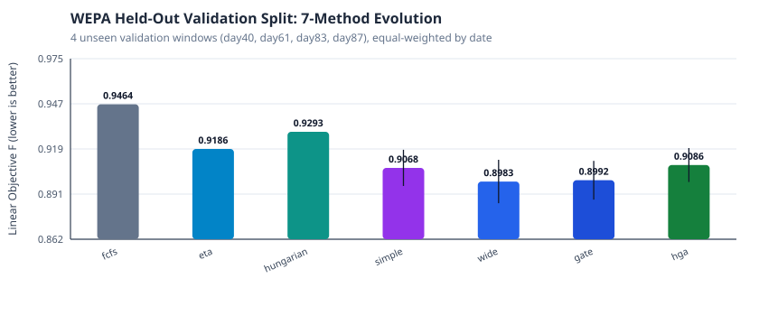
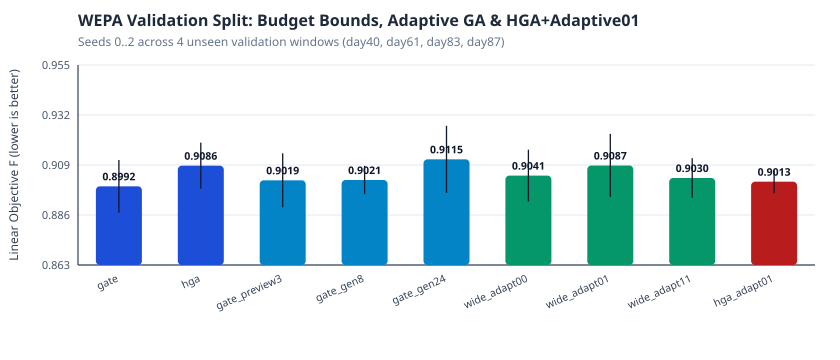

# WEPA 未见验证集（Validation Split）多 Seed 与组合补充实验

- 验证窗口：`['wepa-day40-bin3885', 'wepa-day61-bin5902', 'wepa-day83-bin7983', 'wepa-day87-bin8393']`（共 199 条真实请求，覆盖 day40 / day61 / day83 / day87）。
- 有效完成：**156 / 156**（全部通过 `checked_score` 独立验解）。

## 各方案汇总（按来源日期等权）

| 组别 | 方案 | 次数 | F | seed SD | T (s) | R (s) | D (cells) | P90 (s) | CPU (s) |
|---|---|---:|---:|---:|---:|---:|---:|---:|---:|
| evolution | `fcfs` | 8 | 0.946448 | 0.00000 | 1188.00 | 331.01 | 4755.0 | 585.75 | 0.649 |
| evolution | `eta` | 8 | 0.918629 | 0.00000 | 1173.00 | 288.22 | 4614.0 | 615.75 | 0.570 |
| evolution | `hungarian` | 8 | 0.929314 | 0.00000 | 1190.00 | 289.33 | 4637.5 | 615.00 | 0.616 |
| evolution | `simple` | 12 | 0.906840 | 0.01128 | 1151.50 | 290.95 | 4593.7 | 601.50 | 10.417 |
| evolution | `wide` | 12 | 0.898339 | 0.01351 | 1134.33 | 292.70 | 4605.8 | 609.50 | 20.520 |
| evolution | `gate` | 12 | 0.899159 | 0.01206 | 1136.42 | 292.17 | 4601.5 | 611.25 | 21.664 |
| evolution | `hga` | 12 | 0.908607 | 0.01056 | 1151.75 | 292.94 | 4619.7 | 600.00 | 21.598 |
| budget | `gate_preview3` | 12 | 0.901945 | 0.01231 | 1141.67 | 291.80 | 4601.3 | 608.33 | 12.091 |
| budget | `gate_gen8` | 12 | 0.902054 | 0.00645 | 1140.92 | 291.91 | 4614.5 | 602.67 | 23.802 |
| budget | `gate_gen24` | 12 | 0.911530 | 0.01532 | 1156.50 | 293.98 | 4618.0 | 606.25 | 23.036 |
| adaptive | `wide_adapt00` | 12 | 0.904070 | 0.01185 | 1144.33 | 291.23 | 4623.8 | 605.42 | 24.047 |
| adaptive | `wide_adapt01` | 12 | 0.908715 | 0.01441 | 1152.58 | 291.95 | 4619.0 | 613.67 | 23.024 |
| adaptive | `wide_adapt11` | 12 | 0.902963 | 0.00905 | 1141.67 | 292.83 | 4619.5 | 596.67 | 22.243 |
| combined | `hga_adapt01` | 12 | 0.901263 | 0.00521 | 1140.83 | 291.98 | 4593.8 | 606.75 | 22.396 |

## 同窗口/同 Seed 配对改善率

| 候选 | 基线 | 日期等权平均 F 改善 | 胜/平/负日期 |
|---|---|---:|---:|
| `wide` | `simple` | +0.9561% | 4/0/0 |
| `gate` | `wide` | -0.1011% | 0/2/2 |
| `hga` | `gate` | -1.1157% | 0/0/4 |
| `hungarian` | `gate` | -3.8704% | 0/0/4 |
| `gate` | `eta` | +2.4255% | 4/0/0 |
| `gate` | `fcfs` | +5.4502% | 4/0/0 |
| `gate_preview3` | `gate` | -0.3310% | 0/2/2 |
| `gate_gen8` | `gate` | -0.3487% | 1/0/3 |
| `gate_gen24` | `gate` | -1.4149% | 0/0/4 |
| `wide_adapt01` | `wide_adapt00` | -0.5397% | 1/0/3 |
| `wide_adapt11` | `wide_adapt00` | +0.1059% | 2/0/2 |
| `hga_adapt01` | `hga` | +0.7917% | 3/0/1 |
| `hga_adapt01` | `gate` | -0.2793% | 2/0/2 |

## 验证集对比图

