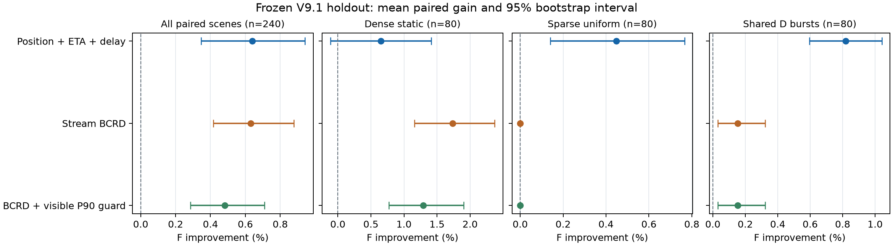

# V9.1 0.6.0 实验证据

结论、选型与实验分析见 [优化报告](../../docs/v91-optimization.md)。全部测试为合成混合货架场景，正式模板均为 4 车、12 单，综合评分 $F$ 沿用同场景固定 A* 基线的 50/30/20 归一化目标（越低越好）。

## 批次与文件

| 批次 | 次数 / 配对场景 | 测量提交版本 | 逐次行与分析 | 完整证据 |
|---|---:|---|---|---|
| Stage0 工具核查 | 72 / 36 | `73c56b93feb11795e0e88b03e7e6f39278b81733` | [CSV](stage0-runs.csv)、[摘要](stage0-summary.json)、[分解](stage0-effects.json)、[审计](stage0-audit.json) | [stage0.tar.gz](stage0.tar.gz) |
| 开发消融 | 252 / 同 36 | `689735f5985a7c727c51b652f28c9efe128f1782` | [CSV](development-runs.csv)、[摘要](development-summary.json)、[分解](development-effects.json)、[审计](development-audit.json) | [development.tar.gz](development.tar.gz) |
| 新种子留出 | 960 / 240 | `ace242e10a16e9cb5d338bb6d1c2521b2fc136ca` | [CSV](holdout-runs.csv)、[摘要](holdout-summary.json)、[分解](holdout-effects.json)、[审计](holdout-audit.json) | [holdout.tar.gz](holdout.tar.gz) |

开发集使用种子 10–12（36 场景），留出集使用独立种子 200–219（240 场景），合计覆盖 276 个独立合成场景（正式执行 1,284 次）。在留出测试开始前，依据开发结果固定 G0 / G4 / B0 / B1 四套策略进行统一盲测。

每份归档包含原始 `runs.csv`、`summary.json`、`diagnostics.jsonl`、`bounds.jsonl`、协议配置、源码哈希清单及每模板首种子的完整轨迹。外部 CSV 和摘要与归档内文件一致，便于直接查阅；`*-effects.json` 由 `scripts/analyze_v91.py` 生成，补充单因素配对改善率及 F 贡献分解。

指标计数说明：CSV 中的 `route_calls/expanded` 记录主执行环境的路径规划器调用量；额外 ETA 估算计数记录于代表轨迹的 `decision_routing_stats`，BCRD 影子试派计数记录于 `dispatch_stats`，而总计算耗时 `raw CPU` 完整涵盖上述全部开销。

## 提取与复核

在仓库根目录执行（请输出至新目录 `runs/`）：

```bash
mkdir -p runs/v91-evidence
tar -xzf results/v91/stage0.tar.gz -C runs/v91-evidence
tar -xzf results/v91/development.tar.gz -C runs/v91-evidence
tar -xzf results/v91/holdout.tar.gz -C runs/v91-evidence
python scripts/verify_v91.py runs/v91-evidence/stage0 --revision 73c56b9
python scripts/verify_v91.py runs/v91-evidence/development --revision 689735f
python scripts/verify_v91.py runs/v91-evidence/holdout --revision ace242e
python scripts/verify_v91_release.py runs/v91-evidence/holdout --output runs/release-replay.json --workers 4
```

验核器会逐项校验归档文件哈希、输入场景哈希、完整实验矩阵、综合评分 F、下界差距与 bootstrap 区间，并对保留的代表轨迹执行独立物理验解（提取目录请保持干净，避免放入额外文件干扰清单校验）。如需使用当前代码重新运行开发或留出基准，可按 [固定协议](../../examples/experiments/) 执行 `benchmark-v91` 命令。

## 性能与语义等价记录

发布版源码 `32a6797` 完整重放全部 48 份留出代表轨迹，剔除计时字段后与历史归档 48/48 完全一致（详见 [release-replay.json](release-replay.json)）。测试与网页端界面验证记录见 [verification.json](verification.json) 与 [实际网页截图](ui-smoke.png)。

留出集 960/960 次运行全部通过验解：综合评分 F 平均改善率为 G4 `+0.640%`、B0 `+0.630%`、B1 `+0.481%`；各 240 场景中 P90 尾部变差次数分别为 67、13、0。详细区间、分工况拆解与耗时分布见对应 `*-effects.json`。



首种子 200 的三个精选本地回放页面（下载后浏览器直接打开，无需外部服务）：[定位与匹配正例](position-positive-replay.html)、[ETA 匹配负例](matching-negative-replay.html)、[尾部保护取舍](tail-guard-replay.html)。

- 预约索引等价测试：[索引修订前](index-performance-before.json)（`73c56b9`）与 [修订后](index-performance-after.json)（`689735f`）在 8 场景 × 3 重复 × 2 后端（共 48 次）中输出轨迹哈希严格一致。
- 观测缓存微测：[observe缓存微测](observe-cache-pilot.json) 记录静态地图缓存的局部开销对比（每图 3 组 × 30 次调用，观测内容一致，CPU 比值约 0.59–0.61）。
