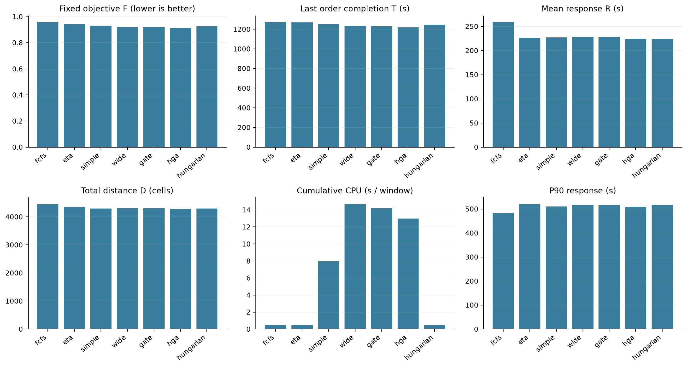
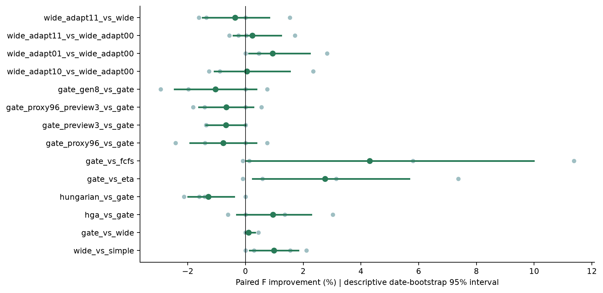
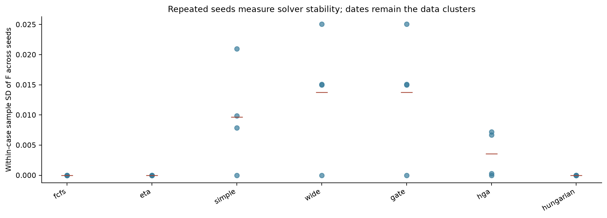
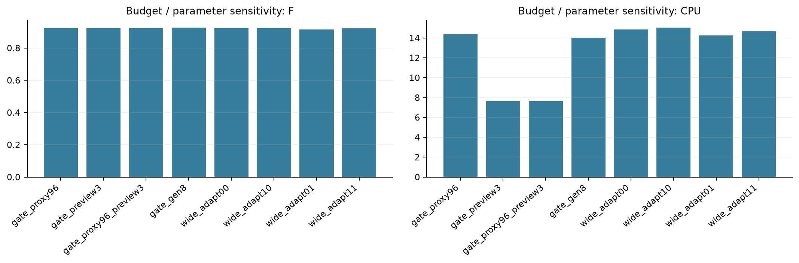
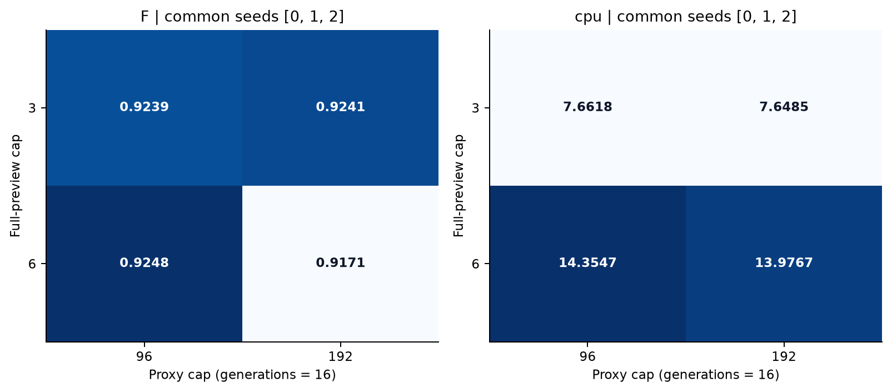
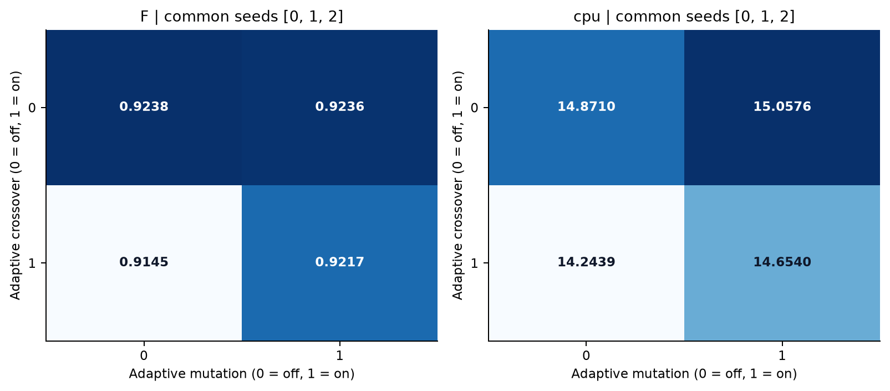
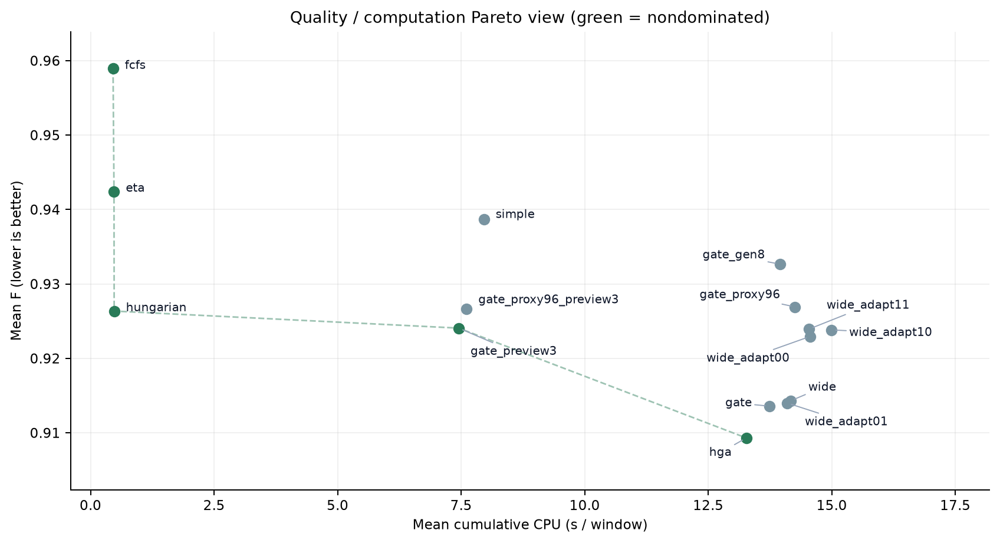
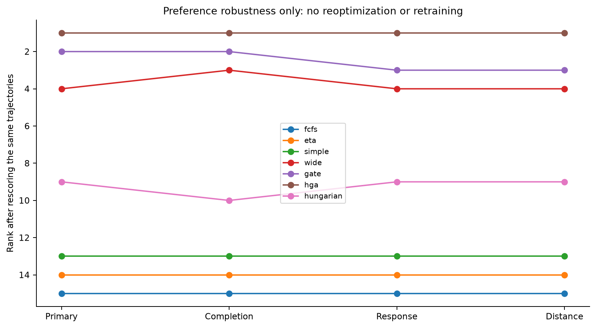

# WEPA 开发窗口多 seed 稳定性与参数敏感性（wepa-dev-sensitivity-20261120）

## 结论

1. `hga` 的 F 最低（0.9101），比 `gate` 改善 +0.95%，4 个日期中 2 改善、1 持平、1 变差；日期内 seed 标准差也最小（0.0035）。
2. `gate` 与 `wide` 基本相同（+0.11%，1/3/0），但 `gate` 触发 GA 搜索次数减少 63%（205 vs 560）；`wide` 比 `simple` 改善 +0.99%（3/1/0）。
3. `gate` 相对 `eta`、`fcfs` 分别改善 +2.75%、+4.30%（均 3/0/1）；`hungarian` 比 `gate` 差 −1.29%（0/1/3）。
4. 预算削减：`preview` 降到 3 次（`gate_preview3`），CPU 降低约 46%（14.20→7.65 秒），F 变差 −0.68%（0/2/2）；代数降到 8（`gate_gen8`），F 变差 −1.04%，CPU 几乎不变。
5. 自适应算子：只开交叉自适应（`wide_adapt01`）相对全关（`wide_adapt00`）改善 +0.94%（3/1/0）；只开变异或两者都开无明显收益，原因之一是开启变异自适应时超 86% 的代数触及 0.95 上限（`wide_adapt10` 4,639/5,376 代、`wide_adapt11` 4,640/5,360 代）。
6. 本轮为回顾性评价，不据此更换默认方案；`hga` 与自适应结论已在既有验证窗口复核（见 [wepa-val-sensitivity-20261121](../wepa-val-sensitivity-20261121/REPORT.md)，两者均未复现）。

## 方法

- 4 个开发窗口（`day12/32/33/45`），来自 4 个来源日期，共 201 条源请求；**200 / 200** 次运行全部完成并通过独立物理验解，无失败。
- 先在窗口内平均 seed，再对来源日期等权平均；比较按同窗口、同 seed 配对，seed 集合在实验前确定。
- 指标定义：`T` = 最后一单完成时刻（不含最终返库），`R` = 订单平均发布到完成耗时，`D` = 总行驶里程（格数，含最终返库）；独立线性目标 $F = 0.5\,T/900 + 0.3\,R/900 + 0.2\,D/5400$。
- 改善率约定：正数 = 候选 F 低于基线（更好）；区间为日期 bootstrap 95% 区间，仅作描述。CPU 为仿真累计计算耗时，不是单次决策延迟。

## 局限

只有 4 个来源日期，重复 seed 仅度量搜索稳定性，不增加独立业务样本，不做统计显著性判断；真实订单映射到本项目 62×47 网格（货位映射种子 17），不是原 WEPA 仓库物理复刻。本轮评估 GA 随机搜索稳定性，不代表 DQN 训练多初始化 seed 稳定性；不同协议或窗口长度下的绝对 F 不可横比。

---

## 核心演进与资源消耗汇总

| 方案 | 有效/计划 | F | T 完工时间 (s) | R 平均响应 (s) | D 总里程 (格) | CPU (s) | 日期内 seed SD |
|---|---:|---:|---:|---:|---:|---:|---:|
| `fcfs` | 8/8 | 0.9589 | 1273.50 | 259.07 | 4457.0 | 0.46 | 0.0000 |
| `eta` | 8/8 | 0.9424 | 1270.75 | 226.48 | 4346.0 | 0.48 | 0.0000 |
| `simple` | 20/20 | 0.9307 | 1252.30 | 227.48 | 4297.0 | 7.96 | 0.0097 |
| `wide` | 20/20 | 0.9205 | 1233.00 | 228.29 | 4303.5 | 14.69 | 0.0138 |
| `gate` | 20/20 | 0.9198 | 1231.75 | 228.21 | 4303.5 | 14.20 | 0.0138 |
| `hga` | 20/20 | 0.9101 | 1218.50 | 224.26 | 4275.8 | 12.97 | 0.0035 |
| `hungarian` | 8/8 | 0.9264 | 1246.25 | 224.45 | 4298.0 | 0.48 | 0.0000 |
| `gate_proxy96` | 12/12 | 0.9248 | 1240.92 | 227.69 | 4307.8 | 14.35 | 0.0116 |
| `gate_preview3` | 12/12 | 0.9241 | 1238.25 | 228.39 | 4320.5 | 7.65 | 0.0122 |
| `gate_proxy96_preview3` | 12/12 | 0.9239 | 1239.08 | 227.53 | 4311.5 | 7.66 | 0.0111 |
| `gate_gen8` | 12/12 | 0.9276 | 1247.00 | 227.13 | 4296.8 | 14.02 | 0.0112 |
| `wide_adapt00` | 12/12 | 0.9238 | 1239.75 | 227.74 | 4295.8 | 14.87 | 0.0077 |
| `wide_adapt10` | 12/12 | 0.9236 | 1240.17 | 227.38 | 4289.0 | 15.06 | 0.0075 |
| `wide_adapt01` | 12/12 | 0.9145 | 1226.00 | 226.45 | 4262.2 | 14.24 | 0.0135 |
| `wide_adapt11` | 12/12 | 0.9217 | 1235.83 | 228.38 | 4292.2 | 14.65 | 0.0085 |



## 固定配对改善汇总

逐日期明细见 [appendix.md](appendix.md)，全部与 `gate` 的配对记录见 `paired.csv`。

| 比较 | 配对 seed | 有效配对 | 平均 F 改善率 | 日期 bootstrap 95% | 胜/平/负日期 |
|---|---|---:|---:|---|---|
| `wide` vs `simple` | 0–4 | 20/20 | +0.9879% | [+0.1473%, +1.8284%] | 3/1/0 |
| `gate` vs `wide` | 0–4 | 20/20 | +0.1116% | [+0.0000%, +0.3349%] | 1/3/0 |
| `hga` vs `gate` | 0–4 | 20/20 | +0.9462% | [-0.3022%, +2.2722%] | 2/1/1 |
| `hungarian` vs `gate` | 0–1 | 8/8 | -1.2855% | [-1.9939%, -0.4001%] | 0/1/3 |
| `gate` vs `eta` | 0–1 | 8/8 | +2.7525% | [+0.2492%, +5.6722%] | 3/0/1 |
| `gate` vs `fcfs` | 0–1 | 8/8 | +4.3010% | [+0.0163%, +9.9802%] | 3/0/1 |
| `gate_proxy96` vs `gate` | 0–2 | 12/12 | -0.7703% | [-1.9160%, +0.3755%] | 1/1/2 |
| `gate_preview3` vs `gate` | 0–2 | 12/12 | -0.6831% | [-1.3662%, +0.0000%] | 0/2/2 |
| `gate_proxy96_preview3` vs `gate` | 0–2 | 12/12 | -0.6691% | [-1.6117%, +0.2735%] | 1/1/2 |
| `gate_gen8` vs `gate` | 0–2 | 12/12 | -1.0412% | [-2.4579%, +0.3755%] | 1/1/2 |
| `wide_adapt10` vs `wide_adapt00` | 0–2 | 12/12 | +0.0544% | [-1.0783%, +1.5357%] | 2/0/2 |
| `wide_adapt01` vs `wide_adapt00` | 0–2 | 12/12 | +0.9376% | [+0.1163%, +2.2330%] | 3/1/0 |
| `wide_adapt11` vs `wide_adapt00` | 0–2 | 12/12 | +0.2344% | [-0.4171%, +1.2268%] | 2/0/2 |
| `wide_adapt11` vs `wide` | 0–2 | 12/12 | -0.3562% | [-1.4824%, +0.8169%] | 1/1/2 |





## 预算与自适应因子分解

| 方案 | 组别 | 参数覆盖 | 搜索次数 | 代理评分 | 完整预演 | 代理上限触发 | 预演上限触发 |
|---|---|---|---:|---:|---:|---:|---:|
| `simple` | evolution | `{}` | 558 | 19813 | 1674 | 0 | 558 |
| `wide` | evolution | `{}` | 560 | 34979 | 3360 | 0 | 560 |
| `gate` | evolution | `{}` | 205 | 32527 | 1230 | 0 | 205 |
| `hga` | evolution | `{}` | 189 | 30301 | 1134 | 0 | 189 |
| `gate_proxy96` | budget | `{"proxy": 96}` | 123 | 11518 | 738 | 117 | 123 |
| `gate_preview3` | budget | `{"previews": 3}` | 124 | 19745 | 372 | 0 | 124 |
| `gate_proxy96_preview3` | budget | `{"proxy": 96, "previews": 3}` | 122 | 11531 | 366 | 116 | 122 |
| `gate_gen8` | budget | `{"generations": 8}` | 121 | 10362 | 726 | 0 | 121 |
| `wide_adapt00` | adaptive | `pm=0.7, pc=0.9 (均关)` | 334 | 20206 | 2004 | 0 | 334 |
| `wide_adapt10` | adaptive | `pm 开, pc 关` | 336 | 21666 | 2016 | 0 | 336 |
| `wide_adapt01` | adaptive | `pm 关, pc 开` | 332 | 20135 | 1991 | 0 | 331 |
| `wide_adapt11` | adaptive | `pm 开, pc 开` | 335 | 21549 | 2010 | 0 | 335 |

注：自适应四格固定同一移植 GA 实现（初始 `pm=0.7`、`pc=0.9`）；`wide_adapt11` 与原 `wide` 的差异同时包含算子实现变化。在开启变异自适应的两组中，`wide_adapt10` 有 4,639/5,376 代（86.29%）、`wide_adapt11` 有 4,640/5,360 代（86.57%）的 `mutation_rate` 触顶 0.95。2×2 图均使用共同 seed `[0, 1, 2]`。







## 成本—质量权衡与权重重评分

Pareto 图与权重重评分均固定共同 seed 交集 `[0, 1]`。重评分仅对同一批已执行轨迹重新加权，未重新优化。



**4 组权重下前 5 名排名稳定**：第 1 名始终为 `hga`，第 2–4 名均为 `gate` / `wide` / `wide_adapt01`，第 5 名始终为 `wide_adapt00`。

| 权重配置 (T/R/D) | 第 1 名 | 第 2 名 | 第 3 名 | 第 4 名 | 第 5 名 |
|---|---|---|---|---|---|
| 默认 `0.5 / 0.3 / 0.2` | `hga` (0.9093) | `gate` (0.9136) | `wide_adapt01` (0.9140) | `wide` (0.9143) | `wide_adapt00` (0.9230) |
| 偏完工 `0.6 / 0.2 / 0.2` | `hga` (1.0198) | `gate` (1.0240) | `wide` (1.0248) | `wide_adapt01` (1.0249) | `wide_adapt00` (1.0352) |
| 偏响应 `0.4 / 0.4 / 0.2` | `hga` (0.7989) | `wide_adapt01` (0.8031) | `gate` (0.8032) | `wide` (0.8038) | `wide_adapt00` (0.8107) |
| 偏里程 `0.4 / 0.2 / 0.4` | `hga` (0.9071) | `wide_adapt01` (0.9112) | `gate` (0.9121) | `wide` (0.9127) | `wide_adapt00` (0.9192) |



## 复现与核验

本目录原封存 PDF 见 [AGV多seed稳定性与参数敏感性研究.pdf](AGV多seed稳定性与参数敏感性研究.pdf)。便携证据核验：

```bash
uv run python scripts/verify_sensitivity_evidence.py verify results/wepa-dev-sensitivity-20261120
```
