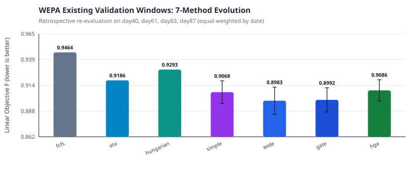
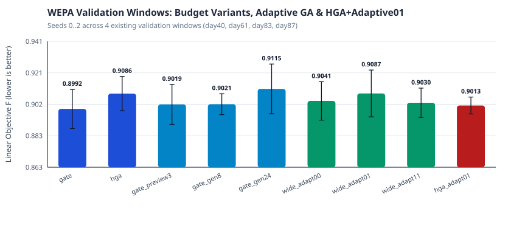

# WEPA 既有验证窗口复评与组合实验（wepa-val-sensitivity-20261121）

> 本实验在 2026-10 已选用的 4 个验证窗口（`day40/61/83/87`）上开展多 seed 回顾性复评，用于检验开发集上发现的候选方案是否具备跨窗口稳定性。

## 结论

1. GA 类方案在 4 个既有验证窗口上全部优于规则基线：`gate` 相对 `fcfs` 改善 +5.45%、相对 `eta` 改善 +2.43%、相对 `hungarian` 改善 +3.87%，4 个日期全部改善（4/0/0）。
2. `gate` 与 `wide` 表现极为接近（−0.10%，0/2/2），`wide` 均值略低（0.8983 vs 0.8992），而 `gate` 触发 GA 次数更少。
3. 开发集最优的 `hga` 在既有验证窗口全部变差（−1.12%，0/0/4）；组合方案 `hga_adapt01` 比 `hga` 改善 +0.79%（3/0/1）且 seed 标准差最低（0.00521），整体仍略逊于 `gate`（−0.28%，2/0/2）。
4. 预算对照：扩大至 24 代（`gate_gen24`）比默认差 −1.41%（0/0/4），说明默认 16 代已足够充分；减半至 8 代（`gate_gen8`）差 −0.35%（1/0/3）；将完整预演降至 3 次（`gate_preview3`）使 CPU 降低约 44%（21.66→12.09 秒），F 仅变化 −0.33%（0/2/2）。
5. 自适应算子：开发集有效的“只开交叉自适应”（`wide_adapt01`）在验证窗口相对 `wide_adapt00` 变化 −0.54%（1/0/3），跨窗口表现不稳定。
6. 与 2026-10 记录一致：本轮 `gate` F=0.8992 为 seed 0–2 均值，10 月记录的 0.8964 为单 seed 0 成绩，两者口径对应。

## 方法

- **窗口与验解**：`['wepa-day40-bin3885', 'wepa-day61-bin5902', 'wepa-day83-bin7983', 'wepa-day87-bin8393']`（day40 / day61 / day83 / day87 各 1 个，共 199 条真实请求）；**156 / 156** 次运行全部通过 `checked_score` 独立物理验解。
- **随机种子设置**：确定性方案（`fcfs` / `eta` / `hungarian`）运行 seed 0–1（每方案 8 次），随机搜索方案运行 seed 0–2（每方案 12 次）；配对比较严格使用两方共同 seed（同窗口、同 seed 配对）。
- **改善率与区间**：改善率 = 100% × (1 − 候选 F / 基线 F)，正数表示候选更优；单日期平均改善率满足 `|Δ| ≤ 1e-9` 判定为“持平”；区间为固定随机种子（4000 次抽样）的日期 bootstrap 95% 区间。
- **指标口径**：`T` 为最后一单完成时刻（不含最终返库），`R` 为平均发布到完成耗时，`D` 为含最终返库总行驶里程（格数）；独立线性目标 $`F = 0.5\,T/900 + 0.3\,R/900 + 0.2\,D/5400`$ 。

## 实验边界说明

本实验基于 4 个既有验证来源日期开展回顾性多 seed 复评，重点观察各方案与超参数在不同日期上的趋势与搜索稳定性，作为保留默认方案 `gate` 的直接实证依据。

## 各方案汇总（按来源日期等权）

| 组别 | 方案 | 次数 | F | seed SD | T 完工时间 (s) | R 平均响应 (s) | D 总里程 (格) | P90 (s) | CPU (s) |
|---|---|---:|---:|---:|---:|---:|---:|---:|---:|
| evolution | `fcfs` | 8 | 0.946448 | 0.00000 | 1188.00 | 331.01 | 4755.0 | 585.75 | 0.649 |
| evolution | `eta` | 8 | 0.918629 | 0.00000 | 1173.00 | 288.22 | 4614.0 | 615.75 | 0.570 |
| evolution | `hungarian` | 8 | 0.929314 | 0.00000 | 1190.00 | 289.33 | 4637.5 | 615.00 | 0.616 |
| evolution | `simple` | 12 | 0.906840 | 0.01128 | 1151.50 | 290.95 | 4593.7 | 601.50 | 10.417 |
| evolution | `wide` | 12 | 0.898339 | 0.01351 | 1134.33 | 292.70 | 4605.8 | 609.50 | 20.520 |
| evolution | `gate` | 12 | 0.899159 | 0.01206 | 1136.42 | 292.17 | 4601.5 | 611.25 | 21.664 |
| evolution | `hga` | 12 | 0.908607 | 0.01056 | 1151.75 | 292.94 | 4619.7 | 600.00 | 21.598 |
| budget | `gate_preview3` | 12 | 0.901945 | 0.01231 | 1141.67 | 291.80 | 4601.3 | 608.33 | 12.091 |
| budget | `gate_gen8` | 12 | 0.902054 | 0.00645 | 1140.92 | 291.91 | 4614.5 | 602.67 | 23.802 |
| budget | `gate_gen24` | 12 | 0.911530 | 0.01532 | 1156.50 | 293.98 | 4618.0 | 606.25 | 23.036 |
| adaptive | `wide_adapt00` | 12 | 0.904070 | 0.01185 | 1144.33 | 291.23 | 4623.8 | 605.42 | 24.047 |
| adaptive | `wide_adapt01` | 12 | 0.908715 | 0.01441 | 1152.58 | 291.95 | 4619.0 | 613.67 | 23.024 |
| adaptive | `wide_adapt11` | 12 | 0.902963 | 0.00905 | 1141.67 | 292.83 | 4619.5 | 596.67 | 22.243 |
| combined | `hga_adapt01` | 12 | 0.901263 | 0.00521 | 1140.83 | 291.98 | 4593.8 | 606.75 | 22.396 |

## 同窗口 / 同 Seed 配对改善率

| 候选 | 基线 | 日期等权平均 F 改善 | 日期 bootstrap 95% | 胜/平/负日期 |
|---|---|---:|---|---:|
| `wide` | `simple` | +0.9561% | [+0.476%, +1.427%] | 4/0/0 |
| `gate` | `wide` | -0.1011% | [-0.287%, +0.000%] | 0/2/2 |
| `hga` | `gate` | -1.1157% | [-2.017%, -0.542%] | 0/0/4 |
| `hungarian` | `gate` | -3.8704% | [-6.258%, -1.483%] | 0/0/4 |
| `gate` | `eta` | +2.4255% | [+1.121%, +4.160%] | 4/0/0 |
| `gate` | `fcfs` | +5.4502% | [+2.278%, +8.589%] | 4/0/0 |
| `gate_preview3` | `gate` | -0.3310% | [-0.662%, +0.000%] | 0/2/2 |
| `gate_gen8` | `gate` | -0.3487% | [-0.876%, +0.231%] | 1/0/3 |
| `gate_gen24` | `gate` | -1.4149% | [-2.645%, -0.407%] | 0/0/4 |
| `wide_adapt01` | `wide_adapt00` | -0.5397% | [-2.303%, +1.284%] | 1/0/3 |
| `wide_adapt11` | `wide_adapt00` | +0.1059% | [-0.748%, +1.109%] | 2/0/2 |
| `hga_adapt01` | `hga` | +0.7917% | [-0.158%, +1.968%] | 3/0/1 |
| `hga_adapt01` | `gate` | -0.2793% | [-0.980%, +0.270%] | 2/0/2 |

## 对比图表

